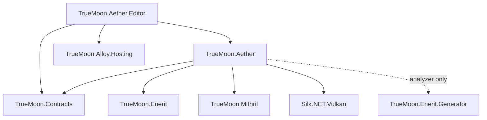
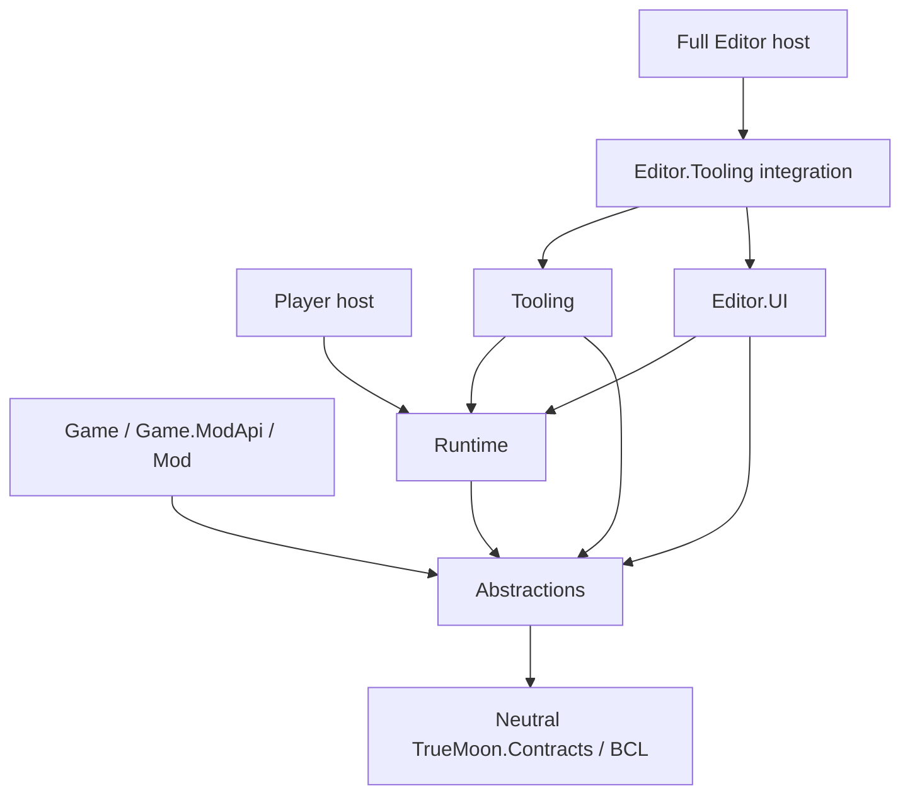

# ARCH3.0: карта Aether перед разделением сборок

**2026-11-12 — историческая статическая карта до переноса.**
ARCH3.1–3 реализованы позднее: [текущий Runtime/ABI](RUNTIME.md), [фактическая дельта](ARCH33_MIGRATION.csv).
ARCH3.4–5 выделили [Tooling](TOOLING.md) и [Editor UI/optional bridge](EDITOR_LAYERS.md).
ARCH3.6 добавляет новые типы в `Abstractions.Mods`, `Runtime.Mods` и `Tooling.Mods`
без переноса прежних CLR types: [Mod SDK/manifest/ownership](MODS.md). Исторические
488 типов/61 проект в CSV описывают исходный снимок, не текущий inventory.
Исходные CSV/SHA ниже сохраняются как evidence исходного решения.
Гиперссылки на перемещённые исходники ведут к текущим файлам; описание их поведения
ниже относится к исходному снимку.
Основание: запрос пользователя и [единственный подробный план ARCH3](PLAN.md#arch3-layers-mods).
Снимок исходников: `73df16229da1db54e1170ac0d56b9d385f91abd7` плюс текущие
документационные изменения. Это снимок до [короткого ARCH2e.4b среза](DRAIN_DIAGNOSTICS.md),
который позже добавил диагностические свойства существующих типов; SHA/CSV здесь
не пересоздаются задним числом. Перед ARCH3.1 сверить дельту. Действуют прежние Aether/Editor assemblies.

## Область и способ проверки

Просмотрены **385 C# файлов**: Aether 270, Editor 115. Roslyn-инвентаризация
нашла 646 объявленных типов, из них **488 внешне доступных**: Aether 372,
Editor 116. Partial declarations объединены; public/protected nested types
учтены только при внешне доступном содержащем типе. Это число типов, не методов
и не обещание стабильности каждого публичного API.

- [ARCH3_TYPE_MAP.csv](ARCH3_TYPE_MAP.csv) — все 488 типов: существующий FQN,
  исходные файлы, владелец после разделения, действие и целевое имя при простом переносе.
- [ARCH3_PROJECT_MAP.csv](ARCH3_PROJECT_MAP.csv) — 61 существующий `.csproj`,
  прямые XML ProjectReference, отдельные analyzer references, PackageReference,
  условия и маршрут затронутых consumers. Это чтение XML, не новая MSBuild evaluation.
- [ARCH3_COUPLINGS.csv](ARCH3_COUPLINGS.csv) — связи публичных сигнатур,
  нарушающие целевые границы; их необходимо устранить, а не переносить как зависимости.
- [ARCH3_INVENTORY.json](ARCH3_INVENTORY.json) — счётчики, allowed graph и SHA-256
  449 входных source/project/profile файлов и трёх CSV.

Проверялись и тела реализаций: наличие нейтральной сигнатуры само по себе
не разрешает зависимость от Tooling/Runtime implementation. IDE find-usages
дополнительно подтвердил потребителей `EcsSystemContext` (9 uses/6 files),
`AetherHost` (84/49) и `GameBuildArtifact` (72/24) в Aether, Editor, Examples и
ManualTests; тесты в этот IDE-срез не входили. Это scope поиска, не полный счётчик
всех бинарных или внешних потребителей.

Анализ выполнен Roslyn 5.9 из PowerShell 7.7 на .NET 11 с .NET 11 reference pack
и существующими Release dependencies; 19 существующих generated/global-using
файлов использованы как вспомогательный вход. Parse errors: 0. Аналитическая
компиляция без запуска source generators дала 19 binding diagnostics только
в приватных LibraryImport helpers `EditorSourceFile`/`EditorSourceDirectoryPin`
(нет generated implementations и производные ошибки definite assignment).
Это ограничение анализатора, **не результат restore/build solution**. Generated
public API, reflection/string lookup, условные профили и native ABI требуют
отдельной проверки на этапах переноса. Build/tests/GPU сегодня не запускались.
Raw JSON, IDE results и helpers — дополнительный ignored evidence в
`TestResults/ARCH30-20261112-141900/`; карта и выводы сохранены здесь независимо от него.

## Текущий граф

Это прямые ссылки проектов; транзитивный bootstrap/UI/provider closure шире.
Сейчас в Aether вместе находятся game contracts, World/scheduler, GPU/frame/IPC,
source capture/compiler, authoring/persistence и preview workflow. Editor вместе
содержит headless project/document/source-watch и View/VM/styles/commands.
Перенос целых нынешних каталогов или единственный rename assemblies границ не создаёт.

## Целевые сборки и допустимый граф

PackageId = AssemblyName = RootNamespace:

| Сборка | Назначение | Текущих публичных типов по карте |
| --- | --- | ---: |
| `TrueMoon.Aether.Abstractions` | Engine Mod SDK, session/ECS contracts, handles/IDs, стандартные value components, нейтральные scene/render definitions | 105 |
| `TrueMoon.Aether.Runtime` | World/scheduler, execution, prepared artifact reader/loader, runtime scene activation, GPU/frame/transport/resources | 211 |
| `TrueMoon.Aether.Tooling` | Project/document/authoring, SDK/compiler/capture, file persistence, source watch, headless preview/export | 84 |
| `TrueMoon.Aether.Editor.UI` | Views/Data/VM/styles, UI gestures, runtime inspection и UI-owned capability ports | 74 |
| `TrueMoon.Aether.Editor.Tooling` | Необязательная интеграция полного Editor: адаптеры Tooling ↔ UI и aggregate registration | 14 |

Последняя сборка связывает два слоя и не является пятым функциональным слоем.
Отдельная ECS Core сборка сейчас не нужна: typed storage остаётся Runtime,
контракт scoped доступа — Abstractions. Добавление сборки не решило бы связь
`EcsSystemContext.World` с concrete World.

Runtime сохраняет необходимые IPC/process/backend зависимости, UI — Alloy/Argentis
и presentation providers. App bootstrap и выбор providers принадлежат host.
Runtime + UI consumer не имеет прямого или транзитивного Tooling reference;
Player не требует Editor, исходного проекта или SDK на машине исполнения.
Включение Runtime пакета не должно само активировать GPU/окно/audio.
Game/mod не получает Runtime implementation как скрытый обязательный dependency.

## Распределение типов и обязательное разделение API

В CSV `Move` означает владельца и будущее namespace, **не бинарную совместимость**.
Сохраняется semantic suffix текущего namespace с новым RootNamespace; при переносе
физический путь должен ему соответствовать. 444 строки допускают такой маршрут,
44 требуют разделения/адаптера. Для них `TargetType` намеренно не выдаёт выдуманную
готовую сигнатуру: перечисленные ниже результаты уточняются в ARCH3.1/3.3–5.

| Текущая область | Назначение после разделения | Условие |
| --- | --- | --- |
| Sessions game interfaces, input/checkpoint values, EntityHandle, IEcsSystem/description/phase, typed query delegates, стандартные transform/motion/render components | Abstractions | Typed values без backend handles, owned World или per-entity boxing. Имя `IEcsSystem` сохраняет смысл; IComponent marker и IEntity facade уточняются в ARCH3.1 |
| Scenes IDs/schema/data/immutable resolved snapshots, render keys/mesh/material definitions, camera/picking values | Abstractions | Данные source/Runtime могут разделять schema; IO, authoring transactions, UI state и resource owners остаются снаружи |
| World/pools/scheduler/system plan, EntityQuery implementations, registry/loaders, codecs/runtime sessions, resources/snapshots/GPU/frame/transport | Runtime | Scheduler serial access, phase command playback, stale handles, leases и bounds сохраняются |
| EcsSystemContext, EcsCommandWriter, CommandTarget/DeferredEntity/result | Контрактный facade в Abstractions, implementation в Runtime | Удалить concrete World/internal buffers из контрактного closure; query/writer нельзя удерживать после invocation |
| AetherHost | Runtime host + отдельный Tooling workflow facade | Сейчас возвращает Builds, GameEditor и ScenePreview вместе с Supervisor/Frames/Gpu; Runtime entry point больше не создаёт compiler/editor graph |
| GameBuildArtifact | Read-only prepared artifact в Runtime + publication/provenance в Tooling | Runtime Open/hash/pin/identity не возвращает InputSnapshot/CompilationSnapshot и не зависит от SDK/capture/retention |
| GameBuildCompiler/Preparation/InputSnapshot/CompilationSnapshot/retention, GameEditor и ScenePreview coordinator | Tooling | Runtime loaders работают по доставленному artifact, не запускают source compilation |
| SceneFileCodec и ISceneDocumentStore/JsonSceneDocumentStore | Pure bytes codec в Runtime; authoring envelope/restore и filesystem persistence в Tooling | SceneWorldCodec уже вызывает SceneFileCodec; метод с ISceneAuthoringSession нельзя унести в Runtime без разделения |
| ScenePreviewDocument/Frame, PreviewPresentedView | Runtime presentation observations | Первый — immutable scene/revision/runtime stamp; не project/document service. Frame/ticket зависимости не делают этот API обязательным для Mod SDK |
| EditorProjects/ProjectSession, SceneDocumentSession, TransformEditor transactions, EditorSourceWatch, headless EditorPreview | Tooling | Никаких View/Argentis/InspectorProperty; TransformField descriptor остаётся UI |
| EditorWorkspace/ViewModel/document commands/window/viewport controller | Editor.UI с нейтральными observations/actions | ProjectSession, GameEditor, TransformEditor и EditorScenePlayback заменяются UI-owned ports. Runtime-only host предоставляет поддержанные capabilities |
| EditorCommands/Session/ScenePlayback и агрегатные configuration extensions | Editor.Tooling | Разделить Runtime UI и full Editor composition; IFactory/View owner thread, cancellation/drain и aliases не меняют владельца |
| AetherProcessDiagnostics/ProcessDiagnosticSnapshot | Runtime observations + Tooling compiler diagnostics | Убрать GameBuildCompiler/batches из Runtime telemetry dependency closure |
| EditorDiagnosticReportWriter и CommandSourceFileNavigator | Headless export в Tooling + UI export/navigation adapters в Editor.Tooling | Export принимает neutral DTO; Tooling не ссылается на EditorDiagnosticSnapshot/ViewModel или UI ISourceFileNavigator |

У текущих публичных сигнатур обнаружены **58 запрещённых целевых связей**:
Runtime → Tooling 12, Editor.UI → Tooling 42, Editor.UI → Editor.Tooling 2,
Abstractions → Runtime 1, Tooling → Editor.UI 1. Это уникальные пары типов,
не число обращений. Другие обращения из тел реализаций также переносятся в
соответствующий owner; CSV не заменяет проверку полного assembly closure.

## Совместимость: решение до переноса

Это **явная breaking migration**, целевая общая линия пакетов — `0.4.0-alpha`
по действующей централизованной схеме версий. Сейчас Directory.Build.props,
PackageReference и solution не меняются. Новые сборки публикуются согласованным
набором после приёмки; старые `TrueMoon.Aether`/`TrueMoon.Aether.Editor` не становятся
молча фасадами с иным назначением. Type-forwarding не является основой перехода:
новые namespace и разделённые aggregate APIs не позволяют обещать прежнюю binary identity.

| Область | Политика перехода | Где проверить |
| --- | --- | --- |
| C# game/mod/system API | Пересборка с Abstractions, обновление namespaces и context/query access. Новые IComponent constraints не вводить массово без явного migration шага для существующих structs | ARCH3.1–2: независимая game DLL, builtin/внешняя система, data/order/lifetime/error behavior |
| Host/Editor API | Replace aggregate registrations на layer entry points; удобный full Editor aggregate живёт в integration. UI ports и типизированные callbacks остаются, имена финальных методов фиксируются при реализации | ARCH3.3–5: source/published/fresh package consumers, оба DI |
| Game artifacts | Новый planned manifest schema 2: точный shared contract set + отдельная runtime pair identity, content/dependency hashes. Schema 1 отклоняется с диагностикой пересборки; старый artifact не загружается через ослабленный allowlist | ARCH3.3/3.6: valid/rejected artifacts и duplicate shared assemblies |
| Cache/lock/captured build inputs | Пересоздать fingerprint и frozen reference closure. Формат lock не повышать только из-за имени DLL, если грамматика сохраняется; старые captures не переиспользовать по одному path/version | ARCH3.3–4: compiler preparation/build/reuse, pinned staging, cancellation/cleanup |
| Scene/project/render-content formats | Разделение сборок само не меняет текущие форматы, ComponentTypeId, persistent IDs, schema versions и unknown-data policy. Не записывать CLR/assembly-qualified type names вместо stable IDs | ARCH3.1–5: open/save/reopen, reject/preserve и existing schema fixtures |
| Process identity/protocol/checkpoints | Не ослаблять parent/session/nonce/generation fencing. Изменившиеся exact binaries требуют нового fingerprint и согласованных parent/child; старый checkpoint не retag в новый runtime pair | ARCH3.3/3.9: mismatch rejection, child startup/reap/drain, explicit checkpoint policy |
| Mod hot replacement | Стабильные shared component types: system swap; mod-owned types: новый private World + neutral snapshot migration. Текущий child Replace остаётся отдельным supported mechanism | ARCH3.6–9; UnloadPending/Failed не выдавать за успех |

### Места, где имя сборки является частью поведения

- [GameBuildProfile](../../TrueMoon.Aether.Runtime/Builds/GameBuildProfile.cs) берёт TFM
  из собственной assembly. После переноса Tooling должен получать явный Runtime
  profile; нельзя выбирать TFM по Tooling/entry assembly, working directory или
  случайному установленному SDK. Сохраняются CORE8 `$(TF)`/`$(TestsTF)`, общий
  SDK/LangVersion/Features, runtime-async и CPM isolation независимых consumers.
- [GameBuildPreparation](../../TrueMoon.Aether.Tooling/Builds/GameBuildPreparation.cs) и
  [Compiler](../../TrueMoon.Aether.Tooling/Builds/GameBuildCompiler.cs) передают
  `AetherContractPath` из `typeof(IGameSession).Assembly.Location` и
  `TrueMoonContractsPath`. Нужен точный captured Abstractions/neutral reference set;
  Runtime не должен случайно стать обязательной compiler reference для игры.
- [GameBuildArtifact](../../TrueMoon.Aether.Runtime/Builds/GameBuildArtifact.cs) сейчас
  создаёт schema 1, считает ContractHash по IGameSession/IFactory assemblies и
  разрешает имена TrueMoon.Aether/TrueMoon.Contracts + BCL/private manifest DLLs.
  Schema/hash/allowlists меняются совместно, до загрузки первой новой game DLL.
- [BuildIdentity](../../TrueMoon.Aether.Runtime/Hosting/BuildIdentity.cs) выбирает shared
  assemblies через SessionIdentity/IFactory/PipesInvocationClient/ChildProcessUnitHandle.
  После split контрактный set и Runtime implementation/pair fingerprints должны
  быть явными; простой перенос SessionIdentity не должен незаметно исключить Runtime DLL.
- [GameBuildLoader](../../TrueMoon.Aether.Runtime/GameBuildLoader.cs) разделяет
  IGameSession/IFactory assemblies с host и загружает только manifest dependencies.
  Нужен явный shared set, отказ duplicate contract copy и прежний reject native
  game dependencies в первом managed профиле. Нынешний collectible loader не
  является manager живой замены модов.

## Ownership и бюджеты, которые перенос не меняет

| Владелец | Ресурс и порядок освобождения |
| --- | --- |
| App / Runtime host | Runtime services/providers, supervisor/frames/GPU. Остановить admission, sessions/tasks, drain completion, затем dispose backend. DI aliases не добавляют второго disposable owner |
| Session / caller фабрики | World/scheduler/system graph и подготовленные scene owners; factory product не становится автоматически контейнерным. Scheduler/loader ownership запрещает преждевременный прямой World.Dispose |
| World / resource owners | Typed pools и их Type keys, registry bindings, leases/snapshots/submissions. Даже пустой pool удерживает component Type до снятия ownership; GPU lease освобождается после actual completion |
| Tooling job / project | Capture/staging/compiler process/provenance и document/authoring/source-watch owners. Runtime заимствует только проверенный prepared input; failed startup/cancel сохраняет cleanup owner |
| Window / parent UI | Factory-created View на UI owner thread, subscriptions/captured gestures; borrowed VM/services не освобождаются View. Tooling/UI adapter заимствует сервисы, снимает свои callbacks |
| Будущий module owner | ALC/system instances/factories/delegates/tasks/registries/pools/snapshot roots. Quiesce и capture до commit, retire/drain/unsubscribe после; failed retire остаётся наблюдаемым owner |

Сохраняются существующие численные limits: World default 65536 entity slots,
128 component types, initial 64 (max 1048576/1024); scheduler default 128 systems,
4096 commands/phase (max 1024/1048576); scene load max 4096 entities,
65536 component instances, 262144 property values, default 4096 prepared resources.
Codec byte budgets, frame/mailbox/render/checkpoint и process deadlines остаются
отдельными существующими контрактами. Перенос не повышает limits/timeouts и не
отменяет explicit settings validation. Для reload-группы принят верхний профиль:
1 active + 1 candidate + 1 retiring generation; незавершённый retiring cleanup
блокирует следующую замену этой группы. Mod bytes/dependency/capture budgets
фиксируются в ARCH3.6 до включения загрузки, а не заменяются «без ограничений».

## Consumers и порядок миграции

| Существующий consumer | Целевой маршрут / сохранённое поведение |
| --- | --- |
| `ManualTests/Game.Logic`; generated frozen game projects | Abstractions + neutral contracts; явные captured references, shared entry/factory identity и checkpoint/input/render interfaces |
| `Examples/AetherRuntimeHost`, `ManualTests/EngineSessionProbe`, `AetherCameraContractProbe` | Runtime; сохранить child/bootstrap, typed factories, headless paths, selected artifact, Stop/reap/drain |
| `Examples/AetherEditor`, `ManualTests/AetherEditorHost`, `AetherSourceWatchPerformance` | Full Editor integration; обновить layer references/composition, сохранив project/document/camera/translation/workflow ownership |
| `ManualTests/AetherPackageConsumer/Gui` | Full UI integration + прежний native transport/readiness contract |
| Package-only `Consumer/Game`, `Consumer/Runtime`, `Consumer/Editor` | Game → Abstractions, Runtime → Runtime, Editor → integration; fresh external feed/cache, оба DI, source/published и native scope отдельно |
| `TrueMoon.Aether.Tests`, `TrueMoon.Aether.Editor.Tests` | Разнести по владельцам API; сохранить behavior/regression cases, явно обновить solution wiring и IVT. Старые passing counts не распространять на новые projects |
| Новый Player-only и Runtime + Editor.UI consumers | Добавить отдельные dependency-closure proofs: без Tooling/SDK/project, без UI в Player-only headless варианте; runtime UI capabilities без project workflows |

Всего сейчас **11 прямых ProjectReference consumers** двух старых assemblies
(включая Editor → Aether), ещё **3 PackageReference projects**. Другие 47 проектов
не получают механический rename dependencies. Дополнительно обновляются dynamic
project templates, `.ps1` runners, package instructions, ManualTests BuildProfile,
frozen reference strings/allowlists и документационные snippets. Source refs,
package refs и generated templates проверяются раздельно.

## Согласованная очередь и выход из ARCH3.0

1. **ARCH3.0 — эта карта.** Границы/имена, breaking policy, consumers, ownership,
   limits и места изменения identities зафиксированы до перемещения файлов.
2. **Короткий ARCH2e.4b срез.** Получить полезный drain/cleanup failure snapshot
   и отдельный baseline; успешный replay не закрывает причину. Не превращать
   необъяснённый старый timeout в бессрочный blocker всех features.
3. **ARCH1f.4.** Реальный mesh/material surface renderer и required-view Playing
   fence поверх имеющихся resources/snapshots; будущий Runtime переносит уже
   проверенное поведение presentation.
4. **Минимальные ENG7b.1–2.** Role selection до App и отдельная Player composition
   с доставленным artifact/content, input/window/cleanup. HUD optional, Editor graph
   не создаётся. Это поведенческая основа; физическое исключение Tooling из нынешней
   монолитной Aether DLL доказывается уже после ARCH3.3.
5. **ARCH3.1–5.** Abstractions → ECS binding → Runtime → Tooling → независимый UI
   и optional integration. Перед .1 сверить дельту типов/consumers после f.4/Player;
   CSV не замораживает новые функции и не требует переименовывать весь код сразу.
6. **ARCH3.6–9.** Manifest/loader → systems reload → new-World component migration
   → failure/unload/source/package acceptance. Import/audio/Nom и ED продолжать
   по собственным задачам; полная реализация всех подсистем не prerequisite split.

Статическая готовность ARCH3.0: public inventory покрыта полностью, у каждого
типа есть целевой owner/действие; целевой allowed graph ацикличен; текущие
запрещённые связи перечислены отдельно. Реализация будущих контрактов и все
runtime/package/GPU/unload гарантии остаются критериями следующих этапов.

## Дельта ARCH1f.4 — 2026-11-12

Исходные CSV/SHA и числа ARCH3.0 выше остаются историческим снимком. F.4 добавляет
следующие public declarations в прежний Aether; assemblies не разделялись:

| Текущий FQN | Маршрут при ARCH3 |
| --- | --- |
| `TrueMoon.Aether.Rendering.Snapshots.IRenderSnapshotGameSession` | Runtime game capability, содержит runtime source |
| `TrueMoon.Aether.Rendering.Snapshots.RenderSceneSource` | Runtime: borrowed World; не переносить целиком в neutral Mod SDK |
| `TrueMoon.Aether.Rendering.Snapshots.RenderSnapshotStamp` | Detached values; кандидат Abstractions после compatibility review |
| `TrueMoon.Aether.Gpu.Surfaces.IGpuSurfaceFrameSource` | Runtime surface/resource owner integration |
| `TrueMoon.Aether.Gpu.Surfaces.GpuSurfaceRenderRequest` | Runtime: typed backend factory и device-generation arguments |
| `TrueMoon.Aether.Runtime.RenderViewReadiness` | Runtime readiness implementation/state; не новый mod ECS contract |
| `TrueMoon.Aether.SurfaceRenderingConfigurationExtensions` | Runtime App integration |

`RuntimeMeshRenderHost` internal и владеет surface-local resource graph; Root
factory регистрируется через DI, backend заимствует surface context. Существующие
FrameMetadata/ControlRequest/ControlReply/Supervisor/FrameSession получили explicit
mesh capability/stamp/acknowledgement, EditorSession — bounded pending acknowledgement
с drain. Эти связи следует включить в повторную полную инвентаризацию **после Player,
до ARCH3.1**; приведённая дельта не переиздаёт старые Roslyn CSV.

`ManualTests/RenderSurface.Game` — новый выбранный fixture project на `$(TF)`,
добавлен в solution. Source/published/package-only consumers проверяются runner
[RenderSurface](../../ManualTests/RenderSurface/Verify.ps1); child не зависит от
Editor/Alloy/Argentis. Surface/source интерфейс нельзя переносить в Abstractions
вместе с World/native owners ради совпадения слова interface.

## Дельта ENG7b.1–2 — 2026-11-12

Добавлен TrueMoon.Aether.Player: local window/input, typed View/data/style/factory,
UseAetherPlayer/UseConfiguredAetherPlayer; зависимости Aether+Alloy.Hosting, без Editor.
В Aether добавлены launch role/options, captured PlayerStart, PlayerSession/status,
local protocol activation и local surface. BuildIdentity.ForPlayer проверяет exact
delivered entry/shared identity. Examples AetherPlayer/AetherHost и отдельный Player
test project зарегистрированы в solution. [Public type delta/inputs/SHA](ENG7B12_BASELINE.json).
Исторические488types/61projects в исходных CSV не пересчитаны и не выдаются за текущие.
Перед ARCH3.1 освежить полный inventory с diagnostics/f.4/Player; физическое разделение
ещё не выполнено. Player baseline не создаёт compiler/Tooling/parent/IPC services.
## Current delta после ARCH3.1 — 2026-11-12

Исторический snapshot выше не изменён. [Текущий полный API map](ARCH31_TYPE_MAP.csv)
охватывает Aether, Editor, Player и новый Abstractions:487source/628public types.
[105legacy→new соответствий](ARCH31_CONTRACT_MAP.csv), [current XML project graph](ARCH31_PROJECT_MAP.csv),
[counts/analysis limitations/SHA](ARCH31_BASELINE.json). Abstractions116public types
готов как новый ABI; старые исполнения/определения сохраняются до ARCH3.2–3.
Pure canonical render/preview codecs вошли в Abstractions для body dependency closure;
другие compiler/native/World APIs не перенесены в SDK. Полное исключение старых
определений и пересборка consumers/artifacts ещё не выполнены. [Порядок](PLAN.md#arch3-2).
