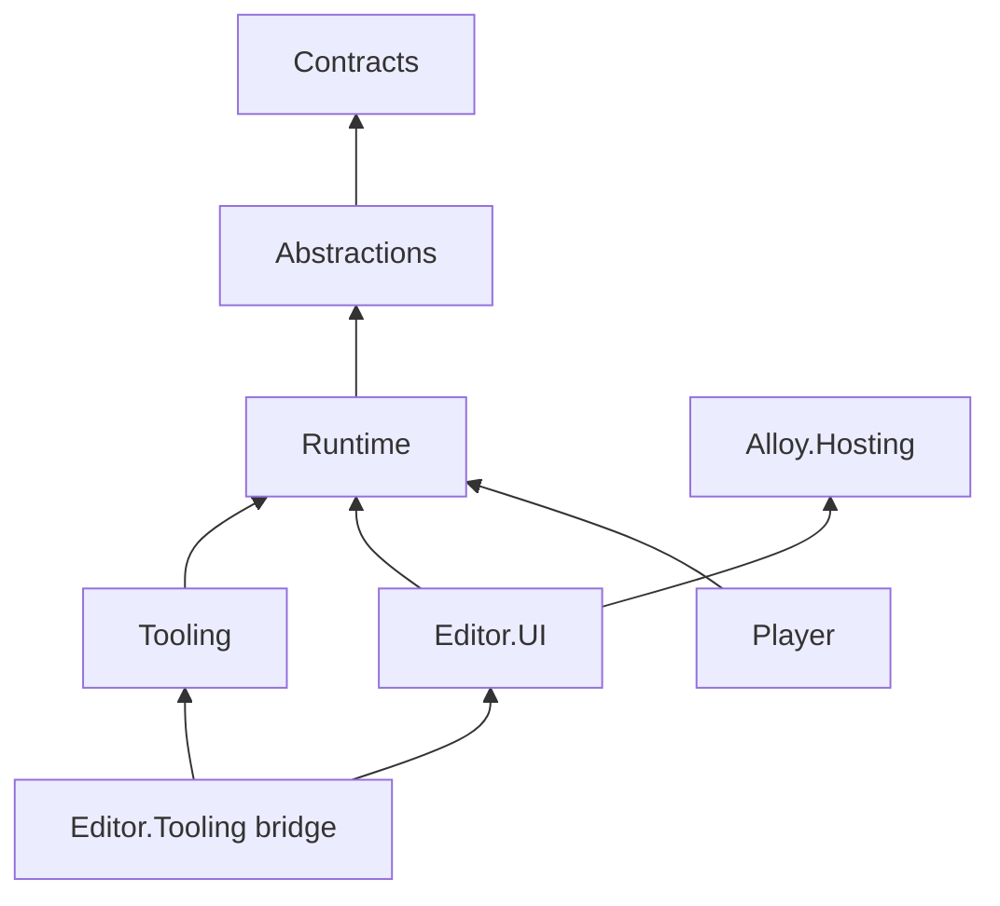

# Aether: выбор слоёв, расширение игры и согласованная поставка

ARCH3.1–8 реализовали разделение сборок и два managed reload профиля. ARCH3.9
проверяет их вместе на одной локальной версии пакетов. Точные текущие результаты,
SHA и ограничения: [baseline](ARCH39_BASELINE.json), [история](HISTORY.md#arch39-2026-11-15).
Наличие пакета или успешный build само по себе не подтверждает native/release readiness.

## Как выбрать зависимости

| Потребитель | Пакет и точка подключения | Владелец ресурсов |
| --- | --- | --- |
| Мод, игровые модели и ECS extension | TrueMoon.Aether.Abstractions + TrueMoon.Contracts; UseAbstractions не нужен | Мод регистрирует фабрики, сам SDK ресурсов не создаёт |
| Исполнение игры, World/системы, scene/render transport | TrueMoon.Aether.Runtime; UseAetherEcs, UseAetherRuntime, при необходимости UseAetherMods | App владеет host; factory/session products — по явному контракту |
| Build/preflight/capture/publisher, project/document/authoring без UI | TrueMoon.Aether.Tooling; UseAetherTooling | App владеет ToolingHost/долгоживущими owners, project/session products имеют собственный lifetime |
| Runtime с UI редактора без project/build tools | TrueMoon.Aether.Editor.UI; UseAetherEditorUi + отдельный window adapter | App/session и UI parent/window; View не освобождает заимствованный ViewModel |
| Полный редактор с project/document/build workflow | TrueMoon.Aether.Editor.Tooling; UseAetherEditor | Bridge явно соединяет UI с Tooling/Runtime |
| Минимальный Player без редактора | TrueMoon.Aether.Player; профиль из Player guide | App/session/window и caller-owned products по Player контракту |



Стрелка означает зависимость. Runtime не зависит от Tooling/UI; Tooling не зависит
от Editor/Alloy/Argentis. UI работает с готовым Runtime deployment без Tooling;
компиляция/публикация такого deployment может выполняться отдельным инструментом.
Приёмка проверяет package closure и фактически загруженные assemblies у родителя
и child, а не только список прямых PackageReferences.

## App, DI, конфигурация и lifetime

Регистрировать модуль один раз в App.Builder(...).Setup(...). Использовать Cobalt
либо существующий Microsoft DI adapter; общие зависимости и IFactory<T>/IFactory<T,
TArguments> находятся в Contracts. Resolver остаётся в composition root/adapter/
factory infrastructure. На кадре и элементе повторного resolution нет.

Настройки проходят общие IConfiguration/providers → schema/binding → validated
options → UseModule/DI. [Общее руководство](../core/CONFIGURATION_GUIDE.md).
Сцены, команды, mutable UI/game state и captured deployment identities не становятся
пользовательской конфигурацией. Host/child identity не переопределяется обычными
args/environment sources. Примеры реальных composition roots:
[Runtime-only](../../ManualTests/RuntimeConsumer/README.md),
[Tooling](../../ManualTests/ToolingConsumer/README.md),
[Runtime+UI](../../ManualTests/EditorUiConsumer/README.md),
[Player](PLAYER.md), [full Editor](EDITOR_LAYERS.md).

Factory result не становится owned объектом DI автоматически. Остановить scheduler/
сессию, дождаться drain, освободить World/leases/resources, затем зависимые сервисы
и App. Заимствующие aliases не Dispose владельца повторно. Failed startup/cleanup
должны оставлять конкретного owner для retry; last-good build/document/generation
не заменяется неуспешным кандидатом. Не освобождать App, пока caller-owned products
ещё используют его зависимости.

## ECS и Mod SDK

ISystem/IEcsSystem, необязательный IComponent и IEntity находятся в Abstractions.
Reference-free struct компоненты хранятся в typed pools без boxing через IComponent.
ISystem.Execute синхронный; query/context/commands действительны только в пределах
своего invocation с проверкой World/owner thread/access declarations. Долгоживущая
идентичность — persistent EntityId/ComponentId/ComponentTypeId и exact schema version.
CLR Type/EntityHandle нельзя сохранять как межверсионный persistent ID.

Обычный managed loader создаёт один collectible AssemblyLoadContext на полный
WholeGroup dependency closure. Manifest/API1, exact assembly identities/hashes,
immutable artifact bytes и запрет private shared copies проверяются до activation.
Мод ссылается только на Abstractions+Contracts; локальные factories/private CLR
types не входят в root DI. [Manifest/publisher/ownership](MODS.md).

| Замена | API | Что сохраняется | Что требует явного решения |
| --- | --- | --- | --- |
| Системы со stable shared components | ModHost.CreateSystemSession(World) | Caller-owned World/handles/pools/data, system state и tick | Все systems reloadable, reversible participants, generation guards |
| Private components и новый World | ModHost.CreateWorldMigrationSession() | Persistent IDs/relations/values, system state/tick | Bidirectional bindings, exact migrators, admission удаления полей/reset |

```csharp
// host, request, seed и persistentId уже подготовлены composition root.
var session = host.CreateWorldMigrationSession(); // результат заимствован, App-owned
var loaded = await session.LoadAsync(request, seed);
if (!loaded.Committed) throw new InvalidOperationException(loaded.Diagnostic.ToString());
session.Tick(TimeSpan.FromMilliseconds(20));
var changed = await session.ReplaceAsync(candidateRequest);
if (changed.Committed)
{
    var currentHandle = session.Entity(persistentId); // handle нового World
}
if (changed.Cleanup.Error != ModLoadError.None) await session.RetryCleanupAsync();
```

Reject/cancel до commit сохраняет прежнюю generation. ResumeRequired требует
ResumeAsync; failed retirement cleanup после commit не откатывает новую generation.
Unknown/untracked данные отклоняются. Field removal и reset включаются явно.
Подробнее: [stable replacement](MOD_RELOAD.md), [World migration](MOD_MIGRATION.md).

Поддерживаемые callbacks проходят generation guard; quiesce/drain предшествуют
capture/commit. Retired callbacks очищают private targets. Сначала закончить cleanup,
затем наблюдать weak unload ticket: UnloadRequested и IsAlive — разные факты.
Forced GC используется только в диагностической приёмке. Невозвращающийся module
code, unfenced subscriptions/tasks, process globals/files/network и native/GPU effects
не получают автоматический rollback от ALC. Для них требуется отдельная isolation/
restart policy; в текущем private-component профиле нет asset/native/GPU migration.

## Миграция существующих потребителей

Старый монолит TrueMoon.Aether и прежний Editor package не являются фасадами новых
сборок. Type-forwarding не введён. Сменить PackageReferences/using, выбрать владельцев
и пересобрать host, child, games/mods, captures и manifests вместе. Exact shared hashes
делают старые DLL несовместимыми после изменения contracts. Общая версия исходников
остаётся заданной Directory.Build.props; локальный acceptance suffix не публикуется
в общий NuGet и не подменяет решение о следующем публичном release.

[Итоговая подтверждённая карта](ARCH39_MIGRATION.csv) сводит исходные neutral contract
соответствия и физические переносы ARCH3.3–5 с проверкой существования final sources.
518соответствий относятся к417текущим файлам; исходный namespace и имена neutral
contracts сверены. [Декларации зависимостей шести проектов](ARCH39_PROJECT_GRAPH.json)
дополняются фактическими independent consumer graphs в baseline.
Исторические [ARCH3.0 решения](ARCH3_MAP.md) и карты сохраняются с исходными датами.
Системные compatibility overloads Runtime и канонические Abstractions values
различаются; source-compatible имя не означает binary-compatible assembly identity.

## Как повторить приёмку

```powershell
pwsh -NoProfile -File ManualTests/ArchitectureDelivery/Verify.ps1 `
  -ValidationDirectory <existing-Vulkan-validation-layer> `
  -EvidenceDirectory <fresh-directory>
```

Runner использует SDK/TF/TestsTF/LangVersion/Features из общего BuildProfile, CPM
isolation и локальные closed feeds/caches. Сначала solution D/R и все14xUnit/VSTest
проектов последовательно: full Aether tests используют exclusive SDK lease.
Затем20согласованных пакетов одной версии, SDK-only/Runtime/Tooling/Runtime+UI/Player/
full Editor и mod profiles. Все independent consumers копируют те же nupkg по SHA.
Полный список и точные команды сохраняются в verification.json/binlogs/TRX.

Для stable replacement и private-component migration выполняется минимум20замен
в каждом из source D/R, published D/R, fresh NuGet и SDK-free профилей на обоих DI.
Каждый retired ALC должен collect при live current, последняя generation — после
App cleanup. Сохраняются старые Worlds/snapshots/contexts/guards; проверяются stale
commands, disposal/owner counts и непрерывность данных/state/tick. Native UI/Player/
Editor profiles отдельно проверяют реальные Vulkan resources/handles/surfaces,
validation errors/warnings и child reap. Success этих profiles не переносится на
device loss, physical input/DPI,20GPU-mod-migrations, other OS/RID/AOT или release soak.

Если требуется повторить только поставку, -RegressionVerification может ссылаться
на завершённый Regression.ps1 manifest с неизменными C#/build inputs. Это повторное
использование явно указанного evidence, не новый запуск тестов. Для повторного
запуска всегда выбирать новую evidence directory. Raw TestResults/temporary feeds
не имеют гарантированной retention; versioned baseline/HISTORY сохраняют scope/
команды/outcome/SHA. [Runner и требования](../../ManualTests/ArchitectureDelivery/README.md).
