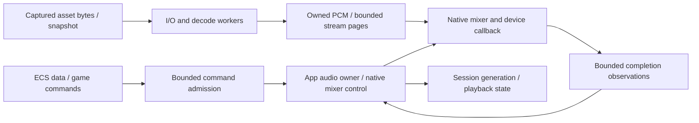

# Звук и музыка для TrueMoon

12.11.2026. Первичное исследование [ARCH1h.0](PLAN.md#arch1h-audio).
Пользователь выбрал порядок платформ: сначала Windows, затем Linux/macOS.
Первый проверяемый профиль предлагается ограничить Windows x64.

Основной кандидат для прототипа — **miniaudio**, первоначально через advanced/native
API пакета **JAJ.Packages.MiniAudioEx 4.0.1**. Запасной вариант — SoLoud/SoLoudSharp.
Первичное сравнение ниже не выбирало production dependency. Позднее12ноября выполнен
[изолированный Windows prototype](../../ManualTests/MiniAudioExResearch/README.md):
[результаты](HISTORY.md#audio-prototype-2026-11-12), [manifest](AUDIO_PROTOTYPE_RESULTS.json).
В исходном MiniAudioEx4.0.1 найдены840/1680byte failed-init leaks; они сохранены в истории.
Затем12ноября исправлены четыре native libvorbis init paths и собран локальный fork
**TrueMoon.MiniAudioEx 4.0.1-truemoon.1** для Windows x64:
[patch/build/verification recipe](../../eng/native/MiniAudioEx/README.md),
[новые результаты](HISTORY.md#audio-native-fix-2026-11-12), [manifest](AUDIO_NATIVE_FIX_RESULTS.json).
Native286checks и по334checks source Debug/published Release проходят без research guard:
malformed/truncated/bad-CRC OGG, streaming, lifecycle и muted actual WASAPI; retained
adapter bytes/blocks0. Managed DLL,1286exports и размеры68native types сохранены.
Позднее12ноября реализован самостоятельный **TrueMoon.Kul AUD1** на этом fork:
[App/DI API и сборка](../audio/README.md), [единственный детальный план](../audio/PLAN.md),
[23tests D/R и source/publish/fresh-package Kul acceptance](../audio/HISTORY.md#kul-rename-2026-11-12).
Shared clips/voices, native music streaming и App-owned cleanup проверены на Windows x64.
ECS/Nom/captured-asset adapter ещё не реализован. OGG duration API, long soak/device loss,
hard peak budgets/command queues и Linux/macOS — AUD2–3. Ролевые предложения и сравнение
библиотек ниже исторические; принятые AUD1 границы находятся в Audio PLAN.

## Сравнение библиотек

| Кандидат | Возможности и поставка | Применимость к TrueMoon |
| --- | --- | --- |
| [miniaudio](https://github.com/mackron/miniaudio) | C-библиотека: устройство, декодирование, mixer/node graph, группы, spatialization; Windows/Linux/macOS и другие платформы. Лицензия на выбор public domain или MIT-0 | Основной кандидат: можно использовать готовый native mixer и workers, сохранив собственные App/session/asset contracts. ABI между версиями не гарантируется, включая bugfix releases; bindings и native binary должны поставляться согласованно |
| [MiniAudioExNET 4.0.1](https://www.nuget.org/packages/JAJ.Packages.MiniAudioEx/4.0.1) | Готовый NuGet над модифицированным miniaudio 0.11.26; WAV/MP3/FLAC/OGG, streaming, spatial audio; netstandard2.0/2.1. Для desktop есть native assets | Первый binding для проверки. Standard API содержит глобальный AudioContext; предпочесть advanced/native API и собственных owners. NuGet указывает MIT, текущий LICENSE исходников — public domain/MIT-0; зафиксировать notices точного nupkg и bundled codecs |
| [SoLoud / SoLoudSharp 0.3.2](https://www.nuget.org/packages/SoLoudSharp/0.3.2) | Игровой mixer: voices, buses, fades, 3D, эффекты, Wav/WavStream. Zlib; готовые native assets для Windows/Linux/macOS; managed net8.0/net10.0 | Удобная альтернатива, но просмотренный backend использует глобальное устройство, а WavStream декодирует в пути mix. Для требований ARCH1h нужны ограничения либо доработка native integration; подробности ниже |
| [OpenAL Soft](https://github.com/kcat/openal-soft) + [Silk.NET.OpenAL](https://www.nuget.org/packages/Silk.NET.OpenAL) | Sources/listener, attenuation/doppler, EFX, HRTF. OpenAL Soft — LGPL-2.0-or-later, bindings Silk.NET — MIT | Хороший вариант при приоритете пространственного звука/HRTF. Для игровых файлов нужны отдельные decoders, resource owners и feeder streaming buffers. Наличие Silk.NET.Vulkan в решении не означает наличие OpenAL bindings/native binary |
| [SDL3_mixer](https://github.com/libsdl-org/SDL_mixer) | Preload/streaming, tracks, positional audio, mixing в устройство или память; Zlib. Текущий upstream требует SDL >= 3.4.0 | Рабочая альтернатива для более простого позиционного звука. Потребует поставки SDL и mixer плюс выбранных codecs; сейчас платформа движка использует Silk, дополнительный SDL lifecycle не даёт очевидного выигрыша |
| [NAudio 3](https://github.com/naudio/NAudio) | MIT, WASAPI/WinMM, mixing/effects и file readers. В версии 3 есть переносимое ядро и Linux ALSA; NuGet NAudio — Windows meta-package | Подходит для Windows playback/tools, но игровой source/listener слой и согласованный путь до macOS потребуют дополнительной работы. Называть всю NAudio Windows-only уже неверно |
| [SoundFlow](https://github.com/LSXPrime/SoundFlow) | .NET framework поверх miniaudio, MIT, широкий DSP/mixing/analysis API | Рассматривать при необходимости готового managed DSP. Для текущей задачи добавляет второй высокоуровневый framework; README сообщает ограниченную поддержку на период Jan 2026–Feb 2027 |
| [BASS](https://www.un4seen.com/bass.html) / ManagedBass | Готовые samples/streams/3D, несколько платформ, proprietary native runtime | Лицензия C# wrapper не заменяет лицензию BASS. Условия обычных лицензий требуют конечного продукта, запрещают resale/sublicensing и отдельно ограничивают commercial use. Для распространяемого framework provider нужно отдельное выяснение условий |
| [FMOD](https://www.fmod.com/licensing) | Готовое middleware с игровым authoring workflow и runtime | Имеет смысл при потребности в работе звукорежиссёра через специализированный инструмент и сложной интерактивной музыке. Условия для engines/B2B рассматриваются отдельно от лицензирования отдельной игры; optional provider возможен после определения такого scope |

Разница между miniaudio и SoLoud здесь не в выборе системного WASAPI backend:
просмотренный SoLoudSharp сам использует miniaudio для вывода. Выбирается также
слой mixer/streaming/resource management, который будет находиться над устройством.
[Сборка SoLoudSharp](https://github.com/vrimar/SoLoudSharp/blob/main/build/CMakeLists.txt).

## Почему предлагается miniaudio

В miniaudio уже есть engine, sound groups, управление ресурсами и streaming;
можно использовать engine без устройства для offline rendering. Встроенные decoders
upstream — WAV, FLAC и MP3; Ogg Vorbis требует дополнительного backend.
MiniAudioEx добавляет libvorbis, поэтому поддержку OGG нельзя приписывать любой
сборке miniaudio. [Engine и resource manager](https://miniaud.io/docs/manual/index.html),
[отличия MiniAudioEx](https://github.com/japajoe/miniaudioex).

Нативный mixer позволяет оставить аудиоблоки внутри C и передавать из C# управление
воспроизведением. Это уменьшает объём собственного real-time кода; отсутствие
underruns или влияния GC всё равно проверяется измерениями. Предпочтительный путь —
штатные native device/engine callbacks без обязательного входа в managed код на
каждый аудиоблок. Managed DSP и пользовательские callbacks в первый профиль не входят.

У MiniAudioEx два разных уровня. [Standard AudioContext](https://github.com/japajoe/MiniAudioExNET/blob/master/src/Core/StandardAPI/AudioContext.cs)
статичен и хранит process-wide sources/listeners/clip handles. Его модель неудобна
для явного App ownership и независимых editor/runtime sessions.
[Advanced MaEngine](https://github.com/japajoe/MiniAudioExNET/blob/master/src/Core/AdvancedAPI/MaEngine.cs)
предоставляет экземпляр и Dispose, но не заменяет проверку lifetime всей native
цепочки. Нельзя считать удобный IDisposable доказательством корректного cleanup
после failed initialization или при ещё работающем устройстве.

Порядок интеграционных вариантов:

1. Проверить готовый MiniAudioEx 4.0.1 через advanced/native API: точные exports,
   struct sizes, decoder capabilities и native assets, несколько последовательных
   App lifetimes, отказ инициализации и освобождение.
2. Если binding не позволяет выполнить ownership/ABI/streaming требования, сделать
   небольшой C shim над pinned upstream miniaudio: opaque handles, явные create/free,
   стабильный собственный ABI и LibraryImport. Не переносить весь miniaudio API в C#.
3. Возвращаться к SoLoud при обнаружении измеримого преимущества или слишком дорогой
   реализации нужных mixing features поверх miniaudio.

Обычная совместимость netstandard/net8/net10 с net11 не подтверждает корректную
native поставку, trimming или AOT. Первый профиль использует общий SDK/TFM/CPM
репозитория; отдельного SDK pin для audio consumer не требуется.

## Ограничения просмотренного SoLoud пути

У SoLoudSharp в source tree submodule SoLoud зафиксирован на
`e82fd32c1f62183922f08c14c814a02b58db1873`. В его
[miniaudio backend](https://github.com/jarikomppa/soloud/blob/e82fd32c1f62183922f08c14c814a02b58db1873/src/backend/miniaudio/soloud_miniaudio.cpp)
обнаружены process-global `ma_device gDevice`, `MA_NO_NULL` (отключение null backend),
неиспользуемая настройка requested period и вызов mix непосредственно из device
callback. Поэтому несколько Soloud objects не доказывают независимость устройств
или App lifetimes. Из исходника сборки SoLoudSharp также следует, что включён только
WITH_MINIAUDIO; наличия SoLoud null/nosound backend в этом артефакте предполагать нельзя.

В [WavStreamInstance.getAudio](https://github.com/jarikomppa/soloud/blob/e82fd32c1f62183922f08c14c814a02b58db1873/src/audiosource/wav/soloud_wavstream.cpp)
вызываются FLAC/MP3/WAV decoders. Вывод из этих исходников: готовый WavStream не даёт
нужной нам гарантии «decode и файловое чтение вне аудиопотока». Для такого контракта
понадобится worker-fed PCM source либо изменение backend/streaming integration.
Это оценка просмотренного source path; соответствие бинарника nupkg этой ревизии
и фактические timing/device outcomes ещё не проверены.

## Предлагаемые границы аудиомодуля

Общий audio runtime должен работать без Aether, окна, Vulkan, Alloy и редактора.
Игровые правила выбора музыки/клипов, реплик и событий остаются у приложения.
Названия ниже обозначают логические роли; PackageId и public API требуют решения
вместе с [ARCH3.0](PLAN.md#arch3-0).

| Слой | Ответственность |
| --- | --- |
| Audio API / Abstractions | Backend-neutral идентификаторы clips/buses/playback, options и playback contracts. Без native handles; при необходимости доступны Mod SDK без зависимости от реализации audio runtime |
| Audio runtime и App integration | Clip/stream/session owners, бюджеты, команды/события, validated configuration, публичный UseAudio и typed factories из TrueMoon.Contracts |
| Miniaudio provider | Устройство, native mixer/resource manager, decoder adapters, native buffers и ABI. Подключается явно при composition |
| Aether Runtime adapter | Преобразует ECS source/listener data и игровые запросы в команды audio session. В World только данные; lifetime owners, buffers и native objects находятся снаружи |
| Tooling / Editor adapters | Подготовка audio assets, metadata/preview controls. Runtime играет подготовленные данные и не зависит от Tooling; Editor UI получает команды и observations |

Собственные audio-specific interfaces остаются у audio направления; перенос всех
интерфейсов в TrueMoon.Contracts не нужен. Общие App/DI/configuration contracts
заимствуются оттуда. Физическое выделение Audio.Abstractions и пакета адаптера
нужно подтвердить картой реальных consumers, а не создавать автоматически.

Предлагаемый внешний путь — App.Setup → UseAudio с выбранным provider и проверенным
снимком options. Device/runtime — один App owner; создаваемые через внедрённую
IFactory audio sessions принадлежат вызывающему Runtime/preview. Clip asset и
экземпляр его воспроизведения имеют разные identities: один clip может играть
несколькими независимыми voices. Повторный UseAudio имеет явный reject/merge contract;
DI aliases не создают второго владельца native engine.

## Потоки и владение

Clip preparation, I/O, decode и allocations выполняются до admission или на workers.
В callback нет наших file I/O, DI resolution, пользовательского кода, блокирующих
ожиданий и непредсказуемых allocations. Native resource-manager path нужно сверить
отдельно, включая refill/seek/underrun, а не выводить эти свойства из названия streaming.
SFX preload разделяется между voices; streamed music использует ограниченные страницы.

Audio owner держит native device/engine/resource manager и живые buffers.
Session владеет своими playback resources; зависимые clips/streams удерживаются
leases до фактического окончания использования. Commands и completions несут
session generation и playback identity, чтобы late completion не затронул новую сессию.
Completion передаёт данные; delegates из collectible mod ALC в native runtime не сохраняются.

Stop session прекращает admission, останавливает её voices, дожидается завершения
работы с buffers и освобождает leases. При закрытии App дополнительно останавливается
устройство и подтверждается отсутствие callbacks; только после этого освобождается
зависимый граф engine/resource manager/buffers/context в порядке выбранного provider.
Ошибка или timeout drain наблюдаемы и не дают права освобождать ещё используемую
память. Failed startup очищает только успешно созданные части графа.

Asset bytes/version leases согласуются с [самостоятельным Nom](../nom/PLAN.md).
Не следует выдавать Nom store или mutable project filesystem прямо в callback.
Для музыки нужно отдельно выбрать bounded chunk/range reader либо подготовленный
immutable file; наличие whole-resource reads само по себе не доказывает такой streaming.
В первом spike достаточно captured fixtures; production Nom bridge — отдельный consumer.

## Предлагаемый первый профиль

Для h.0/h.1 предлагается следующий объём, ещё без утверждения public API:

- Windows x64, WASAPI shared; Linux/macOS — следующие самостоятельные delivery proofs.
- Float32 mix 48 kHz, stereo output; mono positional sources и stereo music.
  Resampling 44.1 → 48 kHz проверяется отдельно.
- One-shot SFX и управляемые looping voices; streaming music с pause/resume/seek,
  fades и crossfade. Для двух одновременно играющих треков предусмотрены два streams.
- Master/Music/SFX/UI buses, gain/mute. Один listener, базовые position/pan/attenuation;
  binaural HRTF, occlusion, reverb graph и surround пока не обязательны.
- WAV/PCM — эталонные fixtures; FLAC — первый compressed lossless путь;
  Ogg Vorbis — целевой формат музыки после проверки bundled libvorbis.
  MP3 — дополнительное удобство, без обещания точного gapless loop/seek для любого файла.
- Explicit Disabled, Offline и Device modes. Headless не открывает устройство;
  muted device остаётся device mode. Failed open не превращается молча в успешный playback.
- Pause session действует на session voices; UI audio может иметь отдельную сессию.
  Игровой time-scale не меняет pitch по умолчанию. Seek/stop/steal переходы должны
  иметь описанную fade/click policy, а не зависеть от частоты render frames.

Начальные численные значения ниже — **предлагаемые лимиты и цели прототипа**,
не измеренные характеристики библиотек и не принятые defaults:

| Параметр | Предложение |
| --- | --- |
| Voices | 64 суммарно, включая до 2 music streams; до 16 positional voices как подмножество |
| Command / completion capacity | По 1024 записи; перегрузка Play возвращает наблюдаемый отказ. Stop/drain не теряются при полной очереди; для них нужен отдельный control/reserved path |
| Resident decoded PCM | Не более 128 MiB; shared clips учитываются один раз |
| Streaming working set | Не более 16 MiB суммарно на PCM pages и encoded staging; прочие native/decode allocations учитываются отдельно |
| Device period request | 256 или 512 frames при 48 kHz: 5.33/10.67 ms на период. Реальный negotiated period и end-to-end latency измеряются отдельно |
| Callback workload goal | p99 менее 25% фактического period deadline; отсутствие deadline misses/underruns на 10-minute workload с 64 voices и crossfade двух music streams |

При превышении voice budget предлагается сначала отклонять Play с явной причиной.
Priority/voice stealing можно добавить после задания стабильной policy; музыка и
защищённые voices не должны случайно исчезать из-за большого количества UI clicks.
Lifetime retiring/candidate buffers входит в бюджеты одновременно с active state.

## Проверки перед выбором production backend

Следующее действие внутри h.0 — **изолированный miniaudio binding spike**, без ECS и GPU.
Он должен проверить пригодность MiniAudioEx и дать основание завершить h.0 либо
перейти к небольшому собственному C shim. H.1 остаётся этапом формального offline
prototype и его эталонных результатов; h.2 — App/ECS/device/package integration.

1. Получить exact nupkg 4.0.1, сохранить SHA, nuspec/notices/RIDs/native dependencies,
   сверить exports/struct layout и соответствие binding/native version. Проверить
   кириллицу в путях и lifetime при failed initialization; не менять repository CPM
   ради исследования и не считать README доказательством состава nupkg.
2. Offline/no-device engine: silence, impulse, constant и sine PCM vectors; gain,
   mixing/clipping policy, channel mapping, resample, exact WAV loop points,
   pause/stop/seek, cancellation, stale generations и предел voices/queues/memory.
3. Streaming с ограниченной памятью: long music, loop boundary, seek во время refill,
   starvation/corrupt input, cancel/late worker completion. Измерить, где выполняется
   decode, какое поведение имеет underrun и как меняется working set.
4. Последовательные и одновременно живые App/session owners; startup rollback,
   Stop/Replace, repeated dispose и drain. Проверить, что shutdown одного owner
   не ломает независимый runtime/preview и не удерживает mod ALC.
5. Actual Windows device отдельно от offline: PCM output и слышимое воспроизведение,
   negotiated period, callback p50/p95/p99/max, underruns, GC pressure и memory trend.
   Device disconnect/default-device change/reopen имеют явный проверяемый outcome.
6. После App/provider реализации — source Debug, published Release и fresh isolated
   NuGet consumer с общим BuildProfile, exact native SHA и cleanup owners. Дальнейшие
   Linux/macOS прогоны не выводятся из успеха Windows; AOT/trimming — отдельный scope.

Итог первичного сравнения: готовая библиотека позволяет не писать собственный mixer
и codecs. Основная работа TrueMoon — typed playback API, configuration/App lifecycle,
bounded ownership/streaming, assets и безопасная связь с ECS. Эти обязанности
сохраняются независимо от выбранного backend.
