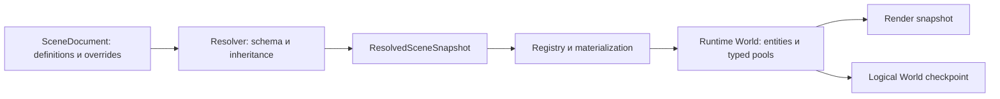

# ECS Aether: черновик системы компонентов

**2026-11-05 — обсуждение; 2026-11-06 — направление внесено в план по запросу пользователя.**
Архитектура развивается поэтапно; headless storage и execution profiles реализованы
2026-11-06; registry и headless scene loading — в [load profile](ECS_LOADING.md).
Initial Runtime transfer/activation добавлены в [e.3b](ECS_RUNTIME_LOADING.md);
[builtin Transform/primitive extraction](ECS_PRIMITIVES.md) реализованы;
mesh/material renderer и checkpoint integration остаются проектом.
Latency benchmark result не заявляется; allocation measurement имеет отдельный scope.
Первый функциональный workload — до10000entities с несколькими value components,
ростом storage, sparse membership и create/destroy; latency/allocation target ещё не выбран.
Задачи/критерии основы ведутся только в [ARCH1e](PLAN.md#arch1e-ecs),
текущее состояние — в [STATUS](STATUS.md). Существующие authoring IDs/форматы не меняются.
Компоненты отображения, материалы и resource owners проработаны отдельно в
[RENDERING_DESIGN](RENDERING_DESIGN.md), этапы — [ARCH1f](PLAN.md#arch1f-rendering).

## Что уже есть и чего не хватает

В Scenes существуют EntityId, ComponentId, ComponentTypeId, ComponentData,
ComponentSchema и ComponentPropertySchema. Уже определены точные версии,
AllowMultiple, RequiredTypes, defaults/null, inheritance/overrides и provenance.
PropertyValue пока поддерживает scalar Boolean/Int64/finite Double/String/null.
ResolvedSceneSnapshot — immutable authoring state, не изменяемый simulation World.

IGameSession принимает SceneSnapshot и Tick. PrimitiveSceneAdapter переносит
поддержанные Transform/Appearance/Interaction; остальные component types остаются
authoring-only. SceneSnapshotAdapter.MaximumEntityCount сейчас64. ECS World с
типизированными pools/query/system execution этим путём не предоставляется.
Checkpoint state содержит tick/camera/interaction и v2 object switches, не весь World.

Первый независимый `TrueMoon.Aether.Ecs.World` добавляет только headless storage;
существующий IGameSession/preview ещё не использует его. Typed queries, phase buffer
и последовательный scheduler добавлены в [execution profile](ECS_EXECUTION.md);
registry/materialization и полный document codec добавлены в [e.3a](ECS_LOADING.md);
initial runtime transport/activation — в [e.3b](ECS_RUNTIME_LOADING.md);
builtin Transform/primitive bridge реализованы в [e.4](ECS_PRIMITIVES.md);
mesh/material lifecycle остаётся ARCH1f.

Следовательно, первый bridge требует явного сохранения всех поддержанных component
values и versioned materialization. Увеличение локальной ёмкости World не увеличивает
автоматически scene/wire/checkpoint budgets; старый primitive compatibility path
остаётся отдельным поддержанным профилем.

## Первый storage profile — решения 2026-11-06

- `World` хранит singleton value components в typed dense/sparse pools. API принимает
  `T : struct`, проверяет отсутствие managed references и отклоняет unsupported type
  до регистрации pool. Primitive/nested value types и пустые tags допустимы.
  Managed/resource-containing storage требует отдельного owner contract.
- `EntityHandle` содержит World GUID, slot index и uint generation начиная с1.
  Default/foreign/stale handles не живы; mutation/read такого target отклоняется.
  При uint exhaustion slot выводится из оборота. World GUID/slot — runtime identity,
  persistent `Scenes.EntityId`/`ComponentId` не заменяются; mapping появится в e.3.
- Create/Destroy и Add/Set/Get/TryGet/Has/Remove выполняются синхронно при внешне
  сериализованном доступе. `Get`/`TryGet` возвращают копии, не ref/span; это ещё не
  scoped query API и не command-buffer playback. Managed thread affinity не нужна:
  владелец может последовательно передавать доступ между потоками, без parallel calls.
- Add отклоняет дубликат; Set не добавляет отсутствующий компонент; Get/Set missing
  дают KeyNotFoundException, TryGet/Has/Remove missing — false. Invalid handle даёт
  ArgumentException, disposed World — ObjectDisposedException. Missing lookup не
  регистрирует type; удаление последнего значения сохраняет pool до Dispose.
- `WorldOptions`: default65536entity slots,128component types, initial64slots;
  допустимо1..1048576slots,1..1024types, initial0..maximum. Рост ленивый и ограниченный;
  retired slots входят в бюджет. Это технические limits, не доказанный throughput
  или новый scene/render/wire limit. Конкретные budgets renderer уточняются в f.0.
- `UseAetherEcs` snapshots/validates options и регистрирует App-local `IFactory<World>`.
  Factory result принадлежит session/caller, не DI; App disposal не заменяет World.Dispose.
  Нет singleton World alias, startup activation, native resources или новых DI scopes.
  Low-level constructor остаётся доступным для самостоятельного использования.
- World не вызывает пользовательские component callbacks/Dispose и не валидирует
  gameplay/asset contents. Copy/remove value с borrowed handle не освобождает ресурс.
  Schema defaults/RequiredTypes/AllowMultiple и подготовка assets входят в e.3/f.1/2;
  неподключённый authoring payload не считается успешно импортированным.

Для первого MeshRenderer предполагается value reference на mesh и binding set,
а variable-length material slots/CPU/GPU resources принадлежат отдельному resource
owner. Массив материалов не вкладывается скрыто в value pool. До реализации binding
set нужно определить immutable revisions, leases и границы publication по ARCH1f;
новых MeshRenderer/MaterialAsset public types этот storage срез не вводит.

Batch failure semantics и scoped queries определены в [ARCH1e.2 execution](ECS_EXECUTION.md):
read/write callbacks, preflight всей command sequence, bounded phase commit и terminal
fault/cancel/Stop outcomes. Полный initial runtime load реализован в
[e.3b](ECS_RUNTIME_LOADING.md); logical persistence/checkpoint остаётся e.5.
Полный vertical slice ниже остаётся целью, не текущей реализацией.

## Разделение данных и исполнения

Это целевой поток. Межпроцессная часть materialization ещё требует bounded
versioned load contract; diagram не утверждает наличие нового transport.
Editor не загружает Game.Logic и CLR-типы пользовательских компонентов для инспектора.
Декларации schema/metadata доступны ему отдельно; CLR bindings создаются в Runtime.

Компонент хранит данные, система исполняет поведение. Предлагаемые роли:

| Роль | Пример | Сохранение/владелец |
| --- | --- | --- |
| Authoring configuration | LocalTransform, mesh/material reference, настройки игрового поведения | Документ/шаблон, overrides и Undo |
| Runtime state | Velocity, current health, состояние patrol | World checkpoint по явному contract, без автоматической записи в документ |
| Derived/cache | WorldTransform matrix, calculated bounds, perception cache | Пересчитывается; policy capture выбирается явно |
| Tag | SelectedForDebug, static/movable classification | Membership без фиктивного object payload; persistent/transient policy явная |
| Resource reference | MeshId/MaterialId/audio/physics handle | Resource service владеет ресурсом; копия компонента не делает Dispose |

Managed/resource integration допускается отдельным storage/owner contract по
потребности. Первый storage profile допускает только values без managed references;
это ограничение данного профиля, не обещание поддержать любые resources через копирование.
Авторские defaults/validators не заменяются default(T).

## Identity, ссылки и множественность

- Сохранить persistent GUID EntityId/ComponentId/ComponentTypeId. CLR Type,
  assembly-qualified name и порядковый registration index не являются disk/wire IDs.
- В World использовать отдельный EntityHandle с world identity, slot index и
  generation. Повторное использование slot не оживляет старый handle; чужой World,
  старая session/generation и disposed World отклоняются. Generation overflow
  требует явной политики, например retire slot вместо wrap-around.
- Authoring EntityRef хранит persistent ID; materializer связывает её с текущим
  World и проверяет required/optional reference. Runtime-generated entities имеют
  checkpoint identity/remapping policy, а не случайно сохраняемые slot indexes.
- AllowMultiple уже часть authoring contract. Singleton Get<T> должен быть
  однозначным; multiple occurrences адресуются ComponentId/отдельным collection API.
  Первый runtime profile может поддержать только singleton, но неподдержанную
  multiplicity обязан отклонить до создания World, без выбора «первого» компонента.
- Scene parent и base definition остаются независимыми. Runtime Parent относится
  к тому же World; cycle, stale target и destroy-with-children требуют явной policy.

Мотив index/version проверен по [Unity Entity](https://docs.unity.cn/Packages/com.unity.entities@1.0/api/Unity.Entities.Entity.html).
World identity и совместимость с persistent IDs — требования Aether, не готовый API Unity.

## Registry и bridge из authoring

ComponentRegistryBuilder.Register<T> сопоставляет exact stable type ID/schema version
с runtime C# value type, validator/importer и explicit reference semantics.
ComponentRegistry immutable после Build, App-local, не меняется из tick и не
держится глобально между game builds/generations. Export/runtime persistence policy
ещё e.5, не автоматическое reflection-сохранение каждого field. Bindings/game code
живут только в Runtime, neutral codec не активирует registry/importers.

SceneWorldLoader сначала проверяет source/resolved limits, exact схемы, references,
RequiredTypes/multiplicity/assets и custom data validators; затем получает fresh
private World, резервирует все entity handles, prepares typed values/owned leases
и публикует SceneWorld. Scalar helpers проверяют kind/null/finite/range conversions.
Ошибка не публикует partial scene; reverse cleanup сохраняет failed owner для retry.
Mutable World не передаётся importers, scheduler/write/dispose во время подготовки
отклоняются. SceneWorld owns World/leases; runtime mutations после publish отделены
от immutable source snapshot. Подробный [ownership/load contract](ECS_LOADING.md).

SceneWorldCodec переносит полный SceneDocument с inheritance/overrides/versions в
TMWL/version1/length/SHA256 envelope, до4MiB+44bytes. Это новый neutral codec,
не расширение existing64KiB IEngineControl и не подключённый Runtime Load method.
Entity/asset references пока declared String GUID semantics registry, без изменения
PropertyValue v1; optional vectors/enums/collections metadata остаются следующим профилем.

Нужны platform-neutral descriptors для vectors/quaternions, enums, entity/asset
references и позднее bounded collections/nested data. Изменения scalar format
делать отдельной версией и explicit migration. Units/range/category/editor hints
не должны зависеть от Argentis controls, Theme или native handles.
Unknown runtime type/version даёт диагностику до запуска; существующий authoring
document не переписывается молчаливым удалением неподдержанных данных.

## Хранение и доступ

Первый storage profile использует typed dense component arrays с sparse entity→slot lookup
для каждого типа. Компоненты одного типа обходятся без Dictionary<string,object>
и boxing в tick; CLR reflection ограничивается composition/registration.
Рост ограничен WorldOptions; первый API выдаёт только value copies, без stable refs.
Этот вариант представлен в [EnTT storage](https://github.com/skypjack/entt/blob/main/docs/md/entity.md#storage);
он здесь рассматривается как устройство хранилища, не как выбор C++ зависимости.

Archetype/chunk storage — альтернатива при соответствующем workload. Выбор между
ними проверяется отдельно на representative entity counts, component density,
query patterns и structural churn; выигрыша одного варианта заранее не заявляется.

Queries реализованы для1/2required types, до8excluded types и явных read/write
callbacks. Nested queries и dynamic reflection query не предоставляются. Borrowed
scoped ref/in действуют только внутри синхронного callback, не переживают structural
flush/await/Stop/Replace. Структурные и direct Set операции при обходе отклоняются.
Query order по packed array не является публичным детерминированным порядком.
Системы с order-sensitive логикой используют явный stable key/order.

## Изменения структуры и системный tick

Create/destroy/add/set/remove реализованы через reusable EntityCommandBuffer с
playback на phase boundary. Reparent/hierarchy validation появятся в e.3/4.
Queries не обходят коллекцию, которую параллельно перестраивают. Deferred tokens
ограничены buffer/batch/world и разрешаются immutable playback result. До commit
симулируется вся FIFO sequence/membership/allocator/type limits. Ошибка validation
не меняет World; неожиданная commit failure делает его Faulted, без silent retry.
Полная schema/dependency/reference validation остаётся materializer e.3.

Simulation command buffer не объявляется транзакцией с полным rollback. Ошибка
неожиданного callback/ресурса не маскируется как успешный tick; продолжение после
неизвестного частичного результата требует определённого Faulted/recovery пути.
Editor runtime edit с capture/restore/atomic outcome остаётся отдельным ARCH1c.
Подход deferred structural changes сверялся с
[Unity ECB](https://docs.unity.cn/Packages/com.unity.entities@1.0/manual/systems-entity-command-buffers.html),
но policy failure/ownership здесь должна соответствовать Aether.

Первый scheduler реализован как caller-driven последовательный EcsScheduler.
Fixed timestep задаётся владельцем через Tick(deltaTime); второго таймера нет.
Фазы Input → Gameplay → Movement → Transform → Extraction заканчиваются playback.
Metadata Read/Write/After/Before frozen; cycle/missing/phase-inversion validation
идёт до activation, actual access проверяется World. Callback contexts активны
только в Execute, writers fenced по invocation generation. Stop/cancel сбрасывают
pending phase commands; уже выполненные writes/commits не откатываются. Cleanup
reverse/best-effort с retained failed owner описан в [execution contract](ECS_EXECUTION.md).
Parallel jobs, change notifications и произвольные queries остаются отдельным профилем.
Fixed tick и stable scheduler сами по себе не обещают cross-platform bitwise determinism.

Enable/disable и change tracking нужны как отдельные contracts. Dirty version может
консервативно отмечаться при выдаче write access; произвольный ref write не даёт
автоматического per-field notification. Tick events живут в bounded buffers с
явным сроком/overflow policy, а не в неограниченном списке или field-event storm.

## Transform, renderer и ресурсы

Authoring Transform v1 сохраняет Euler rad/positive scale semantics. Runtime может
иметь LocalTransform с Quaternion, Parent и derived WorldTransform, но обратное
преобразование не переписывает authoring rotation автоматически. Nonuniform parent
scale/shear сохраняется матрицей, как в нынешней PrimitiveSceneAdapter; decomposition
обратно в TRS не объявляется lossless.

Renderer получает immutable/buffer-owned render snapshot, не ref в изменяемый pool.
Asset/resource handles имеют отдельного owner и version/lifetime fences. Dispose
entity/component не освобождает borrowed shared GPU/audio/physics resource дважды.
Матрицы/видимость/bounds — extraction/cache data, не новая история редактора.

Уточнение2026-11-06: MeshRenderer — data component с mesh/material bindings,
Camera — параметры вида; render extraction — ECS system. Собственно renderer —
DI service backend/host с device/resource lifetime. MaterialAsset разделяется
между entities, instance overrides принадлежат выбранному использованию; shader,
texture и mesh — assets, не обязательные ECS entities. Native handles остаются у
resource owner. Подробные версии/leases/async readiness/frame retirement и первый
opaque unlit профиль — в [проекте отображения](RENDERING_DESIGN.md).

## Компоненты по направлениям

| Направление | Кандидаты | Владелец |
| --- | --- | --- |
| Пространство | LocalTransform, Parent, WorldTransform, bounds | Aether; прежние EntityId/name/hierarchy не дублировать без mapping policy |
| Отображение | Mesh/Material references, visibility/layers, camera | Aether/render integration; первый consumer может оставаться primitive |
| Движение | Velocity/movement intent, collider/rigid-body configuration | Общая engine/provider integration по необходимости; физический solver не часть первого storage slice |
| Взаимодействие | Eligibility/reference/configuration, transient interaction events | Generic engine contract, предметные actions у игры |
| Ресурсы | Asset references, resource handles | Явные asset/provider owners; handles не persistent payload |
| Игра и мобы | Health, inventory, faction, patrol parameters/state, perception, action state | TrueMoon.Tales/Lore; generic ECS не определяет правила здоровья/квестов/мира |

## App, Play/Replace и checkpoint

World и systems создаются через runtime App/Cobalt и injected IFactory с явными
arguments. Результаты factory принадлежат runtime/world owner по договору;
borrowed services не освобождаются World. Entities/components — обычные данные,
их можно создавать через new/commands без DI registration на каждый экземпляр.
В tick нет Resolve, IServiceResolver или глобального service locator.

Stop: запрет новых commands → отмена/drain jobs и reads → остановка owned systems
при ещё доступных данных → освобождение pools/owned resources. Failed startup
освобождает подготовленные ресурсы; aliases не создают второго owner. Новый DI
scope/factory API/assembly для этого черновика не назначен.

Checkpoint хранит logical runtime state, entity/reference remapping, tick/RNG и
нужных участников, не CLR references/GPU handles/slot pointers. Derived state
восстанавливается по policy. Schema migration между game builds explicit; участник
без нужного capture/restore делает соответствующий Replace/edit capability
недоступным. Старые checkpoint/wire budgets не расширяются молча.
Play не пишет runtime state в authoring. Перенос в документ — отдельный diff/commit
с revision/history. Полный live edit ARCH1c не является prerequisite headless ECS.

## Первый проверяемый результат и открытые решения

Предлагаемый vertical slice: materialize supported scene → query LocalTransform+
Velocity → movement system → Parent/WorldTransform → primitive render extraction;
spawn/destroy через phase command buffer, корректный Stop. Проверять headless
storage отдельно от текущего64-entity native compatibility consumer.

Headless payload/version/bindings и admission реализованы в e.3a. Для следующего
этапа выбрать e.3b runtime transfer/activation: identity/capabilities/budgets и
стейджинг полного payload до atomic active-world handoff. Builtin transform mapping,
ресурсные snapshots и checkpoint participants остаются e.4/f/e.5.
Storage alternatives не должны преждевременно
менять все публичные IDs и текущий формат сцен. Дальнейшие этапы/acceptance —
только в ARCH1e engine-плана.
