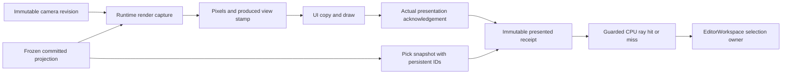

# Камера редактора и выбор объекта

**ED5a.0, решения до реализации — 2026-11-08.** Контракт первого профиля
`editor.preview-view/1`: внешняя камера Edit Preview и одиночный выбор видимого
объекта. ED5a.1 CPU values/math и ED5a.2 explicit preview-view wire/actual receipt
реализованы. ED5a.3 подключил default GPU consumer, retained navigation и selection; ED5a.4 завершил bounded Windows x64 acceptance. Этапы и критерии готовности ведутся только
в [EDITOR_PLAN](EDITOR_PLAN.md#ed5a-camera-picking), состояние — в [STATUS](STATUS.md).

## Основание и границы

Историческая исходная опора ED5a.0 до реализации:

| Опора | Сейчас | Изменение для ED5a |
| --- | --- | --- |
| [PreviewGameSession](../../TrueMoon.Aether/Preview/PreviewGameSession.cs) | Камера `(0,1,6)`, Euler0; tick0; built-in child без Game.Logic | Явный внешний camera snapshot; camera updates между render captures без игрового tick |
| [ScenePreview](../../TrueMoon.Aether/Preview/ScenePreview.cs), [EditorPreview](../../TrueMoon.Aether.Editor/Editing/EditorPreview.cs) | Изоляция по scene/revision/runtime; Show заменяет child, coordinator coalesces document snapshots | Отдельный bounded camera lane в том же child; запрет retag старого кадра новой камерой |
| [ViewportFrame/Presentation](../../TrueMoon.Aether/Frames/ViewportPresentation.cs), [FrameMetadata](../../TrueMoon.Aether/Frames/Frames.cs) | Surface identity/generation, frame/tick; actual Presented ack; camera stamp отсутствует | Явная production-time связь frame→camera/view/pick snapshot |
| [EditorViewport](../../TrueMoon.Aether.Editor/EditorViewport.cs), [EditorSession](../../TrueMoon.Aether.Editor/EditorSession.cs) | Upload, DrawnFrame/ImageBounds и ack после UI presentation | Immutable receipt после успешного actual-present ack; отдельные candidate/drawn/presented состояния |
| [EditorWorkspace](../../TrueMoon.Aether.Editor/EditorWorkspace.cs), [EditorViewModel](../../TrueMoon.Aether.Editor/EditorViewModel.cs) | Единственный selected ID; дерево и inspector заимствуют его | Viewport публикует selection intent тому же owner, с identity/version admission |
| [PrimitiveSceneAdapter](../../TrueMoon.Aether/Scenes/PrimitiveSceneAdapter.cs) | До64 entities; Appearance→opaque cube; полная affine world matrix и persistent ID | Pick snapshot из той же projected scene, с сохранением ID и draw order |

Первый профиль — существующий primitive Edit Preview. Он не добавляет mesh/PBR,
GPU ID buffer, live World edits, gameplay navigation, multi-selection, gizmos или
новую модель хранения сцены. Нет Appearance — нет геометрического hit; такой
объект по-прежнему можно выбрать в дереве. Interaction.enabled относится к gameplay
и не запрещает выбор видимого куба в Editor. Authoring может содержать больше64
entities, но это не снимает текущий bounded preview limit.

Новый mesh renderer остаётся [ARCH1f.3/4](PLAN.md#arch1f-rendering). Контракт внешней
камеры следует [camera/extraction v1](RENDERING_CONTRACTS.md#camera); миграция mesh
preview/picking требует отдельного exact-geometry profile, а не пропуска неизвестных
occluders при выборе лежащего за ними куба.

## Камера и проекция

Камера — transient-состояние одного viewport/document context: rigid world pose,
perspective settings, orbit pivot и distance, монотонная camera revision. Она не
является сущностью authoring/World, не изменяет scene revision/dirty/history и не
попадает в scene file или gameplay checkpoint. Inspector rad/deg preference камеры
не касается. На повторном открытии документа создаётся новый context с defaults;
при Apply/Undo/Redo/Save в той же открытой сцене камера сохраняется.

- Default pose `(0,1,6)`, identity orientation; pivot `(0,1,0)`, distance6.
  FOV vertical π/3 rad, near0.1, far100; исходное изображение сохраняет прежний ракурс.
- RH, +Y up, forward−Z, row vectors. Pose proper rigid: без scale/shear/reflection.
  `View = inverse(CameraWorld)`, `ViewProjection = View * Projection`.
- Perspective constraints и математика совпадают с существующим
  [PerspectiveCamera](../../TrueMoon.Aether/Ecs/Rendering/PerspectiveCamera.cs):
  finite FOV `(0,π)`, near>0, far>near, checks после conversion в Single,
  orthonormal basis/determinant+1 с прежней tolerance0.0001 и finite product.
  Дополнительно для pickable view проверяется representable inverse ViewProjection.
  Общую реализацию переиспользовать; второй расходящийся projection validator не вводить.
- Vulkan depth `[0,1]`, `Projection.M22 *= -1` ровно один раз. Aspect берётся из
  physical extent кадра, а не из всего окна. Extent16..1920×16..1080;
  `0×0` suspend, partial zero invalid. Orthographic/reverse-Z вне v1.
- Pose хранится без обязательного quaternion→Euler→quaternion round trip.
  `CameraTransform` demo checkpoint не становится владельцем Editor navigation.
  Invalid/unrepresentable candidate отклоняется целиком, последняя valid camera
  остаётся текущей; pose и projection не публикуются частями.

Camera revision положительна, возрастает при фактическом изменении pose/projection;
ED5a.1 также выпускает новую revision при изменении pivot/distance. Точное совпадение
всех camera values возвращает прежний объект/revision. Revision
не переиспользуется после отмены. Переполнение закрывает context с ошибкой;
wrap/сброс счётчика в живом view запрещён. Возврат к прежней pose после Esc — новая
revision. Изменение только extent имеет собственную generation; aspect/matrices
фиксируются с этой extent и не вычисляются заново по поздней геометрии окна.

## Identity и данные показанного кадра

Ниже semantic values полного профиля. Camera/geometry ED5a.1 и explicit context/
wire/receipt ED5a.2 реализованы; прикладной opening/view/selection intent owner ещё впереди.
Перечисленные связи обязательны до включения viewport selection.

| Значение | Содержание и срок жизни |
| --- | --- |
| Document context | Свежий opaque epoch на Open/New/Close/replacement session/project switch, плюс project session, SceneId, committed revision и content generation/token. Повторное открытие того же SceneId/revision создаёт другой epoch |
| View context | Свежий ViewId для активного viewport binding и mode epoch. Один active preview view на App-owned FrameSession; второй binding не перехватывает owner неявно |
| Camera snapshot | Camera revision, pose и perspective. Immutable, валиден до/после async render независимо от latest desired camera |
| Pick snapshot | Тот же frozen projected payload, из которого построен render scene: ordered entity IDs, geometry kind, full world matrices и validated inverses. Новый source/content generation — новый snapshot |
| Produced view stamp | View/document/content identity, camera revision, runtime SessionIdentity, surface generation. Захватывается вместе с render scene, связан с exact FrameId/slot use |
| Presented receipt | Успешно acknowledged frame ticket + produced view stamp + strong pick snapshot + frozen ViewProjection/physical extent + фактически нарисованные ImageBounds/clip/layout revision |
| Selection intent | Source(viewport/tree/clear), target ID либо clear, expected document/selection intent revision; viewport дополнительно несёт captured presented context |

Одна scene revision недостаточна: camera и surface меняются независимо; одинаковые
SceneId/revision могут принадлежать другому открытию. Tick preview остаётся0 и не
используется для camera revision. FrameId не заменяет surface generation, а desired
camera не заменяет камеру, использованную для кадра.

Upload/received/copied/submitted не означает Presented. Новый receipt публикуется
на UI owner в FramePresented только при успешном existing presentation ack и
совпавшем stamp. Если acknowledgement отклонён, candidate не становится pickable.
До нового успешного presentation хранится прежний receipt, но admission ниже может
сделать его недоступным. Receipt не получает latest scene/camera из mutable model.

При проверке клика не вызывается повторный ack и не требуется равенство с latest
received/issued FrameId: новая ещё не показанная картинка не аннулирует доказательство
того, что прежняя была показана. Два показанных FrameId с одинаковым semantic context
эквивалентны для click gesture. Изменение camera/content/surface/layout — другой context.

## Обновления камеры и транспорт

Camera input использует уже запущенный built-in EditPreview child, без Build,
Game.Logic load, simulation tick и нового child/surface allocation на каждый move.
Document Show может пока сохранить текущую замену child при новой committed revision;
camera-only update через Show/restart не считается реализацией ED5a navigation.

Один camera update in-flight и один latest waiting value на view; новые pointer
samples заменяют waiting value. Отброшенные значения/leases освобождаются, очередь
и число задач не растут с mouse-move rate. Первый Show содержит согласованные scene
и camera до первого produced frame. При смене document/mode старые camera requests
fenced, новый child получает только snapshot нового context.

Runtime применяет camera request на serialized boundary между render captures.
Render scene, matrices и produced stamp снимаются атомарно; GPU completion старого
кадра сохраняет старый stamp. Control reply означает принятие camera state, не её
показ. Parent не восстанавливает stamp из времени reply или последних requested values.

Исходный ED5a.0 baseline был `(Control=3, Frame=1, Snapshot=2)` без camera stamp.
ED5a.2 явно переводит общую identity на `(Control=4, Frame=2, Snapshot=2)` и добавляет
preview-view capability1, control bytes и production-time metadata. Старый peer получает
strict identity/version отказ; untagged frame не угадывается. Reserved v1 fields, Tick,
SceneRevision и timestamps не переопределены. Fixed-camera C# API сохраняется как
static/untagged путь, но для native counterpart нужны одинаковые новые binaries.

## Координаты и ray picking

Input приходит в logical coordinates Argentis. Сначала штатный UI hit routing:
меню, popup, text/inspector/tree/island, resize chrome и чужой capture имеют приоритет.
Действие viewport получает только свободную область Canvas; прозрачность backdrop
не делает overlay click-through. Letterbox bars и скрытый/zero-size viewport —
`Unavailable/OutsideImage`, не background miss и не ClearSelection.

Для frozen ImageBounds `(L,T,W,H)` и physical frame `(Fw,Fh)`:

1. Принять только half-open `L≤x<L+W`, `T≤y<T+H`; invalid/NaN/outside не clamp-ить.
2. `u=(x-L)/W`, `v=(y-T)/H`; `px=floor(u*Fw)`, `py=floor(v*Fh)`.
   Использовать double intermediates и проверить pixel range.
3. Ray проходит через центр surface pixel:
   `nx=2*(px+0.5)/Fw-1`, `ny=2*(py+0.5)/Fh-1`.
   Здесь **не** `1-2v`: Y уже flipped в projection. DPI второй раз не умножается.
4. Unproject `(nx,ny,0,1)` и `(nx,ny,1,1)` через frozen inverse ViewProjection,
   разделить на finite nonzero w. Origin=near point, direction=normalized(far−near),
   допустимый world t от0 до длины near→far segment. Invalid inverse/points — Unavailable.

Первый picker — geometry ray query для opaque origin-centered cube `[-0.5,+0.5]³`.
World AABB допустим только как broad phase. Ray переводится inverse world matrix:
point с w1, direction с w0. **Local direction не нормализуется**: параметр t должен
сохранить world distance при nonuniform scale/shear. Slab test учитывает parallel
axes. Если near origin внутри cube, берётся положительный exit surface, а не hit0;
пересечение вне near/far segment отвергается. Некорректный inverse не пропускается
как пустое место с выбором скрытого объекта за ним.

Выбирается ближайшая допустимая поверхность. Exact ties сохраняют frozen draw order
(текущий primitive payload — hierarchy/projection order; depth Less), затем stable
primitive order. GUID sorting не заменяет фактический draw order. Это CPU geometry
picking по pixel-center ray, не обещание raster/ID-buffer equivalence на границах
треугольников, coverage и при quantized depth. Для v1 отдельные edge/overlap cases
проверяются; pixel-perfect GPU picking требует отдельного профиля.

Результат различает `Hit(EntityId, world distance, context)`, `Miss(context)` и
`Unavailable(reason)`. Последний включает stale/unsupported/suspended/invalid math;
он никогда не превращается в Miss/Clear. Snapshot содержит только supported exact
geometry. Наличие неизвестного видимого occluder запрещает объявлять весь кадр
pickable; mesh picking добавляется вместе с соответствующим render profile/leases.

## Selection и stale admission

Selection хранит только EditorWorkspace. Viewport, tree и inspector не заводят
собственные authoritative selected IDs. Viewport route проходит общий owner-thread
selection path с existing refresh; клик по тому же ID сохраняет draft, явный выбор
другого ID/clear использует нынешнюю политику дерева: неприменённый inspector draft
отбрасывается. Camera navigation ничего не выбирает и сохраняет даже invalid draft.
Изменение этой политики потребует общей отдельной задачи, не локального поведения viewport.

LMB down в готовом image начинает click gesture с receipt/context и selection intent
revision. LMB up вычисляет query и публикует результат только после повторного admission.
Drag threshold —4logical pixels; движение сверх порога, focus/capture loss, новый
popup, смена layout/context или Escape отменяют click без clear. Во время camera
gesture picking недоступен. Для v1 нет hover-pick задач и очереди async picks на move.

Публикация допускается только если одновременно:

- Mode — Edit, runtime role EditPreview, current document/preview живы; нет
  Play/Replace/Stop/Open/Close/project-switch или document busy/exit fence.
- Project/document epoch, SceneId, committed revision/content generation и ViewId
  совпадают с captured receipt. Same-ID reopen/new context не проходит.
- Runtime/surface generation активны, extent не suspended; receipt действительно
  presented. Camera revision равна latest desired camera; пока новая камера или
  rollback ожидают presentation, показывается прежний кадр с недоступным picking.
- Capture завершён на том же semantic view/layout. Новый FrameId при том же context
  разрешён; changed camera/extent/layout и stale frame — отказ.
- Не было более нового explicit selection intent (включая tree/clear/same-ID intent).
  Hit ID всё ещё принадлежит текущему authoring snapshot. Admission+Select/Clear
  выполняются одним UI-owner действием; поздний результат не перезаписывает новый выбор.

Valid Hit выбирает ID, valid Miss внутри image снимает выбор. Stale receipt, ошибка
или недоступная геометрия оставляют selection/draft как были. Объект, удалённый из
текущего документа, не выбирается из старого кадра. Во время Game Play/Paused game
viewport не управляет authoring selection или editor camera; после Stop требуется
новый preview receipt, game camera обратно в Editor не копируется.

## Navigation, resize и lifetime

Первый input profile использует уже существующие UiInput/capture возможности:
RMB orbit вокруг pivot, MMB pan, wheel dolly, F Frame Selected при focus внутри
viewport. LMB — только selection. Shortcuts текстовых редакторов/меню не перехватываются;
новые global/relative input hooks, Alt и cursor warp для v1 не требуются.

Orbit работает в rad, horizon roll0, pitch ограничен `±(π/2−0.01)` как UI policy.
Pan перемещает pose и pivot вместе в camera right/up plane, масштабируется distance,
FOV и logical ImageBounds; dolly меняет positive distance. Sensitivity/options
валидируются при composition; численные invalid/overflow samples сохраняют последнюю
valid pose. F использует finite world bounds видимой selected geometry (или её
renderable descendants для группы), учитывает vertical/horizontal FOV; pose/pivot/
clip interval публикуются одним valid snapshot. Нет bounds/representable fit —
явный no-op с причиной, без подстановки origin или изменения сцены.

Gesture snapshot сохраняет исходные camera/pivot/projection и context. Release
оставляет новый transient camera state; Esc/focus/capture loss восстанавливает
исходный snapshot **новой** camera revision. При смене document/mode gesture
отбрасывается без восстановления старой камеры в новый context. Capture освобождается
до terminal callbacks. Idle кадры и input polling после завершения не удерживаются.

Layout revision учитывает ImageBounds, visible clip, UI viewport/DPI. Изменение layout
отменяет старый click; новая UI presentation публикует новый receipt даже при том же
source image. Window resize с прежним640×360 может менять только letterbox/layout;
actual render resize дополнительно меняет surface generation и projection aspect.
Suspend/occlusion/resize не освобождают borrow-ресурсы произвольным timeout.

App через UseAetherEditor регистрирует injected factory viewport session/controller;
UI window/parent владеет её продуктом, камера и жесты относятся к этому view/document
context. Стандартный и embedded host используют один контракт active binding.
Controller заимствует Workspace, Preview/FrameSession и renderer services, не
Resolve-ит их в input/render loop. Сами immutable camera/pick значения не требуют DI.

Presented receipt удерживает immutable CPU pick snapshot до замены/снятия и конца
заимствующего gesture. Повторные frame IDs одного content snapshot не копируют geometry.
Bounded retention: current presented, accepted render work и latest waiting request;
discard/cancel освобождают собственные ссылки. GPU imports, Skia copy и surface slots
остаются у прежних owners; receipt не владеет их raw handles. При mesh profile leases
добавляются явно по [resource ownership](RENDER_RESOURCES.md), а не через ссылки в UI.

Dispose/Stop немедленно закрывает input/result admission, снимает subscriptions,
освобождает capture на UI owner и drain-ит собственные requests. Window не dispose-ит
заимствованные App Preview/FrameSession второй раз. Failed cleanup остаётся owned
и retryable по существующему lifecycle; поздний callback старого epoch не публикуется.
Pending readiness/presentation waits отменяются до ожидания worker cleanup: после
Close не требуется новый показ кадра. UI owner не блокируется sync wait на callback
своего render loop; при suspend хранится максимум latest desired camera до resume.

## Реализованный CPU API ED5a.1 — 2026-11-08

Типы принадлежат Aether; они не требуют DI, App, окна, World или GPU resources:

| API | Назначение |
| --- | --- |
| [PerspectiveProjection](../../TrueMoon.Aether/Rendering/PerspectiveProjection.cs) | Общие settings/rigid-pose/extent validation и View*Projection; existing ECS PerspectiveCamera делегирует сюда |
| [PreviewCamera](../../TrueMoon.Aether/Preview/PreviewCamera.cs) | Get-only pose/perspective/pivot/distance/revision, WithView с no-op/checked increment и CreateProjection |
| [CameraProjection](../../TrueMoon.Aether/Rendering/CameraProjection.cs) | Frozen matrices/inverse/physical extent; TryProject, TryUnproject и pixel-center TryCreateRay |
| [ViewportImageBounds](../../TrueMoon.Aether/Rendering/ViewportImageBounds.cs), [Ray3](../../TrueMoon.Aether/Rendering/Ray3.cs) | Logical→physical mapping; normalized bounded world ray, full affine unit cube intersection |
| [PreviewPickSnapshot](../../TrueMoon.Aether/Preview/PreviewPickSnapshot.cs) | Capture из того же projected SceneSnapshot, exact profile `editor.opaque-cubes/1`, detached ID/order/world/inverse |
| [PreviewPickResult](../../TrueMoon.Aether/Preview/PreviewPickResult.cs) | Hit/Miss/Unavailable с retained exact source, optional persistent EntityId/world distance и reason |

`PreviewCamera` проверяет pose/settings/navigation целиком; publication при конкретной
extent дополнительно требует успешного CreateProjection. Invalid candidate не изменяет
предыдущий immutable объект. Монолитного live controller в этом срезе нет.
Revision не является document/view/runtime identity или wire capability.

Для inverse требуется finite Single matrix и абсолютная ошибка каждого элемента
обоих identity products ≤0.001 с double accumulation. Это дополнительный pick-math
admission; прежний forward-only PerspectiveCamera contract не ужесточён. Finite zeros
после intermediate overflow и нестабильные inverses отвергаются. TryUnproject отдельно
проверяет finite nonzero W/representable point; ray — ненулевой near→far segment.
TryProject допускает NDC вне clip volume для finite points перед камерой.

Capture требует непустые persistent scene/entity GUIDs, включая non-rendering groups;
legacy arbitrary string IDs/normalized duplicates отвергаются исключением до публикации.
Unknown profile и valid forward matrix без usable inverse сохраняют snapshot, но все
его queries возвращают Unavailable. Известные cubes не выбираются через пропущенные
unsupported occluders. Source SceneSnapshot и любые возвращённые mutable copies
не заимствуются. DrawOrder хранит исходную позицию в projected entity sequence.

Geometry result сам по себе не разрешает Select/Clear. ED5a.2 реализует exact
actual-present camera/content/runtime/surface/layout admission, ED5a.3 добавит
прикладной context/selection intent owner. Legacy preview остаётся fixed/untagged;
новый explicit API использует внешнюю camera matrix без Euler round trip.

## Реализованный transport/receipt API ED5a.2 — 2026-11-08

`PreviewViewContext` содержит explicit DocumentEpoch/ViewId/ContentId/SceneId/revision,
`PreviewViewState` — context + immutable camera, `PreviewFrameStamp` — context + exact
camera revision и required Version1. Caller создаёт fresh opening epoch при повторном
открытии того же ID и fresh content token для committed payload. Библиотека не угадывает
это по номерам authoring revision; active binding/selection intent owner — ED5a.3.

`ScenePreview.ShowViewAsync(scene,state,width,height,token)` передаёт initial state в
LoadScene до surface readiness; Hello и load ack обязаны подтвердить capability/stamp.
`QueueCamera(context,camera)` фиксирует latest desired, one-flight + latest waiting,
`CameraUpdates` ждёт actual presentation всей принятой batch. Control ack отдельно
проверяет scene revision/tick0/Paused/exact stamp. RuntimeProtocol сериализует apply и
CaptureRenderFrame; PrimitiveScene фиксирует camera вместе с primitives, FromScene
переносит его stamp в точный GPU frame/slot. Старый completion не retag-ится.

Show/Resize/Stop отменяют presentation batch до cancellation callbacks, затем ждут
accepted control под собственным supervisor deadline; UI thread не блокируется.
Show может заменить child; camera-only update не создаёт child/surface и не запускает
игровой tick/Build. Suspend держит latest desired без worker до Resume. Старый receipt
может оставаться последним показанным, но IsCurrent запрещает его при новой desired camera.
Ошибка закрывает admission и сохраняет actual cleanup owner для Stop retry.

Exact wire layout `PreviewViewCodec`:

| Поле | Offset / bytes |
| --- | --- |
| State magic / version / total bytes | `TMPVIEW1`:0/8, version1:8/4, total256:12/4 |
| State stamp |16/148 |
| Row-major rigid World |164/64 |
| FOV, near, far Single |228/12 |
| Pivot XYZ / distance Single |240/12,252/4 |
| Stamp version + four ASCII-N GUIDs |0/4; DocumentEpoch4/32, ViewId36/32, ContentId68/32, SceneId100/32 |
| Stamp scene revision / camera revision |132/8 Int64≥0;140/8 UInt64>0, без signed conversion |

Frame2: `TMFRAME2`, version2, HeaderBytes1536, SlotsOffset256, SlotBytes384,3slots.
Прежние explicit slot fields сохранены на прежних relative offsets; preview stamp
занимает176..323. Null — ровно148zero bytes; malformed/version mismatch — ошибка,
не untagged fallback. GPU JSON stamp Version1 обязателен; slot/use и FrameNumber
согласованы с существующим GPU synchronization stamp version2. CPU reference pattern
не является geometric view, поэтому остаётся untagged/non-pickable даже при Frame2.

`Presented(frame,image,clip,layoutRevision)` создаёт `PreviewPresentedView` только
после existing successful actual ack. Receipt strongly retains exact state/projection/
pick source и logical geometry, не GPU handles. `ScenePreview.IsCurrent(receipt)` не
требует latest FrameId и не вызывает повторный ack; desired camera/context/runtime/
surface обязаны совпасть. `EditorSession.ReadPresentedView(view)` добавляет drawn
stamp, layout/clip/visibility admission через `EditorViewport.MatchesPresentedLayout`.
Получение/upload нового FrameId того же semantic view само по себе не отменяет receipt.

Обычный ShowAsync остаётся fixed/untagged. Default GPU EditorPreview использует
ShowViewAsync: Capture выполняется синхронно на requesting UI owner перед worker.
SceneDocumentState.OpeningId обновляется при каждом успешном opening, даже с теми же
SceneId/revision/reference. Workspace хранит epoch, committed ContentToken и checked
SelectionRevision для каждого explicit Select/Clear, включая no-op same-ID/empty.

EditorViewportState принадлежит App, держит CPU values и borrowed workspace/preview.
Parent-owned EditorViewportController создаётся IFactory с EditorViewportArguments
на UI owner; подписки/gesture capture принадлежат product, View освобождает product.
Привязка эксклюзивна: второе attached View не принимает frames/input. Release и
Stop не освобождают чужие зависимости; async coordinator сохраняет drain ownership.
Legacy custom external transport не требует стандартного окна и сохраняет Show API.

RMB orbit использует baseline+total logical delta (.008rad/pixel, pitch≤pi/2−.01),
MMB pan двигает camera/pivot с учётом image logical height и FOV. Wheel dolly
экспоненциальный (.15/step), ограничен near/far и не забирает focus. F на focused
canvas fit'ит world bounding sphere exact affine cube и сохраняет orientation.
Esc/focus/capture cancellation восстанавливают исходный pose с новой camera revision;
document/context/geometry change отменяет старый жест без stale rollback.

LMB up в пределах4logical pixels от down запрашивает frozen pick snapshot и после
release capture повторяет opening/view/content/camera/surface/layout/intent admission.
Hit и valid Miss идут через общие EditorViewModel.Select/ClearSelection. Unavailable,
pending camera, Play, letterbox, overlays/chrome/foreign capture не публикуют выбор.
Same-ID draft policy сохраняет черновик; different/clear использует прежнее поведение.
Commits/Undo/Redo сохраняют transient camera; reopen/project/binding renew сбрасывает её.

UI viewport dimensions/scale и visibility имеют отдельную drawn geometry epoch.
SetPresentationSuspended отменяет actual presentation waits и убирает receipt,
сохраняет desired camera и physical child/surface; resume требует нового ack. Незавершённый wait для camera, queued while hidden, сохраняется при resume и завершается actual ack.
UI binding прекращает texture copies hidden/suspended consumers; initial default
Show ждёт visible active view, visibility cancellation retries после resume.

## Проверка решений и готовность

ED5a.4 завершён2026-11-08 в bounded Windows x64 v1 scope: full Editor1412/1412,
bounded Aether2104/2104 каждый D/R. Source/published/fresh-package GPU lifecycle:
13groups/17PNG,9children=reaped,8GPU validation+1pre-GPU failure каждый.
Windows SendInput Debug/published Release прошёл hit/clear, invalid draft+wheel/F,
LMB drag и RMB/MMB release;1child=reaped каждый, same PID/surface, cleanup0/validation0.
Hidden-camera wait regression исправлен. Moving RMB/MMB/Esc/focus loss — directed
UI/native GPU; physical held-button/multi-monitor DPI gates отдельно (actual1.5,
deterministic tests1/1.5/2). [Матрица/команды/limits](HISTORY.md#ed5a4-acceptance-2026-11-08).
Далее ED5b translation contract. Ниже — исторические результаты предыдущих этапов.

ED5a.3:33new Editor+1Aether case; full Editor1396/1396, bounded Aether2104/2104 D/R.
Native source Debug/published Release directed UiSession input прошёл navigation,
selection/draft, actual cube pixels, camera1→7 с одним PID/surface, cleanup0 и validation0/0.
[Команды/границы исторического ED5a.3](HISTORY.md#ed5a3-input-2026-11-08). Текущий acceptance scope указан выше.

ED5a.2:52new Aether +10Editor cases; Aether bounded2103/2103 и full Editor1363/1363
каждый D/R. Source Debug/published Release native:50camera samples, same PID/surface,
actual shifted cube pixels, resize/suspend/resume,4camera PNG/profile,1child=reaped,
ownership0, validation0/0. [Команды и ограничения](HISTORY.md#ed5a2-view-2026-11-08).
Full Aether attempt non-green/interrupted: исправлена найденная cancellation race,
repository-build case сообщил missing game csproj; final full-solution/fresh NuGet
и navigation/selection acceptance не объявлены. Ниже — исторические ED5a.1/0 проверки.

ED5a.1:77new production API cases, Aether ECS/Rendering/Scenes/Preview1857/1857 каждый
Debug/Release и Editor1353/1353 Debug прошли. Полная matrix и команды — в
[HISTORY](HISTORY.md#ed5a1-values-2026-11-08). Native/transport/fresh package acceptance
этим CPU срезом не выполнялась. Исходный ED5a.0 probe ниже остаётся отдельной исторической проверкой.

2026-11-08 [численный probe](../../ManualTests/AetherCameraContractProbe/README.md)
на текущих PerspectiveCamera/PrimitiveScene прошёл20
checks: projection compatibility, near/far depth, знак Y, pixel-center reprojection,
logical mapping при DPI1/1.5/2, invalid coordinates и half-open letterbox, near-inside exit/far clipping,
behind-camera rejection, nonuniform scale/shear t, rotated rigid camera и rejected
scaled/reflected/suspended camera. Ray/cube helpers в probe — prototype контракта,
не production picking. [Команда, outcomes и ограничения](HISTORY.md#ed5a0-contract-2026-11-08).

Исторический probe ED5a.0 не является доказательством новой transport/UI readiness.
Текущий ED5a.4 scope и сохранённые hardware gates указаны выше. Матрица tests и source/
published native acceptance находится в [единственном плане ED5a](EDITOR_PLAN.md#ed5a-camera-picking).
