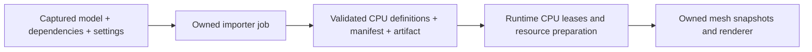

# ARCH1g.0: Assimp, сравнительный spike и выбор кандидата

**2026-11-07. Кандидат для g.1 выбран: AssimpNetter6.0.5, low-level API.**
[План и критерии ARCH1g](PLAN.md#arch1g-model-assets), [история проверки](HISTORY.md#assimp-research-2026-11-07).
После primary-source/package inspection выполнены реальные headless import/delivery
probes четырёх вариантов,8profiles Debug/published Release. [Решение и измерения](#decision-2026-11-07)
ниже. Production dependency пока не добавлена: captured I/O, hard parser budgets,
identity/reimport и cancel contract ещё нужны, весь g.0 не объявляется закрытым.

## Что такое Assimp и где его применять

Assimp — C/C++ Open Asset Import Library: разные model formats преобразуются в общий
CPU scene graph. В [перечне форматов v6.0.5](https://github.com/assimp/assimp/blob/v6.0.5/doc/Fileformats.md)
есть FBX, OBJ, Collada, glTF2/GLB и другие. Поддержка контейнера не означает поддержку
всех его extensions, exporter variants или render features; это проверяется fixtures.
Assimp предоставляет geometry/material/node/animation data, а готовый renderer,
engine asset identity, build cache и runtime resource ownership остаются нашей задачей.
[Upstream overview](https://github.com/assimp/assimp/tree/v6.0.5).

**Выбранное направление для g.1:** использовать AssimpNetter как adapter
Editor/build import stage, выдающий собственный versioned artifact. Runtime получает
captured immutable content и готовит resources через f.2. Runtime import пользовательских
файлов возможен отдельным профилем; он не обязателен первому release consumer.
Это решение для ограниченного prototype; production package/API contract ещё не введён.

## Кандидаты .NET

Проверенные версии — snapshot7ноября, не обещание будущей latest/совместимости.

| Кандидат | Подтверждено источниками/архивом | Роль после сравнительного spike |
| --- | --- | --- |
| [Silk.NET.Assimp2.23.0](https://www.nuget.org/packages/Silk.NET.Assimp/2.23.0) | MIT, low-level C bindings; зависимости Silk.NET.Core/Maths2.23.0 и Ultz.Native.Assimp>=6.0.2. Сам binding не содержит native assets | Кандидат с явным native-scene ownership и контролем копирования; у нас уже используется Silk2.23.0, но это не доказывает ABI/delivery |
| [Ultz.Native.Assimp6.0.2](https://www.nuget.org/packages/Ultz.Native.Assimp/6.0.2) | BSD-3-Clause; native dependency предыдущего binding, не самостоятельный managed importer | Проверять и фиксировать отдельно от версии Silk, включая фактически загруженный native version/compile flags |
| [AssimpNetter6.0.5](https://www.nuget.org/packages/AssimpNetter/6.0.5) | Modern fork AssimpNet, managed high/low-level APIs; native assets включены. Wrapper MIT, Assimp BSD-3-Clause; release связывает его с native6.0.5 | Выбран low-level путь для g.1; high-level оставлен контролем стоимости промежуточной scene copy |
| [AssimpNet4.1.0](https://www.nuget.org/packages/AssimpNet/4.1.0) | Legacy NuGet stable от2018-10-29;5.0.0-beta1 опубликован2020-02-17 | Не первый выбор нового prototype без отдельного обоснования поддержки/обновления native |
| [SharpGLTF.Core1.0.7](https://www.nuget.org/packages/SharpGLTF.Core/1.0.7) | MIT, managed glTF2 reader/writer; в архиве есть net10.0 и нет native runtime assets. Для net10.0 dependency group пуст | Контрольный вариант, если первый профиль ограничен glTF/GLB; не заменяет FBX/OBJ importer |

[AssimpNetter release6.0.5](https://github.com/Saalvage/AssimpNetter/releases/tag/v6.0.5.0)
подтверждает обновление native. [SharpGLTF overview](https://github.com/vpenades/SharpGLTF)
разделяет Core/Runtime/Toolkit: сначала исследуем Core, без подключения готового rendering
layer к Aether. Наличие managed loader не закрывает поддержку compression extensions,
texture decoding или budgets: их нужно проверить для выбранного профиля отдельно.

## Проверенная поставка пакетов

NuGet-архивы скачаны через официальный flat-container; прочитаны nuspec и ZIP entries,
сохранены SHA256. Ничего не добавлено в Directory.Packages.props/csproj/NuGet cache.

| Архив | Сжатый размер всех RID, MiB | Native Windows x64 entry / размер |
| --- | --- | --- |
| Silk.NET.Assimp2.23.0 |0.57|Нет; native приходит через зависимость |
| Ultz.Native.Assimp6.0.2 |39.16|runtimes/win-x64/native/Assimp64.dll /5767680bytes |
| AssimpNetter6.0.5 |24.20|runtimes/win-x64/native/assimp.dll /5842432bytes |
| SharpGLTF.Core1.0.7 |1.21|Нет |

Эти размеры не сравнивают import speed, peak RAM или размер конечного RID publish.
Ultz содержит Linux arm/arm64/x64, macOS arm64/x64, Windows arm64/x64/x86 entries;
AssimpNetter — Linux arm64/x64, macOS arm64/x64, Windows arm64/x64/x86. Наличие
файла не доказывает работоспособность платформы: первым prototype target будет
текущий Windows x64/net10.0, остальные RID получают собственные delivery probes.

У [Silk loader](https://github.com/dotnet/Silk.NET/blob/94605142f7b7bd6e69c9201e8e721d245c69eb7e/src/Assimp/Silk.NET.Assimp/AssimpLibraryNameContainer.cs)
Windows64 ищет Assimp64.dll, Linux/macOS — имя с suffix5. В Ultz6.0.2 присутствуют
имена5 и6. Одно имя не доказывает native ABI/version; в prototype нужно проверить
version exports, struct layout/precision, LoadedPath/SHA и содержимое RID publish.
Не подменять Assimp64.dll из одного provider DLL от другого по одному имени.

Nuspec repository commits: Silk94605142f7b7bd6e69c9201e8e721d245c69eb7e,
AssimpNetter161363c3528c3ba388151e9e796d16ccf9f58913,
SharpGLTFacbc151e70d65ceb8bec24fa95f0067d0e5ed933. У Ultz repository URL указывает
на assimp/assimp, но commit совпадает с Silk metadata; verified upstream Assimp
source pin из этого не выведен. Build provenance native package требует уточнения
перед собственной пересборкой/расширением. Последующий spike подтвердил actual
Windows x64 loading/version/hash обоих provider; собственная пересборка для него
не понадобилась. Это не подтверждение остальных RID или произвольной подмены DLL.

SHA256 архивов:

```text
Silk.NET.Assimp 2.23.0  3542E71B820DC7F57BF8B19CD240B19CF093E319123DA9E8F578D42108B18758
Ultz.Native.Assimp 6.0.2  B7A8DA0D48EA87BC6E362E3C707ABE09B143718787676FD6007EBF6FEDC1AF2A
AssimpNetter 6.0.5  805526348F7D868BC2BA1B56538C5AB1409E5E99E9BB653AF895DC3E5BD2919E
SharpGLTF.Core 1.0.7  2C1EA4AA2A4298A5847714B91E94CCC47FB3600CA5B27DD04FFE664E72B3A819
```

Полные nuspec/runtime entries и архивы — ignored TestResults/AssimpResearch-20261107.
Существенные факты/ограничения сохранены здесь, raw files не единственная запись.

## Ownership, dependencies и postprocess

В [C API6.0.2](https://github.com/assimp/assimp/blob/v6.0.2/include/assimp/cimport.h)
import возвращает borrowed read-only scene до aiReleaseImport; ошибки дают null и
error string. Import adapter должен скопировать/валидировать engine-owned data,
затем освободить native scene ровно один раз. Ни Scene*, ни чужие arrays/handles
не передаются в World/render snapshot. [C++ Importer](https://github.com/assimp/assimp/blob/v6.0.5/include/assimp/Importer.hpp)
не thread-safe на одном instance: ownership/concurrency нужно определить для каждого job.

У [AssimpNetter high-level ImportFile](https://github.com/Saalvage/AssimpNetter/blob/161363c3528c3ba388151e9e796d16ccf9f58913/AssimpNet/AssimpContext.cs)
scene конвертируется в managed representation, native import освобождается в finally.
Это другая lifetime boundary: prototype должен измерить coexistence buffers во время
копирования в MeshDefinition, а не считать managed wrapper бесплатным. Low-level API
у fork также доступен, но требует отдельного owner и cleanup contract.

Memory import одного файла не решает полный asset capture: C API отдельно предупреждает
о форматах с внешними material/dependency files и предлагает custom IO. Для FBX/OBJ+
MTL/glTF+BIN/textures нужно перехватить все reads через captured, ограниченный resolver;
обычный ImportFile(path) сам по себе не фиксирует зависимости build и не создаёт manifest.
GLB — полезный первый fixture, но не общая гарантия отсутствия external references.

Настройки postprocess становятся частью import settings/hash. В
[postprocess.h](https://github.com/assimp/assimp/blob/v6.0.2/include/assimp/postprocess.h)
PreTransformVertices удаляет node graph и запекает transforms; его нельзя безусловно
применять при сохранении hierarchy/instancing. Triangulation, winding/UV conversions,
vertex joining, generation of normals и global scale должны иметь явную policy;
результат проверяется literal fixtures, а не только successful import status.

[Assimp LICENSE](https://github.com/assimp/assimp/blob/v6.0.2/LICENSE) задаёт BSD
redistribution notices и отдельно оговаривает models-nonbsd. Лицензия библиотеки
не лицензирует входные модели. Для fixtures использовать собственную простую geometry
или assets с проверенной лицензией; notices native dependencies включить в поставку.

## Граница первого import-прототипа



Это выбранное направление g.0, ещё не production pipeline. Import job создаётся через App/typed
factory, имеет своего owner/limits и выполняется вне tick/render/UI hot path.
Current MeshDefinition принимает только finite position-f32x3/UInt32 triangle lists,
exact slot ranges и bounds; материал opaque unlit. Assimp PBR/UV/normals/skinning не
становятся поддержанными автоматически. Нужна explicit rejection/projection policy
до publication, а расширенные layouts/materials — отдельные versioned capabilities.

Stable AssetId и slot IDs не брать из transient native pointers или одного mesh name.
Сопоставление source sub-assets при reimport/rename требует import metadata; canonical
revision зависит от engine content и всех влияющих import settings. Counts/canonical
hash order проверять независимо от native traversal order и locale.

Bounds/counters f.1 проверяют уже полученные данные; они не ограничивают внутренние
allocations native parser до возврата scene. До adoption выбрать численные input/
dependency/temporary/resident budgets, способ abort/cooperative cancel и worker isolation.
CancellationToken/timeout не доказывает остановку parser и не разрешает ранний release.
Это открытые критерии исследования, ещё не реализованная защита.

<a id="decision-2026-11-07"></a>
## Решение и практическое сравнение — 2026-11-07

**Выбран AssimpNetter6.0.5 с low-level ImportFile/ReleaseImport для прямого переноса
native scene в engine-owned CPU arrays.** High-level AssimpContext остаётся удобным
контрольным вариантом, но не выбран для основного memory-sensitive conversion path.
При production integration raw pointers останутся внутри import owner; наружу
выдаются только validated definitions/artifact и diagnostics.

Причины выбора:

- На одинаковых fixtures подтверждена нужная multi-format основа и actual native6.0.5.
  Не потребовались изменения или сборка upstream DLL для Windows x64.
- Low-level путь устраняет промежуточную managed scene high-level wrapper. Managed
  allocation delta в нашем workload близка к Silk, при этом используется native6.0.5
  вместо6.0.2. Одна только разница номера версии не доказывает качество всех importers.
- Scene lifetime задаётся явным ReleaseImport в finally после detached copy; package
  предоставляет и более высокий API, позволяя сравнивать оба пути на одной native версии.
- Silk2.23.0+Ultz6.0.2 технически прошёл проверки и остаётся альтернативой. Наличие
  других Silk dependencies в Aether само по себе не даёт преимущество импортёру.
  SharpGLTF.Core сохраняется для glTF-only сценариев, но не покрывает FBX/OBJ workload.

### Что реально проверено

[Воспроизводимый runner](../../ManualTests/ModelImportResearch/README.md) создаёт
isolated projects/caches/feed в OS TEMP, использует pinned candidate NuGet packages
и read-only cached dependencies. Aether подключён через ProjectReference только
для реального MeshDefinition/RenderContentCodec. Это не fresh Aether NuGet proof.
Production csproj/CPM/dependencies, public API и renderer не менялись.

Все4варианта прошли source Debug и framework-dependent published Release — **8/8profiles**:

| Проверка | Фактический результат |
| --- | --- |
| GLB и glTF+external BIN |2primitives/2material assignments,4instances с общей geometry,3nodes; literal translations(10,2,0)/(13,0,0), correct winding. Все варианты прошли |
| OBJ+MTL |2triangles/2material assignments/2instances; оба Assimp API variants и Silk прошли. SharpGLTF явно unsupported |
| Minimal ASCII FBX, созданный нами |1triangle/1instance, literal positions/bounds; все3native variants прошли. Не является широким FBX/exporter/animation corpus |
| Grid GLB |16384vertices/96774indices; полное множество triangles и winding, bounds/cardinality сверены независимо от reorder |
| Broken JSON/missing BIN/truncated GLB |Все варианты дали expected failure, без successful partial result |
| Повторяемость |11imports каждого поддержанного positive fixture дают один fingerprint внутри candidate; D/R совпадают |
| Native activation/delivery |Netter high/low actual6.0.5, Silk actual6.0.2; single precision, flags17. Output-local DLL SHA совпадает с pinned archive и между Debug/publish |
| Cleanup |Tracked LiveImports0, release/close пути отработали. Это не полный allocator/leak proof native implementation |

Небольшая GLB scene дала одинаковый research fingerprint у всех4вариантов.
Grid bytes/fingerprint совпали между native variants, но отличаются от SharpGLTF:
геометрия/winding эквивалентны по независимой полной проверке, storage order отличается.
Это подтверждает необходимость учитывать importer version/settings в build identity;
семантическая эквивалентность не гарантирует одинаковый binary artifact.

В обоих Assimp adapters native column-vector transform переводится transpose в
System.Numerics row-vector convention; Netter копирует raw matrix fields. Вывод
проверен nonzero parent/child translations, не предполагается из имени Matrix4x4.
В production нужны дополнительные rotation/nonuniform scale/shear fixtures.

### Ограниченные измерения

Последний frozen run: Windows x64/.NET10,7warm observations полного grid import+
detached conversion+CPU validation/canonical encoding, после предыдущих fixture imports.
Числа — локальная характеристика этого runner, не parser-only microbenchmark/SLA.

| Published Release variant | Median ms (min–max) | Managed allocated bytes, median | Peak process working set, MiB |
| --- | --- | --- | --- |
| AssimpNetter high-level |7.3421 (6.6926–9.6082)|12302752|67.46|
| **AssimpNetter low-level** |**4.2793 (3.7904–5.5776)**|**4672008**|**53.22**|
| Silk.NET.Assimp/Ultz |4.9298 (4.7844–5.8888)|4675784|56.75|
| SharpGLTF.Core |7.6702 (7.3867–8.1509)|5910880|55.85|

Working set — peak всего процесса, включая CLR/DLL/предыдущие fixtures, не native
parser allocation peak и не гарантированный memory budget. Allocation delta включает
наши arrays/codec; time differences не доказывают общего превосходства библиотек.
Выбор low-level Netter опирается на fidelity/delivery и отсутствие лишней managed
scene copy; небольшой timing выигрыш не является самостоятельным критерием.

Native SHA256: Netter90984E886CF7394560E44FECD5A5666BECD2A93E98251974A562ECB79CFBA386;
UltzA2A385EAEBABB76DCE3E44569E613F76A0C44601CE6E9F79E44322BDC0487969.
Запросы version/flags используют unsigned-int/no-argument exports из
[version.h](https://github.com/assimp/assimp/blob/v6.0.5/include/assimp/version.h),
до чтения typed scene fields; временная loader reference освобождается отдельно.

Повторяемая команда из src:

```powershell
& ./ManualTests/ModelImportResearch/Verify.ps1 -EvidenceDirectory TestResults/MyFreshModelImportRun
```

Runner использует имеющиеся pinned archives, а при их отсутствии скачивает official
NuGet files с SHA256 gate в новый temporary feed. В FinalReusable этот путь проверен
явным отсутствующим ArchiveDirectory. Все21commands exit0,12unique MSBuild binlogs,
8frozen source files и10generated fixture files. Raw evidence — ignored
TestResults/ModelImportSpike-20261107/FinalReusable; результаты сохранены здесь.
Initial Attempt1 исправил только имена M-prefixed fields в новом Silk probe; version/
geometry assertions не ослаблялись. Последующие runs добавили low-level Netter,
полную topology проверку и native version/SHA gates; failed artifacts сохранены.

### Границы решения и следующий шаг

Кандидат выбран **для g.1**, библиотека не добавлена в production graph. Следующий
результат — App/IFactory import adapter с selected static profile и diagnostics.
[Captured I/O/limits/ID/cancel v1](MODEL_IMPORT_CAPTURE.md#capture-v1) уже реализован
и проверен отдельным Windows x64 research proof; production integration ещё впереди.
Первое fixture scope — static glTF/GLB и OBJ; FBX остаётся experimental до расширения
корпуса и policy для unsupported features. Full material/color/PBR/UV conversion,
skinning/animation/compression, reimport identity, units across exporters и all-RID
support не доказаны маленьким corpus. Нет GPU/native-render/Editor/Playing proof.

Comparison выше использует default parser I/O на доверенных созданных fixtures;
новый captured proof отдельно проверяет no-fallback callbacks, budgets, persistent
ledger и native worker cancel/isolation. G.0 остаётся частичным до полного format/
coordinate/unit/material/unsupported policy. Производственные loader capability/
artifact format/package boundaries ещё не введены. Audio h.0 не исследовался этим run.
