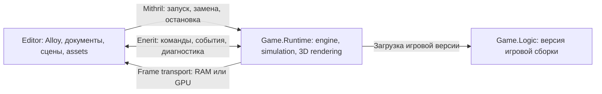

# Игровой движок и редактор на TrueMoon: план

Зафиксировано **2026-10-13** по обсуждению будущего кастомного движка для одной
не очень сложной 3D-игры. Состояние: **запланировано, реализация не начата**.
[Статус направления](STATUS.md), [общий план](../PLAN.md),
[правила ведения](../PLANNING.md).

## Цель и заданные требования

- Использовать TrueMoon как основу приложения, lifecycle, DI, диагностики и UI.
- Развивать компактный движок под одну игру; состав подсистем определяется её
  сценами и взаимодействиями. Жанр и точный масштаб пока не выбраны.
- В режиме редактирования редактор и выполнение игры находятся в разных
  процессах. Редактор сохраняет открытые документы, панели и несохранённые данные
  при остановке, обновлении или обычном crash игрового runtime.
- Game runtime выводит кадры в viewport редактора через отдельный transport.
- Обновление игровой логики не требует полной пересборки и перезапуска редактора.
  Первая надёжная реализация предполагает замену child runtime; возможность
  сохранить работающим и сам game process исследуется отдельно.
- Тот же игровой runtime должен иметь путь самостоятельного запуска игры.

Документ сохраняет исследования и предлагаемый маршрут. Он не объявляет новые
API/проекты реализованными, не задаёт сроков и не меняет readiness существующих
модулей. Порядок развития framework остаётся в общем плане; bounded MIT4/ENE4 results могут стать
основой игрового прототипа. Детальные engine/editor задачи ведутся только здесь.

## Границы и владельцы

Новая часть: игровой цикл, world/scene, камеры, 3D renderer, assets, интеграция
физики/звука, редактор и процессная связь viewport. Названия и границы сборок
Engine, Editor, Game.Runtime, Game.Logic и общих Contracts пока концептуальные;
csproj, versioning и публичные interfaces определяются при начале этапа.

| Направление | Ответственность |
| --- | --- |
| Engine/editor integration | Общий сценарий, game sessions, build replacement, frame transport, состояние и editor viewport |
| [Core](../core/PLAN.md) / [Cobalt](../cobalt/PLAN.md) | Bootstrap/configuration/diagnostics, DI и lifetime подсистем; новые общие изменения принадлежат этим модулям |
| [Mithril](../mithril/PLAN.md) | Owned process startup/stop/reap/restart; изменение unit lifecycle остаётся модульной задачей |
| [Enerit](../enerit/PLAN.md) | Команды/события и wire contracts; передача кадров имеет отдельный контракт |
| [Alloy/Argentis](../alloy/PLAN.md) | UI редактора/HUD, input/focus/layout и интеграция viewport; существующие K1–K9/PA1–PA10 сохраняются |
| Game | Конкретные правила игры, игровые компоненты, контент и поддерживаемые snapshot migrations |

Bootstrap/DI/IPC/units сохраняют независимость от UI и 3D renderer. Подсистемы
создаются через DI при startup; frame/tick loop работает с прямыми ссылками.
Сначала простой world/entities/components по потребностям игры. Generic ECS,
render graph и распределённая симуляция не назначаются обязательными этапами.
Физика и audio могут использовать готовые библиотеки; выбор следует из игры.

## Предлагаемая архитектура

Editor владеет своим окном, UI, authoring documents и приёмником кадров.
Game.Runtime владеет live game world, game loop, renderer и producer ресурсов
кадров. Общая библиотека движка может загружаться в обоих процессах, но их
objects/devices/lifetimes независимы. Editor передаёт DTO, asset/entity IDs и
версии, а не ссылки на CLR objects или raw native pointers другого процесса.

Редактируемый scene document является источником authoring данных. Runtime
получает snapshot/deltas и владеет состоянием симуляции. Сохранение результатов
Play обратно в документ должно стать явной операцией. Scene editing и Play
различаются simulation policy: pause, resume и single-step; камера preview,
viewport resize и input доступны в обоих режимах по согласованным правилам.

В runtime Editor-mode рендеринг offscreen; окно presentation принадлежит Editor.
В standalone-mode runtime создаёт своё окно/presentation. Симуляция использует
фиксированный шаг, renderer получает подготовленное состояние сцены. Потоки,
частоты и необходимость нескольких frames in flight выбираются после baseline.

## Управление игровой сессией

- Каждая сессия имеет session ID, generation, game build ID и версии общих
  control/frame/snapshot contracts. PID используется для ownership/диагностики,
  но не заменяет session identity.
- Различать OS start, runtime readiness, готовность surface и первый completed
  frame. Timeout/ошибка каждого шага наблюдаемы; malformed/stale сообщения не
  переключают viewport на чужое поколение.
- Game crash, disconnect и исчерпание restart budget переводят editor viewport
  в наблюдаемое состояние unavailable. Editor lifetime при этом сохраняется;
  его закрытие останавливает принадлежащие ему game sessions и compiler jobs.
- Замена runtime является явной операцией supervisor. Automatic restart policy
  и работа под debugger задаются отдельно; нельзя скрывать причину crash.
- Нужны повторные Play/Stop/Replace без пересоздания Editor App. Конкретный API
  адаптера/supervisor и расширения Mithril определяются по ownership contract.
- Deadlines/cancellation не блокируют UI thread. Failed cleanup диагностируется;
  ownership не считается завершённым, пока нужные процессы/resources не очищены.

Текущий [IUnitsController](../../TrueMoon.Mithril/IUnitsController.cs) содержит
Spawn, а [UnitsController](../../TrueMoon.Mithril/UnitsController.cs) запрещает
launch после Stop/failed Start и не поддерживает nonempty launch parameters.
Это существующая граница, а не готовый editor session supervisor. Child handle
запускает текущий entry application; отдельный Game.Runtime executable требует
явно выбранного owned launch path. Attach к чужим процессам не подразумевается.

## Обновление игровой логики и состояния

Для C# изменение исходников требует новой сборки либо compiler/runtime deltas.
Цель — обновлять игровую часть, сохраняя Editor и неизменившиеся engine binaries.
Общие editor/runtime contracts остаются стабильными при смене Game.Logic.

Базовый цикл:

1. Собрать candidate game version в отдельном каталоге; идентифицировать build.
2. При compile failure показать diagnostics и сохранить предыдущую рабочую
   игровую версию. Загруженные DLL не перезаписываются новым build.
3. На границе tick получить поддерживаемый checkpoint/snapshot с version/schema.
4. Остановить старую сессию и запустить candidate, либо подготовить обе сессии
   с явным memory budget. Вариант переключения выбирается проверками.
5. Выполнить readiness и согласование transport, применить snapshot/migration.
6. Показать кадры нового generation; retire прежние ресурсы после их использования.
7. При candidate failure оставить Editor usable, сохранить исходную причину и
   обеспечить явный возврат к последней рабочей версии или исходной сцене.

Сначала snapshot включает сцену, камеру и минимальное игровое состояние.
Полное восстановление arbitrary runtime object graph не обещается. Новые/удалённые
компоненты и поля требуют правил migration либо явного reset. После crash
доступен последний сохранённый checkpoint, а не snapshot уже умершего процесса.

.NET Hot Reload — последующее ускорение для поддерживаемых изменений. Rude edits
имеют маршрут через child replacement. Collectible AssemblyLoadContext —
альтернативное исследование: unloading cooperative, references/threads/callbacks
могут удерживать старые assemblies. Оба механизма не являются предусловием
первого работающего editor/runtime прототипа.

## Команды и передача кадров

Control transport передаёт load scene/asset version, input batches, resize/DPI,
pause/resume/step, параметры объектов, inspection DTO, checkpoints и diagnostics.
Контракты должны задавать ordering, acknowledgement, cancellation, limits и
backpressure/coalescing частых событий. Interrupted request не повторяется
автоматически после restart; новое соединение принимает новые запросы.

Enerit сейчас имеет same-build wire scope и
[лимит payload 1 MiB](../../TrueMoon.Enerit/IO/Pipes/PipesProtocol.cs).
Game.Logic update не должен менять общий generated RPC contract. Совместимость
Editor/Runtime builds проверяется до начала normal operation; update общих
contracts/runtime требует отдельной политики. Frame payload не передаётся как
обычный RPC ответ. CPU shared memory для кадров не доказывает готовность ENE3 MMF.

| Transport | Назначение и требования |
| --- | --- |
| CPU/shared RAM | Первый прототип и возможный явно выбранный fallback: GPU readback, bounded ring, upload на стороне Editor; стоимость/latency измеряются |
| Shared GPU memory | Кандидат для рабочего viewport: export/import совместимой GPU memory и synchronization, без CPU readback; отдельная capability/lifetime проверка |

Frame descriptor задаёт generation, frame/slot ID, dimensions/stride, format,
color space/alpha/orientation и completion/resource ownership. Конкретная схема
и pixel formats выбираются в ENG0. Несколько slots не допускают overwrite
читаемого кадра; exhausted ring пропускает/ограничивает frames по явной policy.
Editor отображает последний completed frame, не ждёт runtime на UI thread.

Для Vulkan/Windows потребуются compatible adapter/driver/handle capabilities,
export/import OS handles, image layout/queue ownership и synchronization.
VkImage/VkDevice/указатель из child не является переносимым handle редактора.
Ready означает наблюдённое GPU completion, а не только command submission.
Необходимо исключить бессрочное ожидание editor GPU queue на сигнал умершего
producer. Resize/restart создаёт новый generation; старые imports/handles
закрываются только после завершения editor GPU use. Проверить crash до/после
publish, receiver disconnect, stale frame, outstanding lease и device loss.

Текущие [VulkanHostContext](../../TrueMoon.Alloy.Rendering.Skia/VulkanHostContext.cs)
и [UI lease](../../TrueMoon.Alloy.Rendering.Skia/VulkanInteropSurface.cs) —
borrowed handles внутри процесса, последовательная thread-affine работа.
Cross-process frames и async frames in flight являются новым контрактом.
Process isolation не гарантирует изоляцию shared GPU/driver faults.

## Этапы будущей реализации

Все этапы **запланированы**; таблица задаёт порядок, а не текущие passing results.

| ID | Результат | Критерий завершения |
| --- | --- | --- |
| ENG0 | Scope и минимальные contracts | Выбраны game scenario/platform/API, политика паузы/restore, session/control/frame schema, deadlines и измеримые limits |
| ENG1 | Editor/child skeleton и supervisor | Ping/readiness, повторные Play/Stop/Replace, owned cleanup и ordinary child crash/disconnect при живом Editor |
| ENG2 | CPU frame viewport | Детерминированный pattern/counter из child виден в Editor; bounded ring, корректные generations/resize/slow receiver/EOF и resource cleanup |
| ENG3 | Сборка и replacement Game.Logic | Смена поведения через новую игровую DLL без restart Editor; compile failure сохраняет рабочую версию; checkpoint/reset и rollback candidate проверены |
| ENG4 | Vulkan shared GPU prototype | Capability handshake, корректные imports/completion/layout, resize/restart/crash и bounded waits; pixels сравнимы с CPU reference, поддержка явно указана |
| ENG5 | Небольшая играбельная 3D-сцена | Model/camera/light/material, управление и нужные collisions, Alloy HUD/pause; level load/unload и standalone launch воспроизводимы |
| ENG6 | Hot Reload исследование | Зафиксирован supported edit набор/state behavior, unsupported edits переводятся в проверенный replacement; ALC только по подтверждённой потребности |
| ENG7 | Минимальные инструменты и доставка | Scene/asset editing, inspector/logs/input routing и standalone consumer работают в выбранном package/publish scope |
| ENG8 | Финальные robustness/performance checks | Frame time/latency/allocations/resource trends измерены на фиксированной сцене; reload/resize/crash/cancel/close проходят в объявленных limits |

ENG4 может быть заменён проверенным transport для выбранной платформы после
явной записи решения. Производительный GPU path не является условием ENG1–ENG3.
UI feature work связывается с PA1/PA2 и остальными этапами по реальной потребности;
новый план не отменяет alpha acceptance и внешний K7 блокер.

## Критерии готовности и проверок

- Editor переживает обычный owned child exit/crash/hang и не теряет authoring data;
  при shutdown очищены процессы, RPC workers, mapped buffers, imported resources.
- Update игрового кода наблюдаем в следующей успешной сессии; compile/candidate
  failure имеет предсказуемый recovery, snapshot schema mismatch явно обработан.
- Frame identity/pixels/ordering/ownership корректны при slow receiver, resize,
  overlapping generations и crash; нет torn frames либо ожидания мёртвого peer.
- Preview input учитывает focus/capture, scale/viewport mapping и pause/step.
- Один runtime scenario работает standalone и в editor-mode на выбранной сцене.
- Unit/protocol checks и bounded own-process Debug/published Release probes
  имеют отдельные результаты; package proof выполняется независимо от source refs.
- Перед stress фиксируются repetitions, warmup, timeout, budgets и наблюдаемые
  CPU/GPU/OS counters. Pixel tests не заменяют latency/resource trend proof.
- Исторические TrueMoon UI/IPC/process результаты не считаются engine checks.
  По мере реализации STATUS содержит только текущую сводку, длинные runs — HISTORY.

## Вопросы до начала и дальнейшее развитие

Стартовое предложение — Windows x64/net10.0, existing Cobalt/Microsoft DI,
Alloy UI, Vulkan как кандидат GPU path; это не согласованная platform matrix.
Нужно выбрать жанр/масштаб, target hardware/FPS, graphics API, допустимую паузу
при replacement, объём state restore, editor-mode симуляции и scope standalone.
После этого определить projects/contracts, assets format и physics/audio libraries.

Развитие по потребности одной игры: более удобные scene/tools, asset import/build,
валидация контента, новые snapshots/migrations и measured optimizations.
Большой универсальный editor/ECS, network multiplayer, streaming worlds и
multi-platform release не добавляются автоматически.

## Источники исследования

Проверено при обсуждении2026-10-13; ссылки объясняют constraints, не являются
passing evidence собственной реализации:

- [Microsoft: dotnet watch/Hot Reload и unsupported edits](https://learn.microsoft.com/en-us/dotnet/core/tools/dotnet-watch).
- [Microsoft: cooperative assembly unloading](https://learn.microsoft.com/en-us/dotnet/standard/assembly/unloadability).
- [Khronos: external memory и synchronization](https://docs.vulkan.org/guide/latest/extensions/external.html).
- [Khronos: compatible Vulkan external memory handle types](https://docs.vulkan.org/refpages/latest/refpages/source/VkExternalMemoryHandleTypeFlagBits.html).
