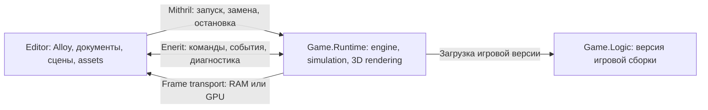

# TrueMoon.Aether: план игрового движка и редактора

Зафиксировано **2026-10-13** по обсуждению будущего кастомного движка для одной
не очень сложной 3D-игры. Состояние2026-10-21: **ENG0 определён;
ENG1 headless supervisor и ENG2 CPU viewport реализованы в bounded probe scope;
ENG3a compiler/artifacts, ENG3b checkpoint/restore, ENG3c Replace/rollback
и ENG3d Editor commands/20Replace proof реализованы2026-10-20; ENG4a/b/c, ENG4d bridge/ENG4d2 ordinary GPU Editor проверены в bounded scope;
ENG4e measured CPU/GPU baseline получен2026-10-21; ENG5a первый Vulkan3D renderer
и ENG5b gameplay input/camera реализованы/проверены2026-10-21;
остальной ENG5 и ENG6–ENG8 запланированы**.
[Статус направления](STATUS.md), [общий план](../PLAN.md),
[правила ведения](../PLANNING.md).

После UI INF7, выделения TrueMoon.Aether, ENG3/ENG4a–e и первого renderer ENG5a
и ENG5b input/camera следующий этап — ENG5c: комната/interaction/HUD. ENG4e сохраняет
CPU Debug budget breaches и allocation debt reference GPU staging path;
измерения не подтверждают performance будущего3D. Прежняя
[декомпозиция ENG3](#eng3-уточнение-плана-перед-реализацией--2026-10-19) сохраняет
исходный checklist; фактические результаты ведутся в HISTORY/STATUS.

## Цель и заданные требования

- Использовать TrueMoon как основу приложения, lifecycle, DI, диагностики и UI.
- Развивать компактный движок под одну игру; состав подсистем определяется её
  сценами и взаимодействиями. Жанр и точный масштаб пока не выбраны.
- В режиме редактирования редактор и выполнение игры находятся в разных
  процессах. Редактор сохраняет открытые документы, панели и несохранённые данные
  при остановке, обновлении или обычном crash игрового runtime.
- Game runtime выводит кадры в viewport редактора через отдельный transport.
- Обновление игровой логики не требует полной пересборки и перезапуска редактора.
  Первая надёжная реализация предполагает замену child runtime; возможность
  сохранить работающим и сам game process исследуется отдельно.
- Тот же игровой runtime должен иметь путь самостоятельного запуска игры.

Документ сохраняет исследования, принятые contracts и маршрут. Реализация и
фактические проверки отражаются отдельно в STATUS/HISTORY; сроков этот план
не задаёт. Порядок развития framework остаётся в общем плане; bounded MIT4/ENE4 results могут стать
основой игрового прототипа. Детальные engine/editor задачи ведутся только здесь.

## TrueMoon.Aether: одна engine assembly — 2026-10-19

По запросу пользователя engine implementation перенесён из ManualTests в
`TrueMoon.Aether/TrueMoon.Aether.csproj`, assembly `TrueMoon.Aether.dll`, net10.0.
Это экспериментальный модуль; выделение сборки не означает реализацию ENG3 или
готовность NuGet/3D/Hot Reload. [README](../../TrueMoon.Aether/README.md),
[проверки переноса](HISTORY.md#truemoonaether--2026-10-19).

| Часть | Текущее размещение |
| --- | --- |
| Engine contracts и implementation | Одна TrueMoon.Aether assembly: Sessions/Scenes/Transport/Frames/Checkpoints, supervisor/protocol, bounded control adapters, native child bridge, CPU ring/receiver/FrameSession |
| Engine tests | TrueMoon.Aether.Tests, direct ProjectReference на Aether; не executable reference/linked production copies |
| Editor/Game.Runtime composition | ManualTests/EngineSessionProbe: entry roles, concrete game factory, App lifetime, Alloy viewport и native fault scenarios |
| Игровая логика | ManualTests/Game.Logic: отдельная DLL с IGameSession implementation; не часть engine library |

Contracts не содержат transport/UI/native types; отдельная Contracts assembly
больше не требуется. Aether использует TrueMoon.Contracts/Enerit/Mithril и generator,
не зависит от Alloy/Argentis/Skia/Silk или Game.Logic. Пример подключает UI явно.
Файлы перемещены, не Compile-linked. Старый Engine.Probe.Contracts project и
EngineSessionProbe.Tests project заменены Aether/Aether.Tests в TrueMoon.slnx.

Уточнение2026-10-21: общая папка/namespace Aether.Contracts устранена. Engine
contracts размещены по назначению рядом с реализацией в Sessions, Scenes,
Transport, Frames и Checkpoints; они остаются в одной Aether assembly. Это
изменяет public namespace относительно прежней alpha, consumers обновлены вместе
с модулем. Общий TrueMoon.Contracts не получает engine-specific types.
Ранние записи ENG0–ENG2 ниже описывают размещение на дату реализации.

Game.Logic остаётся отдельной: независимая замена игровой DLL при стабильном
engine/host contract является требованием ENG3. Один модуль не объединяет CLR
процессы Editor и runtime, tests и исполняемый пример. ENG3a реализуется в Aether;
application-specific composition и проверочные сценарии остаются consumers.
Assembly API экспериментальный; в текущем рабочем csproj IsPackable наследуется
true из общих props. Историческое ограничение false при выделении снято;
публичная публикация остаётся отдельным шагом; independent package consumers
проверены при App integration, без объявления production readiness.

После [аудита](HISTORY.md#проверка-app-integration--2026-10-19) по запросу пользователя
реализован UseAether extension на IAppConfigurationContext. AetherOptions валидируются
и фиксируются при registration; identity/report directory/deadlines/observer/factory
не перечитываются из mutable options. RuntimeFactory callback создаёт свежий
App-owned instance, может использовать resolver для dependencies; отдельная
регистрация IRuntimeFactory и повторный UseAether отвергаются.

AetherHost — единственный App-owned disposable владелец Supervisor/Frames;
эти borrowed свойства не регистрируются отдельными disposable aliases. Runtime
factory имеет собственную единственную provider registration. Non-disposable
lifecycle adapter реализует IStartable/IStoppable: startup готовит модуль без
автоматического child launch, Stop permanently fences new starts, drains frames
и завершает supervisor/child. Concurrent shutdown join, failed cleanup наблюдаем
и допускает явный host Dispose retry. Sync/async provider disposal и startup
rollback также освобождают host; ошибки одного cleanup не отменяют попытку другого.

Headless/viewport examples используют UseAether; manual SupervisorShutdown удалён.
Игровая сессия запускается явно, UI/native child-role bootstrap выбирает consumer.
Новая dependency Aether на concrete App/bootstrap не нужна: contracts уже находятся
в TrueMoon.Contracts. Подробные [tests/native/package evidence](HISTORY.md#app-integration-реализация--2026-10-19)
отдельны от прежнего audit. На дату App integration следующим был ENG3a;
его [контракт2026-10-20](#eng3a-принятые-контракты--2026-10-20) реализован следующим шагом.

## ENG0: принятый scope первого прототипа — 2026-10-15

По решению пользователя после UI package/Hosting quality начинается ENG0.
Зафиксирован ограниченный прототип «Editor запускает игру, показывает кадр и
переживает замену/сбой child». На дату ENG0 это было проектирование без engine code
и собственных build/test/process/GPU результатов. Численные limits ниже — требования
предстоящих проверок, а не измеренная производительность.

### Сцена, платформа и границы

- Рабочая сцена для ENG5: одна комната, пол, несколько примитивов, одна камера
  и переключатель, меняющий цвет/свет одного объекта. WASD/мышь — перемещение
  камеры, E — взаимодействие, Escape — возврат ввода редактору. Это техническая
  demo-сцена; окончательный жанр игры не выбран.
- Первые ENG1–ENG3 используют детерминированный CPU pattern с номером кадра,
  identity и цветом из Game.Logic. 3D renderer, импорт моделей, physics/audio,
  generic ECS, Hot Reload и GPU sharing в эти этапы не входят.
- Baseline: Windows x64, net10.0, текущий .NET10 SDK по global.json, Cobalt default.
  Microsoft DI adapter сохраняется; отдельная engine provider matrix не требуется
  до появления нужной интеграции. Unit/protocol checks — xUnit.
- Editor UI: Alloy/Argentis, OpenGL/Skia с explicit fonts; одно основное окно,
  viewport и минимальные Play/Stop/Pause/Step/Rebuild команды/диагностика.
  Не требуется полный beta editor или новые меню/докинг/инспектор.
- Стартовый viewport1280×720, target30CPU frames/s; диапазон16..1920 ×16..1080
  физических pixels, при zero-size производство приостанавливается.
  UI Scale применяется только при переводе input coordinates.
- Проверочная GPU-конфигурация — текущая Windows x64/NVIDIA; это reference,
  а не minimum hardware promise. Целевой 3D API — Vulkan в ENG4/ENG5; выбор
  shared GPU transport и совместимого Editor backend проверяется отдельно.
  Первые CPU frames не требуют Vulkan presentation.

Допуск прототипа принят с открытыми K3 physical DPI, K7 NVIDIA, K8 real loss,
VRAM и final UI alpha. Эти проверки не являются условием ENG1–ENG3 и не считаются
пройденными. OpenGL выбран для первого Editor; это не исправление/обход K7.
Driver/Windows settings и остановка workaround search сохраняются.
Обычный child crash проверяется; изоляция общих GPU/driver faults не обещается.

### Состав первого host и ownership

Имена ниже выбраны в ENG0; probe projects созданы в ENG1, точные границы уточнены
в его разделе ниже:

| Часть | Назначение и зависимость |
| --- | --- |
| EngineSessionProbe | Один executable с ролями Editor и Game.Runtime в разных процессах; повторные сессии при живом Editor App |
| Engine.Probe.Contracts | Immutable domain snapshots/identity, control version и Game.Logic contract; wire DTO semantics уточнены в ENG1, frame codec/metadata реализованы в ENG2; без Alloy/Mithril/Skia типов |
| Game.Logic | Отдельная versioned DLL: меняет pattern/поведение и минимальный checkpoint через стабильный contract |

Первое размещение — ManualTests/EngineSessionProbe и соседние probe projects.
Публичные production namespaces/packages вводятся по результату прототипа.
Editor и runtime не делят CLR objects/devices. Раздельные Editor/Runtime executable
и самостоятельная поставка игры остаются последующими этапами ENG5/ENG7.

Минимальная Game.Logic boundary живёт только внутри child: entry создаёт одну
game session из SceneSnapshot; session принимает fixed Tick/input, выдаёт данные
pattern/interaction, поддерживает CaptureState/RestoreState и Dispose.
В contracts только primitives/DTO; timer, RPC, process lifetime и graphics resources
принадлежат host. Candidate DLL загружается один раз в новый child из build-ID
каталога. Отдельный collectible ALC/unload не требуется: release assembly связан
с reap её процесса. Scene/snapshot версии проверяет host до вызова logic.

Editor владеет supervisor, authoring model, документом сцены/его Dirty flag,
выделением, логом, compiler job, RPC client, frame receiver и presentation.
Child владеет live world/tick и frame producer. Изменения Play не записываются
в authoring document автоматически. Stop/Replace/crash сохраняют Editor state.

Supervisor — engine composition поверх **нового owned ChildProcessUnitHandle
на каждое поколение**. Объект не перезапускается после Stop. RestartPolicy=Never,
IsControlAppLifetime=false; смерть child не отменяет Editor lifetime.
Специализированный handle в probe передаёт session/bootstrap параметры через
свой ProcessStartInfo; process-wide environment редактора не меняется.
Используется тот же entry executable с child-role bootstrap и parent-exit handler.
Mithril остаётся владельцем launch/stop/kill/reap и process diagnostics.

Это выбранный ENG1 маршрут по существующим protected extension points; его
повторяемость ещё должна быть доказана. Запрещены reflection-доступ к handles,
borrowed attach, обход ownership через Process.GetProcessById и assumption,
что IUnitsController можно запускать после Stop. Если потребуются общие изменения
Mithril, выделить задачу в его плане; готовность external restart не заявлять.

### Identity и состояние сессии

Identity v1: SessionId(Guid), SessionGeneration(UInt64), HostContractId(строка
SHA256 стабильных host/contracts binaries), GameBuildId(строка SHA256 manifest),
ControlVersion=2 (ENG5b input wire,2026-10-21), FrameVersion=1, SnapshotVersion=1.
SessionId принадлежит открытой Editor session; generation увеличивается при каждом
запуске/rollback child и не используется повторно. PID — только ownership/diagnostics.
SurfaceGeneration(UInt64) отдельно увеличивается при новой frame allocation/resize.

Supervisor сериализует Start/Stop/Replace; UI не ждёт процесс/RPC/lock синхронно.
Состояния: Stopped → Starting → Ready(Paused) → Playing/Paused → Stopping → Stopped.
Failure переводит в Faulted с фазой/исходной причиной. CleanupFailed блокирует
следующий Start до явного успешного cleanup; failed reap не объявляется Stopped.
Building — отдельное состояние compiler job, текущая игровая сессия продолжает жить.

OS Started, Hello accepted, Scene loaded, Surface ready и FirstFrame presented —
раздельные отметки. Session Ready требует Hello и применённой сцены/режима;
ENG1 проверяет его без viewport. Viewport Ready в ENG2 дополнительно требует
surface acknowledgement и первого completed/presented frame текущего identity.
Поздние responses/frames старого
generation отбрасываются; после crash прежний кадр может остаться с явной отметкой
«runtime недоступен», но input и счётчики активной сессии к нему не относятся.

### Control v1: Enerit same-build pipes

Enerit передаёт только typed commands/DTO. Одинаковые host/contracts binaries
обязательны; Hello не превращает same-build wire protocol в schema negotiation.
Game.Logic меняется независимо, общий RPC contract при её rebuild не меняется.

| Операция | Результат/граница |
| --- | --- |
| Hello | Проверка expected SessionId/generation/HostContractId/GameBuildId/versions и launch nonce; mismatch завершает startup до normal operation |
| LoadScene | SceneId, DocumentRevision, до64entities со stable IDs/transforms/interaction flag; reply подтверждает применённую revision |
| SetMode / Step | Paused/Playing, fixed tick60Hz; Step разрешён только Paused и выполняет ровно1tick |
| InputBatch | Sequence, viewport/surface identity, нормализованные coordinates и pressed/released events; reply содержит applied sequence/tick |
| ConfigureSurface | Новый SurfaceGeneration, mapping descriptor/размеры/format; acknowledgement до публикации нового surface |
| CaptureCheckpoint / RestoreCheckpoint | SnapshotVersion/HostContractId/SceneId/revision/tick, camera transform и единственный interaction flag; restore подтверждает новый tick/state |
| GetStatus / Stop | Текущая phase/last applied sequence/tick/frame; stop acknowledgement не заменяет process exit/reap |

CommandSequence монотонен в generation; commands выполняются последовательно,
одна обычная операция in-flight. Reply подтверждает применение на tick boundary,
а не только получение bytes. Deadline/cancellation отменяет локальное ожидание,
не обещает remote handler cancellation. Interrupted command не повторяется
автоматически в новой сессии. Stop/cancel fence прекращает выдачу новой работы.

Serialized control payload ограничен64KiB включая scene/checkpoint/envelope,
ниже текущего Enerit1MiB. Assets передаются IDs/hash, не blobs внутри RPC.
Input queue ≤256events/≤64KiB: pointer-move/resize coalesce; key-up не теряется
молча — при overflow batch сбрасывается, отправляется ResetInput и фиксируется
diagnostic. При focus loss, Pause, Stop/Replace input capture освобождается.
Viewport принимает input только при focus и принадлежности активному surface.

Bootstrap descriptor передаётся только своему child: уникальные local endpoint/
mapping names, identity, ожидаемые versions и случайный nonce. Child проверяет
descriptor до открытия frame resources. Это локальная same-user модель доверия,
а не boundary против произвольного вредоносного процесса пользователя.

### Frame v1: CPU/shared RAM

Один producer/consumer,3slots фиксированной capacity. Editor создаёт mapping и
owns allocation; child открывает её после Hello и ConfigureSurface.
Header: magic/version/header length, session/generation/surface identity,
capacity, slot count и layout. Slot descriptor: slot index/state, UInt64 FrameId,
tick, width/height/stride/payload length, GameBuildId, pattern checksum и pixels.
Integers little-endian, explicit codec/checked offsets; CLR struct layout и
raw pointers не являются wire format. Точные offsets закрепляются codec tests ENG2.

Pixels: BGRA8, premultiplied alpha, sRGB, top-left, stride=width×4,
payload=stride×height; первый pattern opaque (A=255). Width/height/length/identity
валидируются до копирования. FrameId монотонен внутри session generation.
Runtime сообщает completed frame только после окончания записи bytes.

Slot states: Free → Writing → Ready → Reading → Free.
Metadata transitions защищены общим named mutex; pixels записываются/копируются
только после claim слота, вне metadata lock. Producer не трогает Reading;
consumer выбирает newest Ready, освобождает более старые Ready под lock.
При отсутствии Free producer пропускает frame: queue и память не растут.
Frame-ready event служит hint; scan header выполняется и после timeout, сигнал
не является доказательством наличия complete frame. Abandoned/corrupt metadata
делает весь transport terminal; продолжать чтение частично изменённого header нельзя.

Receiver работает вне UI thread, копирует Reading в свой bounded CPU buffer,
возвращает slot и публикует не более1pending latest image для UI. UI/graphics
доступ остаётся на owner thread; GPU никогда не читает чужой mapped slot.
Viewport/upload adapter реализован в ENG2 через owned CopyBgraPixels;
динамический CPU upload имеет свой bounded proof. Pattern corners/counter/CRC
проверяют actual pixels и отсутствие torn frames.

Resize создаёт новый SurfaceGeneration/mapping; одновременно допускается только
одна замена surface. Старый mapping живёт до завершения локальной copy/reader
и detach producer; UI image/texture освобождается после своего graphics use.
При crash/EOF invalid generation не публикуется, waits отменяются и ресурсы
закрываются после завершения readers. Переиспользовать mapping старого child нельзя.

### Limits, recovery и replacement

| Ограничение ENG1–ENG3 | Требование к реализации/проверке |
| --- | --- |
| Одновременные процессы |1game child +1compiler job; старый child полностью reap до candidate start; rollback не параллелен |
| Memory | Mapping ≤25MiB,3slots; при resize ≤2mappings/50MiB; ≤2private full-frame copies, UI textures/resources учитывать отдельно |
| Tick/frame | Fixed simulation60Hz, pattern target30fps; записать p50/p95 copy/upload/frame latency и dropped frames; performance pass до baseline не заявлять |
| Startup | Общий deadline15s: OS start/Hello/scene, а с ENG2 также surface/first frame; фаза failure обязательна |
| Command/checkpoint | Обычная операция2s; heartbeat раз в1s, отсутствие ответа5s → Faulted; paused runtime heartbeat сохраняет |
| Metadata lock | UI thread не обращается к mutex; receiver/producer short waits, недоступность100ms → transport fault |
| Stop | Graceful3s, затем owned kill/reap≤5s; ошибка cleanup остаётся наблюдаемой |
| Build/Replace | Build deadline120s; replace отдельно≤45s включая checkpoint/stop/start/restore и максимум1rollback attempt |
| Окружение | Debug apphost и published Release, framework-dependent Windows x64; минимум20Start/Stop и20Replace cycles в одном Editor process |

Rebuild собирает candidate Game.Logic в новый build-ID каталог с manifest/hashes;
активные DLL не перезаписываются. Compile failure оставляет текущую сессию,
последний рабочий build и Editor state неизменными. Последовательность replacement:
pause на tick boundary → bounded checkpoint → stop/reap → candidate start →
restore поддержанного snapshot → first frame → возврат прежнего Playing/Paused.

Checkpoint failure оставляет старую paused session с ошибкой и возможностью Resume;
автоматического разрушительного reset нет. Snapshot mismatch не мигрируется
произвольно: default replacement отменяется, Reset-from-document — явный выбор.
Если candidate не стартовал/не восстановился, supervisor один раз пытается запустить
last-known-good build с сохранённым checkpoint под новым generation. Неудачный
rollback оставляет Editor usable/Faulted; loops/скрытого autorestart нет.

После crash восстановление возможно только из последнего успешно сохранённого
checkpoint; automatic restore не обещает состояние умершего процесса.
Хранятся last-known-good и candidate build directories; удалять загруженную версию
или каталог с незавершённым cleanup нельзя. Closing Editor отменяет owned compiler,
останавливает child и drains workers/readers; только после этого закрывается UI.
Forced parent-exit проверяется отдельно от graceful Editor close.

### Первый исполнимый шаг: ENG1

Исходный scope: создать probe host/contracts/minimal Game.Logic stub и engine-owned supervisor.
ENG1 пока headless: доказать identity/Hello/status,20повторных Start/Stop в одном
живом Editor App, два sequential child generations, stale reply rejection,
startup timeout/cancel, child crash/disconnect и own cleanup/parent exit.
State fixture (document revision/Dirty/selection/панели) должна пережить эти сценарии.
Все waits bounded, logs содержат identity/phase/PID/reap и исходную error.

ENG2 добавляет одно Alloy/OpenGL окно, CPU ring и visible pattern; ENG3 — compiler,
versioned DLL replacement/checkpoint/rollback. Это следующие code этапы,
а не результаты ENG0. На каждом этапе отдельно проверяются success/fault/cleanup;
unit checks и Debug/published Release process reports не подменяют друг друга.

## ENG1: headless supervisor — 2026-10-17

Реализованы ManualTests/EngineSessionProbe, Engine.Probe.Contracts, Game.Logic
и EngineSessionProbe.Tests; зарегистрированы в TrueMoon.slnx, folder Engine.
Это probe-only API, не production engine packages. [Подключение/запуск](../../ManualTests/EngineSessionProbe/README.md),
[датированные команды/failures/evidence](HISTORY.md#eng1-headless-supervisor--2026-10-17).

Supervisor сериализует Start/Stop и control commands; fresh owned Mithril handle
и Enerit client принадлежат каждому launch. Editor Cobalt App живёт между сессиями.
OS start/Hello/scene acknowledgement/Paused разделены; identity/nonce/versions,
sequence/operation/PID и applied revision/mode/tick проверяются до публикации state.
Stop отменяет локальный wait и ставит fence на queued/late work, повтор команд
не выполняется. Crash/disconnect/timeout дают Faulted с фазой и причиной; owned
cleanup обязателен. CleanupFailed блокирует launch до успешного явного retry cleanup.

На завершении ENG1 Game.Logic — минимальный fixed-tick stub без frames/checkpoint/restore.
Поддержаны Hello, LoadScene, SetMode, Step, GetStatus, Stop; surface и frame transport
добавлены ENG2. InputBatch остаётся отдельной будущей engine input задачей;
compiler/versioned replacement и checkpoint/restore относятся к ENG3.
Число60Hz в stub — target timer, не измеренная performance guarantee.
Контракт полного Game.Logic checkpoint/restore из ENG0 остаётся требованием ENG3.

Явные уточнения реализации относительно концептуальных DTO ENG0:

- Enerit generator поддерживает mutable DTO classes и Int64 scalar. Wire generation,
  sequence/tick несут точные UInt64 bits в Int64; unsigned domain counters и checked
  increments сохранены, bit conversion применяется только на wire boundary.
  Domain identity/SceneSnapshot immutable; scene проверяется и копируется до game mutation.
- Generated request/response payload ограничивается actual serialized length≤64KiB
  probe adapter, без изменения общего Enerit1MiB limit или schema negotiation.
- HostContractId — SHA256 manifest host/contracts/Enerit/Mithril binaries,
  GameBuildId — SHA256 manifest Game.Logic.dll. Bootstrap сверяется child с собственными
  binaries до RPC. Same-build/local same-user trust scope сохраняется.
- До ENG2 readiness проверяется без surface/first-frame. Native proof остаётся
  headless; отсутствие UI/driver faults не объявляется их изоляцией.

Acceptance выполнен на Windows x64/net10.0/SDK10.0.402:31engine cases Debug и
Release,32native cases Debug apphost/published Release, включая по20Start/Stop,
stale reply/startup/command cancel/timeout/crash/disconnect/heartbeat/forced kill/
parent exit и authoring fixture. Полный Debug solution test entry point прошёл
1305tests; nonincremental build0errors/1207warnings. Source/binary fingerprints
зафиксированы; новый independent engine package consumer не создавался.
На завершении ENG1 следующим шагом назначен ENG2; его реализация описана ниже.
Остальные criteria и UI hardware blockers сохраняются.

## Границы и владельцы

Новая часть: игровой цикл, world/scene, камеры, 3D renderer, assets, интеграция
физики/звука, редактор и процессная связь viewport. Engine implementation и contracts
теперь объединены в TrueMoon.Aether. Editor/Game.Runtime остаются ролями отдельного
примерного executable, Game.Logic — отдельной игровой DLL. Production Editor/
standalone delivery и versioning уточняются в своих этапах; текущая
экспериментальная сборка не закрывает их.

| Направление | Ответственность |
| --- | --- |
| Engine/editor integration | Общий сценарий, game sessions, build replacement, frame transport, состояние и editor viewport |
| [Core](../core/PLAN.md) / [Cobalt](../cobalt/PLAN.md) | Bootstrap/configuration/diagnostics, DI и lifetime подсистем; новые общие изменения принадлежат этим модулям |
| [Mithril](../mithril/PLAN.md) | Owned process startup/stop/reap/restart; изменение unit lifecycle остаётся модульной задачей |
| [Enerit](../enerit/PLAN.md) | Команды/события и wire contracts; передача кадров имеет отдельный контракт |
| [Alloy/Argentis](../alloy/PLAN.md) | UI редактора/HUD, input/focus/layout и интеграция viewport; существующие K1–K9/PA1–PA10 сохраняются |
| Game | Конкретные правила игры, игровые компоненты, контент и поддерживаемые snapshot migrations |

Bootstrap/DI/IPC/units сохраняют независимость от UI и 3D renderer. Подсистемы
создаются через DI при startup; frame/tick loop работает с прямыми ссылками.
Сначала простой world/entities/components по потребностям игры. Generic ECS,
render graph и распределённая симуляция не назначаются обязательными этапами.
Физика и audio могут использовать готовые библиотеки; выбор следует из игры.

## Предлагаемая архитектура

Editor владеет своим окном, UI, authoring documents и приёмником кадров.
Game.Runtime владеет live game world, game loop, renderer и producer ресурсов
кадров. Общая библиотека движка может загружаться в обоих процессах, но их
objects/devices/lifetimes независимы. Editor передаёт DTO, asset/entity IDs и
версии, а не ссылки на CLR objects или raw native pointers другого процесса.

Редактируемый scene document является источником authoring данных. Runtime
получает snapshot/deltas и владеет состоянием симуляции. Сохранение результатов
Play обратно в документ должно стать явной операцией. Scene editing и Play
различаются simulation policy: pause, resume и single-step; камера preview,
viewport resize и input доступны в обоих режимах по согласованным правилам.

В runtime Editor-mode рендеринг offscreen; окно presentation принадлежит Editor.
В standalone-mode runtime создаёт своё окно/presentation. Симуляция использует
фиксированный шаг, renderer получает подготовленное состояние сцены. Потоки,
частоты и необходимость нескольких frames in flight выбираются после baseline.

## Управление игровой сессией

- Каждая сессия имеет session ID, generation, game build ID и версии общих
  control/frame/snapshot contracts. PID используется для ownership/диагностики,
  но не заменяет session identity.
- Различать OS start, runtime readiness, готовность surface и первый completed
  frame. Timeout/ошибка каждого шага наблюдаемы; malformed/stale сообщения не
  переключают viewport на чужое поколение.
- Game crash, disconnect и исчерпание restart budget переводят editor viewport
  в наблюдаемое состояние unavailable. Editor lifetime при этом сохраняется;
  его закрытие останавливает принадлежащие ему game sessions и compiler jobs.
- Замена runtime является явной операцией supervisor. Automatic restart policy
  и работа под debugger задаются отдельно; нельзя скрывать причину crash.
- Нужны повторные Play/Stop/Replace без пересоздания Editor App. Конкретный API
  адаптера/supervisor и расширения Mithril определяются по ownership contract.
- Deadlines/cancellation не блокируют UI thread. Failed cleanup диагностируется;
  ownership не считается завершённым, пока нужные процессы/resources не очищены.

Текущий [IUnitsController](../../TrueMoon.Mithril/IUnitsController.cs) содержит
Spawn, а [UnitsController](../../TrueMoon.Mithril/UnitsController.cs) запрещает
launch после Stop/failed Start и не поддерживает nonempty launch parameters.
Это существующая граница, а не готовый editor session supervisor. Child handle
запускает текущий entry application; отдельный Game.Runtime executable требует
явно выбранного owned launch path. Attach к чужим процессам не подразумевается.

## Обновление игровой логики и состояния

Для C# изменение исходников требует новой сборки либо compiler/runtime deltas.
Цель — обновлять игровую часть, сохраняя Editor и неизменившиеся engine binaries.
Общие editor/runtime contracts остаются стабильными при смене Game.Logic.

Базовый цикл:

1. Собрать candidate game version в отдельном каталоге; идентифицировать build.
2. При compile failure показать diagnostics и сохранить предыдущую рабочую
   игровую версию. Загруженные DLL не перезаписываются новым build.
3. На границе tick получить поддерживаемый checkpoint/snapshot с version/schema.
4. Полностью остановить/reap старую сессию и запустить candidate. Для ENG3 принят
   только один game child; overlapping sessions потребуют отдельного решения.
5. Применить поддержанный snapshot, согласовать transport и подтвердить первый
   presented frame восстановленного состояния. Произвольная migration не обещается.
6. Показать кадры нового generation; retire прежние ресурсы после их использования.
7. При candidate failure оставить Editor usable, сохранить исходную причину и
   обеспечить явный возврат к последней рабочей версии или исходной сцене.

Сначала snapshot включает сцену, камеру и минимальное игровое состояние.
Полное восстановление arbitrary runtime object graph не обещается. Новые/удалённые
компоненты и поля требуют правил migration либо явного reset. После crash
доступен последний сохранённый checkpoint, а не snapshot уже умершего процесса.

.NET Hot Reload — последующее ускорение для поддерживаемых изменений. Rude edits
имеют маршрут через child replacement. Collectible AssemblyLoadContext —
альтернативное исследование: unloading cooperative, references/threads/callbacks
могут удерживать старые assemblies. Оба механизма не являются предусловием
первого работающего editor/runtime прототипа.

## ENG3: уточнение плана перед реализацией — 2026-10-19

Документальная сверка после завершения UI INF7. На дату сверки ENG3 не реализован; результаты
ENG1/ENG2 и INF7 имеют прежние даты/scopes. Порядок остаётся ENG3 → ENG4,
без обязательного расширения INF5/RTE, без production engine packages/Hot Reload.
Ниже декомпозиция существующего ENG3; она не добавляет новый игровой renderer/input.
[Findings и ссылки на code](HISTORY.md#сверка-плана-после-ui-inf7--2026-10-19).

### Подэтапы и наблюдаемый результат

| ID | Работа | Критерий перехода дальше |
| --- | --- | --- |
| ENG3a | Compiler job, immutable build artifact и выбор GameBuild на каждый launch | Candidate собирается без пересборки/перезаписи активного host. Manifest/hashes и разрешённые dependencies проверены; child загружает выбранную DLL, Editor её не загружает. Compile failure/cancel/timeout сохраняют действующую session/build/document |
| ENG3b | Минимальный checkpoint/restore contract | На tick boundary фиксируются version/host/scene/revision/tick, camera transform и interaction flag. Payload ограничен64KiB; invalid/mismatched snapshot не применяется частично. Состояние восстанавливается до первого показываемого кадра candidate |
| ENG3c | Serialized Replace и однократный rollback | Pause/capture → stop/reap → start/restore/first-present → прежний mode. Новые generation/identity, один game child; failed cleanup блокирует launch. Candidate failure сохраняет исходную ошибку и допускает не более1rollback; rollback failure оставляет usable Editor/Faulted |
| ENG3d | Интеграция команд Editor и воспроизводимый proof | В Debug apphost и published Release по20Replace при одном Editor App/window. Поведение/pixels меняются между builds, checkpoint и authoring state сохраняются; compile/candidate/rollback/cancel/close/cleanup failures проверены отдельно. Повторены релевантные ENG1/ENG2 regressions |

ENG3a–d/ENG4a–d2 реализованы2026-10-20; ENG4e baseline получен2026-10-21,
следующий функциональный этап — ENG5.
Production Core/Cobalt/Enerit/Mithril/UI APIs заранее не расширяются; общая проблема
модуля при обнаружении получает свою задачу.

### ENG3a: принятые контракты — 2026-10-20

По согласованному порядку сначала зафиксирована исходная точка dc64b63, затем
реализованы compiler/artifact/child loader в TrueMoon.Aether. Checkpoint/Replace/
rollback и UI команды replacement не входят в ENG3a.

- `Builds.GameBuildRequest`: trusted local SDK net10.0 csproj, entry DLL/type,
  SourceRevision и explicit private DLL names; request/options snapshots. Project
  потребляет frozen AetherContractPath как Reference/Private=false; ProjectReference
  builds и shared build servers отключены. Compile outputs/obj идут в owned job.
- `GameBuildArtifact`: schema1/net10.0, HostContractId, SHA256 общей Aether assembly,
  entry DLL/type, SourceRevision, sorted file names/lengths/SHA256. Hash manifest
  задаёт directory/BuildId. Manifest≤64KiB,1..16flat managed DLL,≤64MiB/file и
  ≤128MiB total; paths/links/duplicates/extra payload/framework/Aether copies и
  undeclared managed references отвергаются. Полный candidate публикуется atomic
  directory move, active artifacts автоматически не удаляются/не перезаписываются.
- `GameBuildCompiler`: один owned job/App, отдельный от session gate;120s maximum
  build budget (options могут уменьшить). Cancel/timeout/failure reaps compiler
  tree, сохраняет bounded stdout/stderr (по1Mi characters) и удаляет staging/work.
  Timeout отличается от caller/close cancellation. Failed cleanup удерживает
  ownership и блокирует новый job до явного successful disposal retry.
- `AetherHost.Builds` — borrowed App-owned compiler, не отдельный disposable alias.
  App Stop закрывает compiler/session admission и независимо drains build/frames/
  supervisor; viewport Closing выполняет terminal engine cleanup до UI disposal.
- Completion только возвращает artifact с SourceRevision, без auto-apply. Caller
  сопоставляет revision с текущими исходниками и явно выбирает следующий Start.
  Stop во время build не запрещает получить candidate, но completion не запускает
  новую game generation. Supervisor/Frames принимают artifact на каждый launch;
  existing session сначала полностью Stop/reap. Legacy fixed build path сохранён.
- Native lease pins все artifact files до successful child reap. Runtime bootstrap
  несёт directory/expected BuildId; child повторно проверяет manifest/contract/hash,
  GameBuildLoader создаёт IGameSession в отдельном AssemblyLoadContext, sharing
  только loaded Aether contract и framework. Private dependencies — только manifest;
  native game dependencies/assets вне scope. Editor читает metadata/bytes без load.
  Это trusted-local dependency policy, не security sandbox; unload cooperative,
  окончательная runtime resource boundary — process exit.
- Self guard примера явно изменён с абсолютных2minutes на2minutes без успешного
  control request. Heartbeat живого Editor продлевает его, поэтому build120s не
  прерывает old session. Parent monitor и startup/command/heartbeat limits прежние.
  Replace45s/rollback budget относится к ENG3c и этим шагом не реализован.

[Публичный пример](../../TrueMoon.Aether/README.md#сборка-и-выбор-игровой-версии--eng3a),
[тесты/команды/границы](HISTORY.md#eng3a-compiler-artifacts-и-child-loader--2026-10-20).

### ENG3b: принятые контракты — 2026-10-20

Минимальный checkpoint реализован в Aether.Contracts без новой bootstrap/UI
dependency. Optional `ICheckpointGameSession` сохраняет возможность запуска игр,
реализующих только IGameSession; capture/restore такой игры возвращает Unsupported.

- Snapshot v1: host SHA256, source-build SHA256, scene ID/revision, UInt64 tick,
  camera XYZ + pitch/yaw/roll в radians и interaction bool. Capture выполняется
  в Paused под runtime gate на tick boundary и не меняет игру. Camera finite,
  scene1..128 UTF16 characters со strict UTF8, revision≥0. Игра применяет Restore
  атомарно после полной проверки; expected rejection не меняет состояние.
- Canonical little-endian TMCK: magic/version@0/4, host/build32bytes@8/40,
  scene UTF8 length UInt16@72, revision Int64@74, tick UInt64@82,6float32@90..113,
  flag@114, scene@115 и SHA256 последних32bytes. Fixed147bytes + scene1..512bytes;
  общий accepted payload≤64KiB, без trailing bytes. Codec проверяет схему,
  integrity/length/UTF8/finite values и поля до вызова game restore. Это integrity,
  не аутентификация недоверенного кода; same-user trusted-local scope сохраняется.
- GameCheckpoint.ValidateFor проверяет host/scene/revision до остановки старого
  child и создания нового generation. Source build — provenance; новая совместимая
  сборка может отличаться. Generic object graph/schema migration не добавлены.
- CaptureCheckpoint/RestoreCheckpoint — новые same-build generated control commands.
  Captured/Restored/Unsupported/CaptureRejected/RestoreRejected подтверждают sequence.
  Только валидированный explicit capture rejection сохраняет paused child,
  heartbeat и Resume. Неподтверждённое исключение, timeout/disconnect, mutation или
  malformed acknowledgement сохраняют ENG1 Faulted/cleanup policy.
- Restore доступен только при fresh startup с SessionLaunch.RequireRestore:
  Hello → LoadScene → RestoreCheckpoint → SetMode(Paused) → ConfigureSurface →
  first-present. Pending restore блокирует tick/mode/surface/frame production.
  Runtime проверяет полное recaptured state после применения. Failed candidate
  restore очищается и не объявляется ready. Startup15s включает restore/first-present.
- Supervisor/Frames.StartAsync overloads принимают checkpoint с fixed или выбранным
  artifact. Start без checkpoint явно reset из документа. Live in-place restore и
  автоматический Stop/Replace/rollback не добавлены. Stop/close отменяют pending
  restore и drains child/frames по прежним ownership/fence rules.

[Публичный пример](../../TrueMoon.Aether/README.md#checkpoint-и-восстановление--eng3b),
[тесты/native evidence](HISTORY.md#eng3b-checkpoint-и-startup-restore--2026-10-20).
Следующий ENG3c должен объединить эти primitives в serialized Replace с общим45s
monotonic budget/резервом однократного rollback и восстановлением прежнего mode.

### ENG3c: принятые контракты — 2026-10-20

App-owned `AetherHost.Replacement.ReplaceAsync(request)` объединяет primitives ENG3a/b.
Request фиксирует candidate artifact, expected current session identity, immutable
scene и актуальную expected source revision. До Pause/Stop проверяются identity,
source revision, scene ID/revision, manifest/host/dependencies; оба managed artifacts
удерживаются pins до завершения transaction. Fixed old build поддержан отдельно.

- Общая reservation Supervisor/Frames запрещает конкурирующие Start/Step/mode/
  capture/Resize и вторую Replace. Начатые раньше операции сначала drains. Stop и
  terminal App close отменяют reservation до ожидания gates; поздний rollback или
  candidate не создаёт child. Heartbeat/frame fault monitoring остаются активными.
- Default monotonic total45s начинается при принятии reservation. Forward window18s
  включает preflight/Pause/capture/old stop/reap/candidate startup/first-present/
  возврат прежнего mode. Остальные27s зарезервированы для candidate cleanup≤10s,
  rollback startup/first-present≤15s и mode≤2s. Каждый wait получает оставшийся
  budget; local maxima не суммируются независимо. Options могут уменьшить бюджеты:
  Total≤45s, Forward≤18s, Cleanup≤10s, все положительны, Forward+Cleanup<Total.
- До destructive Stop подтверждённый capture rejection/локальная отмена сохраняют
  old process; прежний mode восстанавливается при здоровом канале. Unknown command
  outcome сохраняет Faulted/cleanup policy. Snapshot совместим с exact scene revision.
- После old reap candidate failure допускает не более одного запуска прежнего
  artifact/fixed build с тем же snapshot, fresh generation/nonce и first-present,
  затем прежний mode. Исходная candidate error остаётся InnerException результата
  ошибки, recovery error хранится отдельно. Rollback failure не вызывает новый retry.
- Caller cancellation после Stop также пытается восстановить old build в оставшемся
  budget; caller token не отменяет recovery. Explicit Stop/close отменяют и recovery,
  не возобновляют игру. Ошибка transaction содержит phase/rollback outcome и cause.
- Истёкший deadline не означает reap. Незавершённый owned cleanup task и lease
  удерживаются в CleanupFailed, новый launch запрещён до явного успешного Stop retry.
  Late cleanup наблюдаем, сам не запускает игру и не снимает failure. App drain
  ждёт завершения accepted Replace перед освобождением зависимых engine resources.

Это ENG3c scope. Команды UI,20Replace cycles и полный failure/pixel proof относятся
к следующему ENG3d; отдельные native/viewport regression cases проверяются уже здесь.
[Публичный API](../../TrueMoon.Aether/README.md#замена-игровой-сборки--eng3c),
[точные tests/команды/evidence](HISTORY.md#eng3c-serialized-replace-и-rollback--2026-10-20).
Visible surface и headless поддержаны; suspended surface отвергается до Pause.
Caller задаёт актуальную source-input revision и expected identity; UI отменяет
запрос при смене selection/document. Автоматическая подписка на editor model в Aether
не вводится. Уже начатый Resize завершается до принятия reservation; ожидающий
Replace, superseded by Stop/close, не принимается и не запускает child.

### ENG3d: принятые контракты — 2026-10-20

`AetherHost.Editor` — App-owned UI-independent controller Build/Select/Start/Replace/
Play/Pause/Step/Cancel/Stop. Immutable context фиксирует build request/source revision,
scene snapshot и selection ID; каждое SetContext меняет editor version, отменяет
текущую работу и снимает candidate. Build completion также проверяет исходную
session identity: поздний artifact не становится выбором для другой session.
Select готового artifact — явная команда. Replace не совмещён с автоматическим build.

Cancel завершает текущую операцию с обычной recovery policy ENG3c; Stop инвалидирует
выбор и немедленно fences runtime/recovery, затем drains command/compiler. Close
permanently closes admission; App drains Editor до disposal зависимых ресурсов.
UI показывает operation/source/active/candidate и полную исходную/recovery error.
Scene/Dirty/selection/panels автора не меняются при симуляции и failure.

Native proof в Debug apphost и published Release: один Editor App/Alloy OpenGL
window,20последовательных A/B Replace в Paused/Playing, фактические selected DLL
path/hash, dynamic body color в GPU pixels, restored first-frame tick и полный
camera/interaction checkpoint из runtime diagnostics. Отдельный Step после restore
проверяет новое поведение игры. UI/session/window identity и authoring сохраняются.
Существующий viewport smoke и headless matrix остаются regression runs.

Failure cases: compile error/deadline/cancel, missing/tampered artifact, capture
reject/unknown outcome, candidate Hello/restore/first-frame failure, rollback failure,
Stop/close во время build/replace, stale completion и failed cleanup/retry. Последний
случай использует явно обозначенную injected lease Stop failure с реальным owned
child, без заявления о воспроизведении OS kill failure. Proof уменьшает compiler/
replacement deadlines в допустимых limits; default ENG3c отдельно повторяется.
Runner выделяет отдельный editor-proof process на конфигурацию, deadline300s для
всего proof; individual build/Replace limits сохраняются. Драйверы/Windows settings
не меняются, UI hardware/release/performance и ENG4–ENG8 остаются отдельными.

Реализация и фактические проверки ENG3d завершены; [tests/commands/evidence](HISTORY.md#eng3d-команды-editor-и-20replace-proof--2026-10-20).

### Что уточнить до реализации соответствующего подэтапа

Ниже вопросы исходной сверки2026-10-19. Artifact/loader и build cancellation
решены ENG3a выше, checkpoint/recovery — ENG3b; transaction budget/fences — ENG3c.
Editor context/proof — ENG3d. Вопросы ниже сохранены как исходный checklist; текущая точка — ENG5.

1. **Artifact/loader boundary (ENG3a).** Нынешние direct ProjectReference и
   `new ProbeGame()` не выбирают versioned DLL; supervisor хранит fixed GameBuildId,
   BuildIdentity читает DLL из AppContext.BaseDirectory. Нужен validated descriptor
   выбранного build на каждый generation, включая rollback. Build job сначала пишет
   в собственный staging directory, build-ID определяется по готовому manifest;
   неполный output не становится candidate. Определить разрешённый dependency set
   и единый contract assembly; не создавать второй несовместимый экземпляр contracts.
   Active/last-known-good artifacts неизменяемы и не удаляются до успешного reap.
2. **Publication/compatibility (ENG3b).** Текущий FrameSession.StartAsync уже ждёт
   first-present. Для Replace restore должен предшествовать разрешению публикации
   candidate frames; первоначальный default-state кадр не считается restored readiness.
   Проверяемую version/scene/revision совместимость определить до остановки старого
   child. Отказ внутри candidate restore относится к rollback. Reset-from-document
   остаётся явным выбором; миграция произвольного object graph не входит в ENG3.
3. **Recoverable checkpoint failure (ENG3b).** Сейчас любой CommandAsync error
   вызывает FailAsync/cleanup, а RuntimeProtocol не подтверждает command sequence
   при exception. Это не даёт обещанного Resume после отказа CaptureCheckpoint.
   До кода определить подтверждённый nonterminal отказ checkpoint отдельно от
   transport/protocol fault с неизвестным исходом; проверить sequence, heartbeat,
   сохранность paused old child и возможность Resume. Не обещать recovery после
   произвольного RPC timeout без отдельного согласования с fault policy ENG1.
4. **Races и cancellation (ENG3a/ENG3c).** Build job не держит session gate120s.
   Его результат связан с job/source revision и ожидаемым session/generation/build;
   завершившаяся после Stop/нового Start/правки документа сборка не применяет себя
   автоматически к другой сессии. До остановки old runtime отмена сохраняет его;
   после остановки отдельно определить recovery и обязательный owned cleanup.
   Editor close ставит fence, отменяет compiler и drains workers/child/readers до UI
   disposal; поздний build/rollback не запускает новый child после close.
5. **Единый deadline (ENG3a/ENG3c).** Сохранены build120s и replace45s из ENG0.
   Local maxima startup15s/command2s/stop3+5s нельзя независимо суммировать для
   candidate и rollback. До кода записать распределение общего monotonic budget,
   резерв rollback и правила cleanup при исчерпании deadline; timeout не означает
   успешный reap. Runtime self guard2minutes тоже сверить: он не должен прерывать
   допустимый build120s при живом Editor. Изменение принятого общего лимита требует
   явной записи решения, эта сверка численные limits не меняет.

### Proof и границы вывода

До запуска зафиксировать сценарии, counts/deadlines и cleanup assertions. Нужны
различимые builds A/B, фактический loaded path/hash в child и отсутствие Game.Logic
в Editor CLR; одних changed manifest/цвета toolbar недостаточно. Для checkpoint —
non-default state до Replace и восстановленный tick/state/pixels после него,
отдельно Playing/Paused, mismatch и explicit reset. Authoring revision/Dirty/
selection/panels и живой Editor App/window сохраняются при failure.

Matrix включает compile error/timeout/cancel, missing/tampered artifact, snapshot
reject/capture error, candidate startup/restore/first-frame failure, rollback failure,
Stop/close во время build/replace, stale completion и failed reap/retry. Задачи и
результаты отражаются в engine STATUS/HISTORY; source/binary/native/report hashes,
partial logs, owned child/compiler completion и mappings0 проверяются явно.
INF7 UI runner не подменяет ENG3 proof; engine runner расширяется в своём scope.
Package/standalone/3D/shared GPU/long performance остаются ENG4–ENG8.

## Команды и передача кадров

### ENG4a: capabilities и transport decision — 2026-10-20

Первый подэтап ENG4 проверяет только eligibility следующего import-probe. Pure
contracts/decision находятся в Aether/Gpu без UI/native dependencies; transient
collectors — в существующем EngineSessionProbe. GPU resources/handles не создаются,
transport не переключается автоматически. Unsupported/invalid evidence оставляет
CPU path с явным reason. Actual import/pixels/completion ещё не проверены.

Windows x64 profile v1: Vulkan1.1 producer, одна graphics-capable physical device,
совпадение ненулевых deviceUUID и driverUUID с единственным GL device. Query именно
R8G8B8A8_UNORM/2D/optimal/single sample, usage ColorAttachment|Sampled|TransferSrc|
TransferDst; max extent/resource size покрывают запрошенный viewport в16..1920×16..1080. OPAQUE_WIN32 NT
memory/semaphore export и compatible handle bits обязательны; DedicatedOnly
сохраняется в результате, Importable Vulkan диагностируется без требования, поскольку
importer — OpenGL. GL требует memory_object/semaphore +обе win32 extensions,
все используемые entry points, RGBA8 support/optimal tiling и fence polling.
OS bitness/version/session identity/profile errors не превращаются в GPU readiness.

Native command запускает App-owned runtime с read-only Vulkan instance/physical
queries, получает correlated diagnostics и сравнивает с текущим Alloy OpenGL
context на UI owner. Это local prototype evidence, не расширение control wire v1.
Schema1 и full SessionIdentity проверяются до capability decision; production
capability exchange/OS handle transfer вводятся ENG4b отдельным contract.
Debug apphost/published Release сохраняют raw query results/extensions/UUIDs,
typed decision/reasons, cleanup/process и source/binary fingerprints.

ENG4b должен сначала доказать dedicated image import и CPU-reference pixels.
OPAQUE_WIN32 handles дублируются только в owned peer, recipient closes свою копию
по правилам API; descriptor несёт session/surface/slot generations, format/color/
alpha/origin, allocation size/offset и dedicated flag. Producer выполняет layout/
queue release и сигнализирует ready binary semaphore. Editor не ставит GPU wait
на ещё не подтверждённый signal: отдельное CPU-visible fence completion/notification
предшествует enqueue wait, identity/generation перепроверяются. GL completion
polling и return semaphore не позволяют переиспользовать slot до завершения UI use.
ImportAck/Ready/Release/Retire имеют bounded deadlines, disconnect/crash/cancel
fence, retained ownership при unconfirmed GPU use и явный unavailable outcome.
Точный bounded wait/device-loss cleanup требует executable proof ENG4b–d; наличие
extensions не доказывает отсутствие GPU hang/driver isolation. Следующие шаги:
ENG4b one-frame import/completion/pixels; ENG4c slots/resize/stop/restart/crash;
ENG4d integration/actual first-present/replacement и resource/validation checks.
UI K3/K7/K8/VRAM/final alpha, drivers/Windows settings и остановка K7 workaround
search сохраняются. CPU-only режим остаётся рабочим до отдельного выбора GPU path.

ENG4a реализован/проверен; reference допускает ENG4b import-probe, CPU selected.
[Результаты/границы](HISTORY.md#eng4a-gpu-capabilities-и-transport-decision--2026-10-20).

Нормативные основания сверены2026-10-20:
[Vulkan ID properties](https://docs.vulkan.org/refpages/latest/refpages/source/VkPhysicalDeviceIDProperties.html),
[external image tuple](https://docs.vulkan.org/refpages/latest/refpages/source/VkPhysicalDeviceExternalImageFormatInfo.html),
[GL memory/semaphore/tiling/wait semantics](https://registry.khronos.org/OpenGL/extensions/EXT/EXT_external_objects.txt),
[Win32 import/NT handle ownership](https://registry.khronos.org/OpenGL/extensions/EXT/EXT_external_objects_win32.txt).

### ENG4b: one-frame import contract — 2026-10-20

Implementation находится в единственной TrueMoon.Aether assembly: GpuResourceHost
на AetherHost.Gpu owns connections/producer/imports и closes admission/drains до
обычного session shutdown. App startup не создаёт GPU. Low-level resources доступны
через этот owner, UI context/resolver/owner dispatch заимствованы и живут дольше
cleanup. Failed cleanup сохраняет resource/error для explicit retry. Добавляется
существующий Silk.NET.Vulkan2.23.0 dependency; UI/Skia references в Aether нет.

Отдельный same-build probe pipe (CurrentUserOnly, bounded64KiB frames, strict
session/surface/frame/slot/schema/sequence) не меняет control/frame wire v1.
Offer содержит RGBA8_UNORM/sRGB/premultiplied/top-left profile, dedicated offset0
allocation≤64MiB, exact adapter/driver и3различных NT handle tokens. Editor pulls
duplicates только через owned NativeRuntimeLease process handle; OpenProcess/PID
attach/inheritance не используются. GL не получает ownership NT handle: originals
и duplicates освобождаются каждым владельцем, imports держат native references.

Один Vulkan optimal image и staging upload формируют asymmetric RGBA reference
с alpha/channel/origin markers; это transport proof без3D renderer. ImportAck
предшествует Produce. Queue-family release в EXTERNAL/layout GENERAL и ready
binary semaphore включены в submission с fence. Ready reply требует observed
CPU fence completion; только после него GL wait/readback. GL signal return +fence
poll timeout0 завершают use, Release требует CPU-observed GL completion. Vulkan
acquire/return wait ставится только после этого подтверждения; fence/Retire
предшествуют освобождению. Нет DeviceWaitIdle/glFinish; fence waits на UI заменены
polling с timeout0. Диагностический ReadPixels синхронен и не является production
presentation/performance path; stored sRGB/premultiplied bytes проверяются без
утверждения о window compositing/color conversion.

Probe проверяет actual whole-image pixels, validation/errors, return completion,
failed import/descriptor/stale/early phase, cancel/timeout/crash до ready и cleanup,
native close с live imports. Неизвестный GPU outcome сохраняет ownership; process
guard не обещает прервать driver hang. Peer death до Ready запрещает enqueue wait;
после submitted use cleanup требует local GPU completion. Slots/resize/restart/
обычный viewport integration остаются ENG4c/d, GPU transport не включается default.
Debug apphost/published Release и прежний regression сохраняют отдельные reports.

ENG4b реализован/проверен2026-10-20 в one-frame scope:3whole-image roundtrips,
14transfer/failure/cleanup checks на каждой configuration, core/synchronization validation
errors0/warnings0. [Точные результаты и границы](HISTORY.md#eng4b-one-frame-import-и-retirement--2026-10-20).
Следующий шаг ENG4c: bounded reusable slots, surface/slot generations и retirement
перед reuse, resize/suspend/Stop/restart/crash со stale completions. Обычный
viewport/GPU presentation переключается только после отдельного ENG4d proof.

### ENG4c: reusable slots и surface lifecycle — 2026-10-20

Отдельный explicit surface API в AetherHost.Gpu сохраняет ENG4b/v1. Surface protocol2
использует3persistent slots с одним Vulkan instance/device/queue. Каждый slot имеет
dedicated allocation и пару reusable binary semaphores; SurfaceGeneration меняется
при configure/zero-size/resume, FrameId — per-slot monotonic reuse generation.
Полный session/surface/slot/frame/version stamp проверяется до native use/wait.
Повторное Produce запрещено до CPU-observed GL return и Vulkan retirement fence.
Разрешены3outstanding Ready frames; channel commands сериализованы и bounded,
не создают unbounded queue. Изменяющийся RGBA pattern доказывает отсутствие stale pixels.

App owns surface session/producer work; GL context borrowed. Один active GPU
surface session на App, failed cleanup блокирует новый до explicit retry.
Configure fences новые Produce, drains Ready/read-complete slots, освобождает GL
imports, подтверждает detach/exporter cleanup и только затем создаёт fresh surface.
0×0 suspends без allocations; partial-zero/invalid extent отклоняются до I/O.
Stop/cancel/unknown command outcome permanently fence connection, drain accepted
work и local GPU use; failed cleanup retains ownership. Runtime exit fences late
operations; restart требует нового owned lease/full session identity. Surface Stop
освобождает GPU ownership, runtime Stop/reap остаётся у Supervisor; App closes GPU
до child/UI. Resize coalescing/ordinary viewport presentation относится к ENG4d.

Native proof проверяет reuse всех slots, bounded outstanding frames, resize с
Ready slots, suspend/resume, stale completions, Stop/cancel/deadline/crash/restart
и WM_CLOSE. Core/synchronization validation включает teardown. Device-loss/driver
hang не получают hard deadline от managed token; ordinary viewport CPU default,
K3/K7/K8/VRAM/final alpha и запрет K7 workaround search сохраняются.

ENG4c реализован/проверен2026-10-20 в diagnostic readback scope:21checks/80frames
на configuration,3persistent slots/shared device, resize/queued resize/suspend,
cleanup retry, cancel/deadline/crash/restart/WM_CLOSE. Core/sync validation
errors0/warnings0; [результаты и границы](HISTORY.md#eng4c-reusable-slots-и-surface-lifecycle--2026-10-20).
Первый ENG4d bridge реализует borrowed texture/use lifetime и GPU copy в retained
UI image; actual draw/first-present/compositing проверяются отдельно от diagnostic
readback. Обычный GameEditor GPU transport/selected DLL/checkpoint replacement
подключён в ENG4d2; CPU path сохраняется самостоятельным default режимом.

Control transport передаёт load scene/asset version, input batches, resize/DPI,
pause/resume/step, параметры объектов, inspection DTO, checkpoints и diagnostics.
Контракты должны задавать ordering, acknowledgement, cancellation, limits и
backpressure/coalescing частых событий. Interrupted request не повторяется
автоматически после restart; новое соединение принимает новые запросы.

Enerit сейчас имеет same-build wire scope и
[лимит payload 1 MiB](../../TrueMoon.Enerit/IO/Pipes/PipesProtocol.cs).
Game.Logic update не должен менять общий generated RPC contract. Совместимость
Editor/Runtime builds проверяется до начала normal operation; update общих
contracts/runtime требует отдельной политики. Frame payload не передаётся как
обычный RPC ответ. CPU shared memory для кадров не доказывает готовность ENE3 MMF.

| Transport | Назначение и требования |
| --- | --- |
| CPU/shared RAM | Первый прототип и возможный явно выбранный fallback: GPU readback, bounded ring, upload на стороне Editor; стоимость/latency измеряются |
| Shared GPU memory | Кандидат для рабочего viewport: export/import совместимой GPU memory и synchronization, без CPU readback; отдельная capability/lifetime проверка |

Frame descriptor задаёт generation, frame/slot ID, dimensions/stride, format,
color space/alpha/orientation и completion/resource ownership. Конкретная схема
и pixel formats выбираются в ENG0. Несколько slots не допускают overwrite
читаемого кадра; exhausted ring пропускает/ограничивает frames по явной policy.
Editor отображает последний completed frame, не ждёт runtime на UI thread.

Для Vulkan/Windows потребуются compatible adapter/driver/handle capabilities,
export/import OS handles, image layout/queue ownership и synchronization.
VkImage/VkDevice/указатель из child не является переносимым handle редактора.
Ready означает наблюдённое GPU completion, а не только command submission.
Необходимо исключить бессрочное ожидание editor GPU queue на сигнал умершего
producer. Resize меняет SurfaceGeneration, restart — SessionGeneration;
старые imports/handles
закрываются только после завершения editor GPU use. Проверить crash до/после
publish, receiver disconnect, stale frame, outstanding lease и device loss.

Текущие [VulkanHostContext](../../TrueMoon.Alloy.Rendering.Skia/VulkanHostContext.cs)
и [UI lease](../../TrueMoon.Alloy.Rendering.Skia/VulkanInteropSurface.cs) —
borrowed handles внутри процесса, последовательная thread-affine работа.
Cross-process frames и async frames in flight являются новым контрактом.
Process isolation не гарантирует изоляцию shared GPU/driver faults.

## Этапы будущей реализации

ENG0 **определён документом2026-10-15**; ENG1 проверен2026-10-17 в headless scope;
ENG2 CPU viewport реализован/проверен2026-10-17; ENG3–ENG8 запланированы.
Таблица задаёт границы; точные runs остаются в STATUS/HISTORY.

Уточнение порядка2026-10-14 по решению пользователя: перед ENG0 довести текущие
модули до рабочего уровня качества, начиная с Cobalt. [Общие критерии](../PLAN.md#качество-модулей-до-engineeditor--2026-10-14).
Engine architecture/ENG0–ENG8 сохраняются. После quality прохода пользователь
2026-10-15 выбрал ограниченный ENG0 с открытыми UI рисками; подробный scope выше.
ENG1 и ENG2 proof выполнены2026-10-17; следующий code этап — ENG3 replacement.

| ID | Результат | Критерий завершения |
| --- | --- | --- |
| ENG0 | Scope и минимальные contracts — определены2026-10-15 | Demo-сцена, Windows/net10/OpenGL+CPU prototype, identity/control/frame v1, pause/checkpoint/rollback и limits записаны выше; code/protocol verification ещё нет |
| ENG1 | Headless Editor/child skeleton и supervisor — реализован/проверен2026-10-17 | Hello/scene readiness,20Start/Stop/configuration, generations/stale replies/cancel/timeouts/crash/disconnect/parent exit, owned cleanup при живом Editor; Game.Logic replacement отдельно ENG3 |
| ENG2 | CPU frame viewport — реализован/проверен2026-10-17 | Детерминированный pattern/counter из child виден в Editor; bounded ring, корректные generations/resize/slow receiver/EOF и resource cleanup |
| ENG3 | Сборка и replacement Game.Logic — реализован/проверен2026-10-20 | Смена поведения через новую игровую DLL без restart Editor; compile failure сохраняет рабочую версию; checkpoint/reset и rollback candidate проверены |
| ENG4 | Vulkan shared GPU prototype — ENG4a–d2 проверены; ENG4e baseline получен2026-10-21 | Ordinary GPU Editor Build/Replace/checkpoint/first-present/lifecycle и measured CPU/GPU reference path подтверждены; Debug CPU budget breaches/temporary staging allocations сохранены, hardware/final acceptance открыты |
| ENG5 | Небольшая играбельная 3D-сцена — ENG5a renderer и ENG5b input/camera проверены2026-10-21 | Далее ENG5c комната/пол/примитивы, осмысленный interaction, переключатель цвета/света, нужные collisions и Alloy HUD/pause; level load/unload и standalone launch воспроизводимы |
| ENG6 | Hot Reload исследование | Зафиксирован supported edit набор/state behavior, unsupported edits переводятся в проверенный replacement; ALC только по подтверждённой потребности |
| ENG7 | Минимальные инструменты и доставка | Scene/asset editing, inspector/logs/input routing и standalone consumer работают в выбранном package/publish scope |
| ENG8 | Финальные robustness/performance checks | Frame time/latency/allocations/resource trends измерены на фиксированной сцене; reload/resize/crash/cancel/close проходят в объявленных limits |

ENG4 может быть заменён проверенным transport для выбранной платформы после
явной записи решения. Производительный GPU path не является условием ENG1–ENG3.
UI feature work связывается с PA1/PA2 и остальными этапами по реальной потребности;
новый план не отменяет alpha acceptance и внешний K7 блокер.

## Критерии готовности и проверок

- Editor переживает обычный owned child exit/crash/hang и не теряет authoring data;
  при shutdown очищены процессы, RPC workers, mapped buffers, imported resources.
- Update игрового кода наблюдаем в следующей успешной сессии; compile/candidate
  failure имеет предсказуемый recovery, snapshot schema mismatch явно обработан.
- Frame identity/pixels/ordering/ownership корректны при slow receiver, resize,
  overlapping generations и crash; нет torn frames либо ожидания мёртвого peer.
- Preview input учитывает focus/capture, scale/viewport mapping и pause/step.
- Один runtime scenario работает standalone и в editor-mode на выбранной сцене.
- Unit/protocol checks и bounded own-process Debug/published Release probes
  имеют отдельные результаты; package proof выполняется независимо от source refs.
- Перед stress фиксируются repetitions, warmup, timeout, budgets и наблюдаемые
  CPU/GPU/OS counters. Pixel tests не заменяют latency/resource trend proof.
- Исторические TrueMoon UI/IPC/process результаты не считаются engine checks.
  По мере реализации STATUS содержит только текущую сводку, длинные runs — HISTORY.

## Вопросы до начала и дальнейшее развитие

В ENG0 принят Windows x64/net10.0 Cobalt/OpenGL Editor+CPU frame prototype,
target30fps и fixed tick60Hz, versioned child replacement с минимальным checkpoint.
Это ограниченный reference scope. Окончательный жанр, minimum hardware/performance
budget, 3D renderer/GPU transport acceptance, assets format, physics/audio libraries
и standalone delivery уточняются для ENG4/ENG5/ENG7. Успех prototype не создаёт
поддержку других OS/RID/deployment modes или arbitrary state migrations.

Развитие по потребности одной игры: более удобные scene/tools, asset import/build,
валидация контента, новые snapshots/migrations и measured optimizations.
Большой универсальный editor/ECS, network multiplayer, streaming worlds и
multi-platform release не добавляются автоматически.

## Источники исследования

Проверено при обсуждении2026-10-13; ссылки объясняют constraints, не являются
passing evidence собственной реализации:

- [Microsoft: dotnet watch/Hot Reload и unsupported edits](https://learn.microsoft.com/en-us/dotnet/core/tools/dotnet-watch).
- [Microsoft: cooperative assembly unloading](https://learn.microsoft.com/en-us/dotnet/standard/assembly/unloadability).
- [Khronos: external memory и synchronization](https://docs.vulkan.org/guide/latest/extensions/external.html).
- [Khronos: compatible Vulkan external memory handle types](https://docs.vulkan.org/refpages/latest/refpages/source/VkExternalMemoryHandleTypeFlagBits.html).

## ENG4d: GPU viewport bridge — 2026-10-20

Первый проверяемый результат ENG4d — callback-scoped borrowed GL texture и
независимое retained GPU image в Skia. Aether не зависит от UI; consumer вызывает
UseTextureAsync на ready stamp. Callback синхронно submits все uses, включая
exception path; native name нельзя сохранять. После callback Aether signals return,
polls GL fence, затем explicit ReturnAsync retires slot. GPU completion и actual
FramePresented — разные события. UI image живёт на исходном surface/context owner
до замены/dispose и позволяет вернуть imported slot до следующей UI перерисовки.
Это одна GPU copy на кадр, не zero-copy presentation и не CPU readback delivery.

Reference proof выбирается явно `--gpu-viewport`: whole viewport pixels с background,
premultiplied alpha/stored sRGB/top-left, scaling/clipping, first actual presentation,
retained image после slot reuse/resize/suspend, runtime-generation replacement,
Stop/crash/cleanup. Diagnostic readback применяется только для проверки результата.
Ordinary CPU GameEditor остаётся default; подключение GPU transport к его
Build/Replace/checkpoint/first-present pipeline выполнено в ENG4d2 после
этого bridge proof. Успех reference proof не закрывает ENG4 в целом.

ENG4d2 acceptance: consumer-neutral viewport transport/presentation contract
в Aether, явный CPU/GPU selection и runtime GPU producer; Start/Build/Replace/
checkpoint/rollback сохраняют authoring и принимают first-present только актуального
stamp. Проверить selected Game.Logic DLL/state behavior в одном App/window, оба
transport modes, resize/cancel/Stop/close и safe resource drain. Новую engine
assembly или UI dependency в Aether не вводить. [Текущий proof](HISTORY.md#eng4d-gpu-viewport-bridge--2026-10-20).

ENG4d2 concrete contract2026-10-20: FrameSession сохраняет общий serialized
Start/Resize/Stop/first-present lifecycle и optional App-owned IGameViewportTransport
connection. ViewportSurface не содержит memory/native handles; ViewportFrame ticket
принадлежит одной ViewportPresentation, latest issued ticket подтверждается через
FrameSession после actual UI FramePresented. Старый CPU API сохраняется. Connection
drain предшествует child Stop; failed cleanup сохраняет connection и блокирует
новый Start до retry. Strategy factory задаётся в UseAether options; default CPU,
GPU selection explicit, без автоматического переключения при fault.

GpuViewportTransport borrows App GPU owner/GL callbacks, pumps ProduceFrame →
owner GPU copy → Return. Первый frame pinned до first-present; resize останавливает
только pump admission и drains accepted use, Stop cancels/fences connection. Runtime
GPU provider возвращает RGBA reference pattern + metadata из атомарного capture
loaded/restored selected game tick/color. Пока это CPU-generated pattern/Vulkan
staging; полноценный 3D renderer относится к ENG5. Pixels не передаются в pipe и не
читаются из imported texture для доставки. Ordinary Editor использует тот же View/
commands с explicit GPU mode и независимой retained UI image.

## ENG2: CPU frame viewport — 2026-10-17

Probe implementation: explicit codec в Engine.Probe.Contracts, SharedFrameRing,
FrameProducer/FrameReceiver/FrameSession и одно Alloy/OpenGL окно в EngineSessionProbe.
Production изменение ограничено `SkiaImageSource.CopyBgraPixels(width,height,pixels)`:
собственная копия tight BGRA8 premultiplied/sRGB/top-left data, checked shape/length.
IImageSource/Argentis.Image borrowing contract сохраняется; новый engine package
не создаётся. [Запуск](../../ManualTests/EngineSessionProbe/README.md#cpu-viewport--eng2),
[фактические проверки](HISTORY.md#eng2-cpu-frame-viewport--2026-10-17).

### Точный frame layout v1

Header1024bytes; mapping=`1024+3*width*height*4`. Все integers little-endian.
Identity96bytes: SessionId ASCII Guid N32bytes, GameBuildId raw SHA25632bytes,
HostContractId raw SHA25632bytes. Nonce остаётся в authenticated same-build control
stamp/bootstrap; mapping names случайные и никогда не переиспользуются.

| Header offset | Значение |
| --- | --- |
|0..7 | ASCII TMFRAME1 |
|8/12/16 | UInt32 version1/header1024/slot count3 |
|20/24/28/32 | UInt32 width/height/stride/payload length |
|36 | UInt32 slot capacity=payload length |
|40/48/56 | UInt64 child generation/surface generation/mapping length |
|64..159 | Identity96bytes |
|160 | UInt32 producer ended0/1 |
|256+slot*192 | Slot descriptor192bytes; slots0..2 |
|1024+slot*payload | Pixel payload outside header |

| Slot-relative offset | Значение |
| --- | --- |
|0/4 | UInt32 state/index |
|8/16 | UInt64 FrameId/tick |
|24/28/32/36 | UInt32 width/height/stride/payload length |
|40 | CRC32/IEEE of actual pixel bytes |
|48 | Int64 Stopwatch timestamp; shared Windows QPC timebase |
|56/64 | UInt64 child/surface generation |
|72..167 | Identity96bytes |

Reserved bytes initially zero. Unknown version/state, invalid shape/length/identity,
future/invalid timestamp, abandoned mutex,100ms metadata timeout и CRC failure
делают local transport terminal. EOF likewise terminates receiver; events только
hints, scan повторяется после timeout. Stale Ready frame IDs освобождаются без
публикации. FrameId counter сохраняется при resize и возрастает внутри child;
receiver учитывает последний полученный и последний presented frame.

ConfigureSurface wire DTO содержит generation(Int64 bits),3resource names,width,height;
reply отдельно подтверждает SurfaceGeneration и сообщает producer DroppedFrames.
Wire UInt64 representation следует ENG1 Int64 bit mapping. Zero-size configuration
не имеет resource names/mapping. Runtime открывает новую mapping, finishes old
writer и detach до ack. Editor сначала drains old receiver/private copies, после
ack закрывает old mapping. Simultaneously≤2mappings/50MiB, один replacement;
receiver имеет ровно2reusable buffers/≤1pending frame, UI держит lease только на
время собственного image copy. Latency diagnostics ring≤256samples, presentation
tracking хранит только последний frame key. UI не ждёт mutex и не читает mapping.

Start/resize ждать не только first copied frame, но и owner-thread presentation;
Start total15s включает ENG1 launch/Hello/scene. Stop fences queued work и отменяет
first-frame wait до operation gate. Transport/process failure invalidates display;
readers drained before mapping close, CleanupFailed сохраняет mappings до reap retry.
Window close drains controller work/child before releasing its UI. Interactive
resize coalesces150ms; zero-size suspends production, heartbeat продолжает работать.

Уточнение scope2026-10-17: ENG2 реализует CPU frame viewport и existing control
кнопки. InputBatch/focus/key overflow contract выше сохраняется как будущая задача
engine input; он не входит в результаты ENG2. ENG3 остаётся compiler/checkpoint/
versioned DLL replacement/rollback. UI K3/K7/K8/VRAM/final alpha не закрываются
этим bounded engine proof, target30fps/60Hz не становится performance guarantee.

## ENG4e: CPU/GPU viewport baseline перед 3D — 2026-10-21

**Выполнен в reference scope2026-10-21:**12cases/36intervals, Debug/published
Release ×CPU/GPU ×3повтора. [Метрики, raw evidence, failures и ограничения](HISTORY.md#eng4e-cpugpu-baseline--2026-10-21).
Advisory budgets не подгонялись: Debug CPU1280×720 имеет2FPS и6latency breaches;
Release budgets выполнены. Это measured baseline, не performance guarantee.

На той же Windows x64/reference configuration измерить оба явных transport modes
с одинаковыми game pattern, extent/tick/frame cadence и сценариями Start/resize/
Replace/Stop в одном Editor window. Сначала записать warmup/repetitions/measurement
interval и выбранные budgets; затем p50/p95 production/copy/import/retained-copy/
actual-present latency, received/presented/dropped frames, CPU allocations и
доступные process/GPU counters. Отсутствующие counters отмечать unavailable, а не0.
Сохранить raw samples и воспроизводимые Debug/published Release commands. Сравнение
reference CPU-generated/Vulkan-staging pattern не объявляет производительность
будущего 3D renderer. Оптимизации выбирать только после измерений. Long VRAM trend,
physical DPI/driver loss/final UI acceptance и K7 остаются отдельными открытыми
проверками; driver/Windows settings не менять. Далее ENG5 renderer/input/3D scene.

### ENG4e: протокол измерений — 2026-10-21

До первого полного запуска зафиксирован workload: одна App/Editor/window на case,
явный CPU или GPU transport, одинаковая DLL Game.Logic/FramePattern/color.
Start640×360 → Resize1280×720 → Replace1280×720 → Stop; A/B artifacts отличаются
revision/manifest identity при одинаковых DLL bytes. Simulation60Hz, production30Hz,
UI continuous60Hz; cadence является target, фактический throughput измеряется.
На каждом из трёх участков после pixel verification —2s warmup и5s measurement.
Три повтора каждого mode отдельно Debug apphost/published Release; порядок пар
чередуется CPU/GPU и GPU/CPU. Native validation выключена только в measurement
процессах; correctness runs с validation имеют отдельные результаты.

Предварительные advisory budgets: presented≥24fps, production-start→actual-present
p95≤100ms, Editor managed allocation≤32MiB/s, runtime≤256MiB/s,
каждая операция Start/Resize/Replace/Stop≤15s. Нарушение фиксируется в отчёте;
Completed означает полноту experiment/ownership cleanup, а не прохождение budgets.
Бюджеты не изменять задним числом по полученным результатам.

Opt-in EventSource хранится в bounded capture каждого процесса. Raw QPC samples
связываются по session/runtime generation/surface generation/frame number;
повторная presentation одного frame не увеличивает throughput. Общий latency
начинается до production у обоих modes: прежние wire ProducedTimestamp имеют
разную границу CPU/GPU и напрямую для сравнения не используются. CPU production
включает pattern/CRC/MMF write, CPU copy — MMF read/CRC; GPU production — CPU
pattern и Vulkan staging/observed ready, retained-copy — CPU submission независимого
Skia image, gpu-use — owner queue/callback/observed GL fence. Import — отдельная
configuration latency. GPU execution timestamps/physical-display latency этим
не измеряются. Instrumentation/polling overhead включён в CPU/allocations.

Process counters каждые200ms: cumulative managed allocations, CPU time,
private/working-set bytes, handles, GC collections; rates имеют собственные
sample interval endpoints. GPU timestamp/utilization/VRAM counters без provider
явно unavailable. Raw data, commands, environment, source/binary hashes и полный
report сохраняет `ManualTests/EngineSessionProbe/RunViewportBaseline.ps1`.
Короткие1s smoke до matrix проверяют инструмент, не являются baseline.

### Продолжение после ENG4e

Уточнение2026-10-21, **ENG5b**: optional `IInputGameSession` получает input только
на fixed tick (60Hz/Step), commands не меняют camera/game state. Новый control
wire v2 добавляет bounded input state/ack; frame/checkpoint versions прежние.
WASD — движение по XZ, нормализация диагонали, mouse delta — yaw/pitch с clamp,
E — одно действие на rising edge (пока toggle demo color при наличии interactive
entity). Click по fitted viewport захватывает focus/pointer; Escape возвращает
focus Editor. Потеря focus/capture, Pause, resize/suspend, Stop и смена runtime
сбрасывают held/look/actions. OS cursor lock/raw mouse не входят в этот этап:
движение мыши использует logical deltas существующего UI pointer capture.
Отдельная CameraGame сохраняет reference ProbeGame и его старые сценарии.

Input transient, не checkpoint state. В packet нет caller dt/world pose; server
ограничивает flags/look и lease12fixed ticks (200ms) без повторного refresh.
Один UI sender,30Hz, ограниченный coalescing buffer, без task/queue на event.
Перед exchange проверяется exact ожидаемая runtime identity: старый packet не
переадресуется новому child после Replace. При reset не replay held input;
новая capture требует click. App host остаётся owner lifecycle; sample sender
drains до host/UI teardown. Unsupported optional input capability возвращает
явный ack, не разрушает working legacy runtime.
Acceptance: unit math/bounds/edge/lease/paused/restore/stale identity и Enerit
roundtrip; native actual UI routing + GPU pixels/камера/E/Escape/focus/resize/
Replace без stuck input, Debug/published Release с validation/cleanup; interactive
sample с работающими Editor commands. Комната/HUD/collisions — далее ENG5c.

Уточнение2026-10-21: первый ограниченный подэтап **ENG5a** — настоящий Vulkan
draw куба с depth buffer, perspective camera и простым opaque материалом в
существующем App-owned GPU viewport. Immutable render snapshot захватывается
под тем же lock, что simulation/checkpoint; это optional capability Game.Logic,
старый CPU/reference workload остаётся доступным. Пиксели3D не генерируются CPU.
Renderer/depth/pipeline принадлежат surface slots и освобождаются до device.
Проверки: геометрия/камера/материал, resize/suspend/resume, checkpoint Replace,
Debug/published Release с core/sync validation и нулевым live ownership после stop.
WASD/mouse/E/Escape, комната/HUD и standalone остаются ENG5b/ENG7; ENG5a не
объявляет весь ENG5 выполненным. Новый input wire contract будет уточнён в ENG5b.

Первый renderer contract/настоящий3D frame реализован в ENG5a.
Input contract/camera control реализованы в ENG5b; следующий этап — ENG5c.
Далее развить согласованную небольшую комнату/HUD/управление
и отдельный standalone сценарий по ENG5/ENG7. Сохранить CPU default/явный GPU выбор,
App ownership, checkpoint/Replace, surface generations и cleanup.

Measured backlog: CPU generation/CRC/copy и callback cadence в Debug1280×720,
новый RGBA buffer на frame в reference GPU producer (~107MiB/s allocation).
Для оптимизаций воспроизводить этот baseline до/после; при переходе к настоящему
GPU renderer сначала заменить workload и повторить измерения, не переносить
reference timings на3D. VRAM/utilization providers, long resource trend,
physical DPI/loss/K7/final alpha остаются отдельными задачами.
