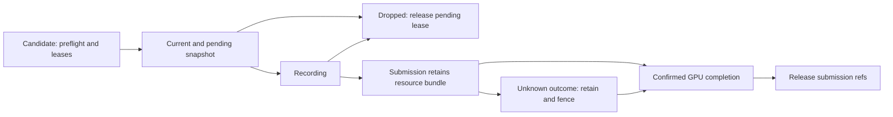

# Первый mesh/material profile Aether

**2026-11-06, ARCH1f.0: принятые решения до кода.** Имя профиля —
`aether.opaque-unlit/1`. CPU definitions/schemas/codec реализованы в ARCH1f.1
2026-11-07 ([API и bytes](#cpu-v1)); [resource owners/leases/preparation](RENDER_RESOURCES.md)
реализованы в f.2. Mesh snapshots/surface renderer остаются f.3/4. Это не новый Runtime
wire format; native resource proofs не подменяют pixels/frame acceptance. Этапы и acceptance ведутся только в
[PLAN](PLAN.md#arch1f-rendering); общий контекст — [RENDERING_DESIGN](RENDERING_DESIGN.md).
Изменения ниже относительно первоначальных предложений приняты явно: один
renderer-wide tint, строгая двухступенчатая готовность, встроенный/in-memory content
и один render view. Textures/PBR/streaming требуют последующих версий/capabilities.

<a id="identity"></a>
## Identity, revisions и размещение

Authoring хранит project-scoped AssetId: nonempty GUID в D format. Kind задаётся
схемой свойства; произвольный path/CLR Type/native handle идентификатором не служит.
Frozen manifest разрешает каждый ID в **exact key**:
`(ProjectId, AssetId, AssetKindId, SchemaVersion=1, ContentRevision)`.
ContentRevision — 32bytes SHA256 канонического content payload, не timestamp/номер
загрузки. Один ID/kind имеет ровно одну revision в manifest. Empty/default ключ
invalid; unknown kind/version/hash mismatch — ошибка, fallback на latest запрещён.
Тот же AssetId другого ProjectId или та же revision другого kind не взаимозаменяемы.

CPU definitions immutable и отделены от unmanaged component values. Digest в value
представим фиксированными32bytes без string/byte[]; GUIDs/mask/tint также значения.
MeshRenderer хранит pinned mesh/binding-set keys. Массивы definitions принадлежат
content owner; компоненты не содержат managed arrays, services, leases или GPU handles.
Все типы остаются в Aether: `Rendering` для CPU content, `Ecs/Rendering` для компонентов/
extraction, `Rendering/Resources` для platform-neutral resource owners, `Gpu/Vulkan`
для native backend. F.1/2 не требуют нового пакета или backend dependency.

Резерв persistent IDs: общий prefix `6fc9fce0-9547-42f5-b4df-f05f306f`, suffix ниже.
Полный GUID получается конкатенацией prefix и четырёх hex digits. Все schema versions1.

| Suffix | Роль |
| --- | --- |
| 1101 | MeshRenderer component type |
| 1102 | PerspectiveCamera component type |
| 1201 | Mesh asset kind |
| 1202 | OpaqueUnlitMaterial asset kind |
| 1203 | MaterialBindingSet asset kind |
| 1301 | Builtin opaque-unlit shader family, layout version1 |
| 1401 | Builtin origin-centered unit cube asset |
| 1402 | Builtin opaque white material asset |
| 1403 | Builtin cube/white binding-set asset |
| 1404 | Stable default material slot of builtin cube |

Существующие1001Transform/1002Appearance/1003Interaction/1004Velocity и их
defaults не меняются. IDs реализованы в f.1; BuiltInComponents.Schemas сейчас
содержит прежние3roles. Новый explicit registry helper не добавит rendering всем
играм автоматически. Profile/manifest identity включает ProjectId, BuildId,
catalog generation GUID и digest отсортированных exact keys. Digest и canonical
asset payload codec реализованы в f.1; hash покрывает kind/version, все параметры,
ordered data и dependency keys, исключает paths/display names/runtime generations.
Digest не является аутентификацией; Build/content owner отвечает за происхождение.

<a id="mesh"></a>
## Mesh v1

Фиксированы: right-handed coordinates, +Y up, camera forward -Z, row-vector
S*R*T и local*parentWorld из [Transform profile](ECS_PRIMITIVES.md).
Topology — triangle list; vertex layout `position-f32x3/1`, packed12bytes/vertex,
little-endian IEEE754 Single x/y/z. Index format — UInt32 little-endian; baseVertex0.
Нет normals/UV/vertex color/instance buffer/skinning, implicit format conversion
или importer в tick. Другие layouts/topologies дают UnsupportedLayout.

Definition содержит vertex/index data, ordered slot ranges и local AABB(min,max).
Каждый slot: nonempty GUID, firstIndex, indexCount; имена только metadata. Slots
уникальны, ranges непустые, идут в порядке firstIndex, начинаются с0 и без holes/
overlap покрывают весь index buffer. FirstIndex/indexCount кратны3; additions и
byte-size products проверяются без overflow. Каждому slot соответствует ровно один
range; один материал можно назначить нескольким разным slots. При изменении mesh
ID слота сохраняется для той же semantic части, positional index identity не заменяет.

Vertex/index counts ненулевые, index < vertexCount. Coordinates finite,
abs(coordinate)<=1000000; AABB finite с min<=max по каждой оси и покрывает все vertices.
Bounds могут быть conservative; NaN, overflow и missing vertex отвергаются до upload.
Degenerate triangles допустимы, если остальные условия соблюдены; zero-area bounds
не означают invalid WorldTransform. General affine world AABB вычисляется по всем
8углам либо эквивалентной center/extents формуле с abs(linear matrix), с finite check.
Два преобразованных min/max не считаются достаточным bounds test при rotation/shear.

Builtin cube:8vertices с координатами±0.5,36indices/12triangles, один slot1404,
AABB[-0.5,+0.5]³. Это новый mesh definition, старый embedded draw36 не меняется.
Порядок треугольников CCW при взгляде снаружи; raster profile v1 double-sided
(culling off), fill, depth test/write Less, sample count1, blending off.

<a id="materials"></a>
## Material, binding set и instance tint

Material v1: exact family1301/layout1, `baseColorSrgb=(r,g,b)` finite[0,1], opaque
alpha1. Builtin white=(1,1,1). Alpha modes, texture/sampler/shader parameters,
arbitrary bags и unknown fields не принимаются как поддержанная версия. Pipeline
key учитывает family/layout/vertex layout/target/depth/sample/alpha/device generation;
изменение base color или tint не создаёт новый pipeline.

Binding-set v1: exact mesh key и ordered pairs `(SlotId, exact material key)`.
Множество SlotIds **точно** равно множеству slots этой mesh revision, порядок
совпадает с mesh ranges. Missing/extra/duplicate/foreign slot, wrong asset kind или
другая mesh revision — ошибка. Никакого fallback к первому/white material. New mesh
revision требует нового проверенного binding-set, даже при прежних SlotIds; remap
делает отдельная явная authoring operation с Undo, не loader.

Один MeshRenderer на entity, RequiredTypes={Transform}, AllowMultiple=false.
Точные scalar property IDs/defaults для f.1:

| Property ID | Kind / default | Семантика |
| --- | --- | --- |
| mesh | String / GUID suffix1401 | Nonnullable mesh asset reference |
| bindings | String / GUID suffix1403 | Nonnullable binding-set asset reference |
| enabled | Boolean / true | Только render visibility |
| layers | Integer / 4294967295 | UInt32 mask, inclusive0..4294967295 |
| tintEnabled | Boolean / false | Применять instance multiplier |
| tintR, tintG, tintB | Number / 1 каждый | Linear RGB multiplier, finite[0,1] |

References разрешаются в exact keys frozen manifest. Bindings.MeshKey обязан
равняться MeshRenderer.MeshKey. Все значения/references проверяются и при disabled/
masked renderer; invalid tint не скрывается tintEnabled=false. V1 tint один для всех
slots renderer. Per-slot overrides требуют следующего явного schema/layout profile.
Несколько частей с разными instance tint представлены дочерними entities.

Reset tint отключает override (`tintEnabled=false`), effective multiplier=(1,1,1).
Stored tint values могут сохраняться в draft/document; reset всего authored override
возвращает inherited/default values обычной history operation. Изменение tint одной
entity не меняет material/binding set другой. Shared material edit создаёт новую
revision; отдельная catalog transaction публикует согласованный manifest и bindings.
Runtime tint — World state; документ не переписывается, checkpoint support только f.6.

<a id="color"></a>
## Цветовой конвейер

Material/clear RGB — stored-sRGB[0,1]; tint — linear multiplier[0,1]. CPU preparation
один раз decode base color в linear RGB. Extraction умножает linear base*effectiveTint;
shader получает linear RGB и **один раз encode** output для существующего UNORM
external target. Alpha всегда1, premultiplied/straight RGB тогда совпадают. Clear
задаётся уже encoded sRGB; второй encode clear не делается. HDR/tone mapping отсутствуют.

Для c,L∈[0,1] приняты стандартные transfer functions:

```text
decode(c) = c/12.92                         if c <= 0.04045
            ((c+0.055)/1.055)^2.4           otherwise
encode(L) = 12.92*L                        if L <= 0.0031308
            1.055*L^(1/2.4)-0.055          otherwise
outputSrgb = encode(decode(baseColorSrgb) * effectiveTintLinear)
```

Основание формул — [W3C sRGB conversion](https://www.w3.org/TR/css-color-4/#color-conversion-code).
UNORM и SRGB — различные VkFormats: [Khronos format definitions](https://docs.vulkan.org/spec/latest/chapters/formats.html#formats-definition).
В текущем коде target/view/attachment R8G8B8A8Unorm и offer RGBA8_UNORM/sRGB;
само metadata ColorSpace не выполняет conversion. Новый shader явно encode-ит,
UNORM target не подменяется SRGB attachment с повторной conversion. Изменение target
потребует другого capability и собственного pixel proof. Legacy Appearance v1
и embedded primitive shaders продолжают прежний stored-sRGB path без нового tint.

Независимые reference vectors для f.1/f.4 (каждый канал; pixel tolerance±1LSB):

| Base sRGB | Tint linear | Output sRGB ≈ | RGBA8 RGB ≈ |
| --- | --- | --- | --- |
| 0 | 1 | 0 | 0 |
| 1 | 1 | 1 | 255 |
| 0.5 | 1 | 0.5 | 128 |
| 1 | 0.5 | 0.735356983 | 188 |
| 0.5 | 0.5 | 0.360780214 | 92 |

<a id="camera"></a>
## Camera и extraction

PerspectiveCamera type1102: singleton, RequiredTypes={Transform}. Scalar properties:
`fov` Number π/3, `near` Number0.1, `far` Number100, `layers` Integer4294967295,
`clearR/G/B` Number0.04/0.06/0.10. Все nonnullable; fov finite(0,π), near>0,
far>near, layers UInt32, clear[0,1]; conversion в Single должна быть representable.
Semantic ranges и far>near проверяются также после conversion, без clamp/округления
недопустимого double в допустимый float. View/projection product должен быть finite.
Другой projection profile не подразумевается наличием Camera.

Render view явно выбирает persistent camera entity либо external camera value
(например navigation camera). Выбор разрешается в live same-World handle, нужный
component и current-tick WorldTransform. Missing/stale/foreign/no camera — ошибка,
«первая камера в pool» не выбирается. Camera basis orthonormal с determinant+1
(abs(dot(bi,bi)-1)<=0.0001, abs(dot(bi,bj))<=0.0001 для i≠j,
abs(det-1)<=0.0001); scale/shear/reflection отклоняются,
без молчаливой decomposition. External camera подчиняется тем же constraints.

Pose inverse — view matrix; projection row-vector RH, Vulkan depth[0,1], flipped
Y как в текущем PrimitiveScene; backend получает эквивалентную GLSL matrix. Physical
extent16..1920×16..1080,0×0=suspend, partial zero invalid. V1 один view на session,
default native acceptance extent640×360. Resize меняет surface generation, не asset
revisions; target-specific pipeline/cache entries учитывают совместимость target.

Enabled && (renderer.layers & camera.layers)!=0 допускает draw ranges; zero mask
допустима и рисует background. Frustum/occlusion culling, interpolation, instancing
не обязательны v1. Все source refs/values валидируются до visibility filtering.
Snapshot фиксирует session/build/world/scene/source revision/tick, manifest digest,
camera/extent generation, full affine matrices/bounds и exact mesh/material keys.
Items идут по EntityHandle.Index, затем mesh slot order; renderer batching может
менять opaque draw order, не simulation iteration. Никаких mutable refs/spans в pools.
Appearance и MeshRenderer вместе на одной entity в новом profile отвергаются как
ambiguous render role. Старый primitive profile остаётся отдельным consumer.

<a id="admission"></a>
## Content delivery и строгая готовность

Первый сквозной content scope — builtin cube/family и typed in-memory definitions,
включённые в pinned framework/game build. Child entry через DI предоставляет frozen
project catalog/manifest. Parent не загружает Game.Logic для их получения. Пути,
произвольные model files, shader source/tool execution и remote content в этот scope
не входят. Новые scene properties остаются GUID references в прежнем neutral codec;
mesh bytes не прячутся в String/SceneSnapshot/control message.

Content owner фиксирует manifest до import. Registry AssetValidator и importers
заимствуют один frozen CPU scope: обязательные references/kinds/versions/dependency
closure проверены до publication. F.1 helper устанавливает manifest AssetValidator
и typed import/validation callbacks; они проверяют exact project/type/revision/slots
в frozen CPU scope. Этот data-only helper не приобретает leases; f.2 добавляет explicit
RenderResourceComponents с SceneWorld-owned CPU leases и отдельную GPU preparation.
Встроенные assets также versioned/hash-validated. Изменение catalog не меняет captured
manifest задним числом. Source watcher captured managed graph не объявляется general
content watcher; external files потребуют отдельного Build/preview/Player input и
delivery contract до расширения capability.

**Strict двухступенчатый profile выбран вместо неразличимого CPU/GPU Ready:**

1. CPU definitions/dependencies и leases готовы до ActiveScene; SceneWorldLoader
   остаётся synchronous/cooperative и не ждёт GPU/file IO. Missing/corrupt/unsupported
   content не активирует частичный World. Headless CPU activation полноценна сама по себе.
2. Required view готовит device resources асинхронно на разрешённом owner thread до
   первого ready render binding/frame. Runtime/view owner не сообщает render-ready/
   Playing для required view до upload completion и первого presentation fence.
   GPU failure не превращается в white/missing draw: native start fails, runtime/view
   owners stop/clean up; CPU-only/headless потребитель может работать независимо.

Existing e.3b World acknowledgement означает CPU activation, не новое GPU readiness.
PrepareSceneWorld hook и IDisposable scene cleanup не становятся async GPU owners.
F.2 реализует отдельную preparation operation/resource-ready fence и owned Stop/drain;
f.3/4 согласуют её с existing frame readiness/Runtime Playing без скрытого sync-over-async.
Это не новая DI async activation. Typed IFactory создаёт owned operation, caller awaits
её работу и drains её при stop. Streaming/fallback в v1 отсутствуют: Pending — состояние
preparation, не разрешение отрисовать incomplete binding.

Dependency DAG bounded и exact: binding set→mesh/material asset keys. Material family
и vertex layout — builtin versioned capabilities из profile header, не дополнительные
assets без AssetKindId. Их IDs/versions проверяются вместе с asset data. Cycle/missing/
wrong type/revision отклоняются до GPU work. Session freezes
one manifest; reload готовит целую candidate closure и GPU bindings, затем atomic switch
на serialized boundary без смешивания revisions внутри item/frame. Публикация catalog
сама не retarget-ит pinned components: explicit reload transaction preflights и заменяет
все затронутые MeshRenderer keys и binding tables вместе с manifest. Это runtime
content operation, не готовый Editor live edit; unknown commit fault fences World/view,
предыдущий complete render snapshot и owners сохраняются. При failed/cancelled preflight
reload прежний ready manifest остаётся current с явной ошибкой. Initial failure не имеет
старой ready fallback. Same AssetId с новыми slots требует explicit binding remap.

<a id="ownership"></a>
## Владение, leases и completion

| Owner | Чем владеет | Что заимствует / release |
| --- | --- | --- |
| App content service | Immutable CPU revisions, frozen manifests, counted CPU leases | Factory products не удерживает до App exit; no global cache |
| SceneWorld | Exclusive CPU manifest/binding leases через existing Acquire | CPU values/World; не GPU resource owner, Dispose не ждёт driver |
| Device resource owner | Allocations, uploads, pipelines, retirement records | GPU device/queue от platform owner; destroy до device teardown |
| Render-view session | Owned prepare operation, ready bindings, bounded mailbox | World только на extraction boundary; drains view до scene/device stop |
| Snapshot lease | Detached immutable data и retained revision/resource bundle | Не World; inspection metadata не даёт права draw без live lease |
| Submission record | Собственный retained bundle, exact device/surface/frame stamp | Освобождает refs только по подтверждённым applicable completions |

Настройка — explicit module extension IAppConfigurationContext; services/factories
через Cobalt, provider adapters сохраняются. Options валидируются/копируются при
composition. Startup lazy, не создаёт GPU. Typed factories задают owner/lifetime
каждого view/preparation; new разрешён внутри factory и для данных, не service locator
в query/draw. Catalog/device service borrowed consumers; DI aliases не владеют одним
product дважды. Конкретные C# имена/сигнатуры extension выбираются в f.1/2, не являются
именами действующих методов из этого документа.

Ресурсный handle cache-local: owner GUID, device generation, slot index, slot generation.
Default/stale/foreign/wrong-device handle отвергается до native command. При exhaustion
generation slot retires, не wrap. Копия handle не Acquire. Каждый возвращённый lease —
отдельный reference owner; alias того же lease не удваивает владение, Dispose idempotent.
Fork разрешён только владельцам bounded pipeline по явной операции с reservation;
неограниченного public Clone для произвольных readers в v1 нет. Shared dependencies
удерживаются до последнего lease; удаление одной entity не разрушает ресурс соседней.

Resource cache key содержит exact asset keys/family layout и device generation;
scope compatibility проверяется даже при одинаковых integer slots. Sharing между
Worlds только внутри явно общего content/device owner. CPU dedup по одному exact key,
GPU dedup по exact key+device; different logical keys не alias автоматически из-за hash.
Zero-ref CPU revision можно удалить, GPU — только после всех accepted uses/completions.
Idle cache без дополнительных leases/неограниченного LRU v1 не удерживает resources.
Manifest/current view/snapshots/uploads/submissions pin необходимые dependencies.

Snapshots передаются owned envelopes, immutable data сами по себе не IDisposable.
Simulation держит current lease; mailbox держит один latest pending, replacement
освобождает старый pending. Render worker берёт lease в recording; до submit drop/cancel
разрешены после подтверждения отсутствия native use. Перед submit owner заводит
retained submission record, так что exception после submit не теряет владельца.



CPU envelope release, producer GPU completion, external GL read/use completion,
return fence и slot retirement — разные факты. Mesh buffers, читаемые только producer,
могут утратить submission ref после его подтверждённого completion; shared external
target сохраняется до existing use/return/retirement. Bundle с обоими видами ресурсов
ждёт все применимые зависимости. Boolean произвольного caller не подменяет backend
completion proof. Coalescing не отменяет submitted work; timeout не разрешает destroy.
Unknown submit/device outcome fences generation и удерживает affected owner/budget до
подтверждённого safe teardown. Device-loss recovery не обещается этим профилем.

Stop: close tick/load/frame admission → cancel/drain prepare → quiesce scheduler/
extraction и release current/pending → finish/retire accepted submissions/external
frames → release ready bindings → dispose owned systems до SceneWorld (он освобождает
World, затем scene CPU leases) → destroy device resources owner до platform device.
App content owner живёт до release последних borrowers. View owner координирует async drain до synchronous
game/SceneWorld Dispose, не передаёт borrowed GPU service в Acquire. Partial creation/
late completion сразу учитываются actual owner; successful cleanup stages не повторяются,
failed owner и исходная ошибка сохраняются для retry. Stop timeout не заявляет Released.

<a id="budgets"></a>
## Workload и admission budgets v1

Это hard ceilings профиля для последующей реализации, не измеренный SLA и не новые
значения existing options. Все ceilings включительные; checked size arithmetic и
reservation предшествуют копированию/Acquire/allocate/submit. Превышение — LimitExceeded,
без truncate/drop draw ranges. Для reload учитывается peak old+candidate+retiring;
нехватка coexistence budget сохраняет old current и отклоняет candidate.

| Scope | Ceiling |
| --- | --- |
| Functional workload | 10000logical entities; до4096MeshRenderer; shared cube/material плюс independent tint |
| Mesh definition | 65536vertices,196608indices,8slots/ranges,2MiB canonical payload |
| Material / binding-set definition | 4KiB canonical payload каждый; binding set до8pairs |
| Frozen manifest | 1024unique exact keys включая dependencies;256KiB canonical manifest |
| Content owner resident | 2048CPU revisions;64MiB живых CPU content buffers включая retained/candidate copies |
| CPU preparation | 4active +16queued operations;16MiB staging bytes sum |
| Device owner | 64MiB geometry allocations по actual requirements.size;16MiB upload staging;16pipelines |
| View/snapshot | 1view;4096draw ranges;2MiB accounted packed snapshot payload |
| Snapshot owners per view | current1 + pending1 + recording1 + submitted3 + candidate1 =7;16MiB snapshot buffers sum |
| Resource refs per bundle | До1024unique exact keys/dependencies; duplicates внутри bundle counted once |
| Submitted frame slots | До3accepted uses, existing surface ledger/stamp/return limits сохраняются |

10000logical не означает4096×8accepted draws: общий предел4096ranges проверяется
отдельно. Cube raw positions96bytes+indices144bytes=240bytes; максимальные vertex/
index buffers786432+786432=1572864bytes, оставляя место metadata под2MiB ceiling.
Бюджет CPU buffers считает каждую реально живую owned copy, а не только logical asset
size. Dedup одной allocation считается один раз; повторные leases всё равно имеют
bounded records. Snapshot/resident/staging — отдельные счётчики, без двойного списания
одного буфера в разных владельцах. Metadata/object/driver overhead не объявлены RAM
quota. Pipeline/entry counts и closure depth<=8 ограничивают остальные structures.
Existing surface allocations/depth attachments и driver pipeline memory не входят
в64MiB geometry budget; их прежние limits сохраняются, общий VRAM cap не заявляется.
Retiring/cancelled resources остаются в resident counts/bytes до safe release.

<a id="implementation-boundary"></a>
## Граница реализации и проверка следующих этапов

F.0 закрыл **решения**; f.1 реализовал CPU schemas/definitions/codec, f.2 —
[CPU/GPU resource services](RENDER_RESOURCES.md), counted leases/preparation и
standalone Vulkan upload/readback. F.3 owned extraction/submitted snapshot leases и
f.4 surface consumer/Playing fence ещё нужны. Единый acceptance matrix —
[ARCH1f](PLAN.md#arch1f-rendering). Pure immutable manifest f.1 не является resource service.
New mesh profile не подменяет IRenderGameSession.CaptureRenderScene,
GpuFrameData.Scene или старую v3 primitive/control payload молча: f.3/4 добавят
явную capability/API boundary с проверкой отказа старых consumers и message budgets.
Нет увеличения existing64primitives,4096scene-load entities,4MiB document envelope
или64KiB control message. Logical storage10k остаётся отдельным workload.

При coding проверки должны различать geometry/slot/version/budget failures,
disabled validation, tint/reset isolation и gray transfer vectors; cross-world/
owner/device generations; drop-before-submit и no-release-after-unknown-submit;
cancel/late completion/failed cleanup retry; CPU-ready vs GPU-ready, reload peak
budgets и legacy compatibility. Headless cases не заменяют actual source Debug/
published Release pixels/core+sync validation/cleanup и затронутый fresh-package
consumer. Physical/K7/device-loss/VRAM/general release gates остаются отдельными.
Checkpoint сохраняет logical revisions/tint, не cache handles; реализация только f.6/e.5.

<a id="cpu-v1"></a>
## Реализованный CPU API и canonical bytes — ARCH1f.1, 2026-11-07

`Rendering.RenderContentHash` хранит SHA256 как четыре unmanaged UInt64 с big-endian
byte conversion. Default/all-zero — empty sentinel, запрещённый в asset/build key.
Parse принимает64hex digits, ToString возвращает lowercase. RenderAssetKey содержит
ProjectId/AssetId/KindId/int schema/Revision и проверяет точную version1. Это value
reference, копирование не приобретает ownership.

MeshDefinition, OpaqueUnlitMaterialDefinition и MaterialBindingSetDefinition — sealed
immutable CPU definitions общего RenderAssetDefinition. Входные IReadOnlyList копируются
в ImmutableArray после count admission, validation завершается до возврата объекта.
Revision вычисляется из canonical bytes, не задаётся пользователем. RenderAssetEntry
связывает definition с persistent key; RenderContentManifest проверяет соответствие
всех entries и полную mesh/material dependency closure. AssetId уникален во всём
project manifest, включая разные kinds. Empty manifest допустим для CPU scope без
mesh references. Entries отсортированы по RFC4122 AssetId bytes.

Manifest — данные с ProjectId/BuildId/Generation/Digest, не IDisposable cache/service.
Same content/build с другой Generation даёт тот же Digest, но другой identity tuple.
Resolve(assetId,kind) проверяет expected kind; Resolve(key) также project/schema/revision,
без latest fallback. Shader-family/layout — известные capabilities, не missing assets.
Самостоятельные immutable definitions не требуют leases; service-retained copies,
scene imports и preparation учитываются owners/leases из f.2.

Canonical asset header (12bytes): ASCII TMRA, UInt16 format1, UInt16 kind tag
(1mesh/2material/3binding-set), UInt32 schema1. Integer/Single scalars little-endian;
все GUIDs — RFC4122/network bytes, а не default .NET mixed-endian Guid byte array.
Каждый Single zero записывается как positive zero. Nonfinite запрещён validation.

| Kind | Body после header |
| --- | --- |
| Mesh | UInt32 topology/layout/indexFormat=1; UInt32 vertex/index/slot counts;6Single bounds min/max; vertices по3Single; UInt32 indices; slots по Guid+UInt32 firstIndex+UInt32 indexCount |
| Material | Guid family1301;UInt32 layout1;3Single baseColorSrgb. Полный payload44bytes, alpha1 следует из kind/version |
| Binding set | MeshKey84bytes;UInt32 count; пары SlotGuid16bytes+MaterialKey84bytes. Полный payload100+100×count bytes |

Key84bytes: ProjectGuid16, AssetGuid16, KindGuid16, UInt32 schema4, SHA256 digest32.
Mesh payload60+12×vertices+4×indices+24×slots; cube324bytes. Decode проверяет byte/count
admission до allocations, semantic geometry/layout/material/keys, exact length и
canonical re-encoding. Trailing/truncated/negative-zero/unknown format/tag/version
не принимаются как альтернативные representations. Header не содержит inline checksum:
Decode вычисляет новую revision проверенного content; expected revision сверяет
manifest/Resolve. Это integrity reference, не authentication.

EncodeManifest — canonical **fingerprint**, не transport/manifest loader. Header:
ASCII TMRM, UInt16 format1,UInt16 reserved0,ProjectGuid16,BuildHash32,UInt32 count;
далее sorted exact keys по84bytes. Generation и сами definition bytes исключены;
definition SHA256 уже в keys. Digest=SHA256 этих bytes. Порядок входных entries не
меняет Digest; project/build/dependency revision меняют. DecodeManifest API не вводился.

`Ecs.Rendering.MeshRenderingComponents` предоставляет exact two schemas и Register
для existing ComponentRegistryBuilder. Caller регистрирует Transform отдельно.
Helper устанавливает single AssetValidator builder для manifest; дополнительные
asset domains должны явно compose callback после него. Validation/import closures
удерживают один immutable scope, не читают global latest catalog. Missing refs дают
existing SceneWorldLoadError.InvalidReference, typed validation — InvalidValue с
inner RenderContentException.Error. Failed registration не transactional: builder
нужно discard. Старые registry/load/control contracts не изменены.

MeshRenderer/PerspectiveCamera — unmanaged values. Первая проверяет references/tint
даже при invisible/off; вторая проверяет настройки и через CreateViewProjection —
явно переданный rigid pose. Registry import проверяет double domain до Single
conversion и float domain после. Derived WorldTransform/active camera selection
по всей сцене появятся в f.3; CPU import не выдаёт их за проверенный render-ready World.
Appearance+MeshRenderer на одной effective entity отвергаются до World allocation.
Existing App/IFactory scene loading используется без фиктивного UseMesh registration.

Фактические проверки — в [HISTORY](HISTORY.md#render-cpu-2026-11-07).
Source Debug/published Release/fresh isolated package runner —
[ManualTests/RenderingCpu](../../ManualTests/RenderingCpu/README.md).
GPU resources/leases/readiness, native output и прежний overall regression этим API
не объявлены исправленными/проверенными.
