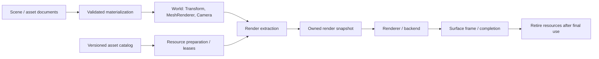

# ECS и отображение Aether: компоненты, материалы и ресурсы

**2026-11-06, проработка по запросу пользователя; ARCH1f.0 решения зафиксированы.**
Первый профиль — [opaque-unlit/1](RENDERING_CONTRACTS.md): exact mesh/material schemas,
slots/revisions, color conversion, budgets и CPU/GPU owners. Направление включено в план;
названия ниже обозначают роли, а не готовый public API. Детальные этапы и критерии
ведутся в одном месте — [ARCH1f](PLAN.md#arch1f-rendering), основа World —
[ARCH1e](PLAN.md#arch1e-ecs) и [ECS_DESIGN](ECS_DESIGN.md). Workload, budgets и
lease/cache policy выбраны в f.0; CPU schemas/definitions/codec реализованы в f.1,
[App-owned resources/leases/preparation](RENDER_RESOURCES.md) — в f.2,2026-11-07.
[Owned mesh extraction/mailbox/submission contracts](RENDER_SNAPSHOTS.md) реализованы в f.3; surface renderer остаётся f.4. Standalone Vulkan upload
не объявляется готовым frame consumer. Первый headless storage срез описан в [ECS World v1](ECS_DESIGN.md#world-v1).

## Исходная точка

Сейчас RenderPrimitive содержит world matrix и stored-sRGB RGB одного opaque cube.
PrimitiveScene копирует до64примитивов и задаёт camera/projection. Optional
IRenderGameSession захватывает этот снимок на сериализованной границе simulation;
GpuFrameData передаёт его существующему Vulkan producer. VulkanPrimitiveRenderer
использует embedded cube shaders и draw36vertices; depth/framebuffer/pipeline
принадлежат surface slot. GpuResourceHost сохраняет ownership при failed cleanup.
PreviewGameSession — статический consumer с fixed camera, без Game.Logic.

Это рабочая база primitive rendering. F.1 добавил [immutable CPU mesh/material data,
exact keys и frozen manifest](RENDERING_CONTRACTS.md#cpu-v1). F.2 добавил bounded
CPU catalog, scene/preparation leases, device mesh cache, atomic World rebind и
actual Vulkan upload/readback. Texture loader, mesh snapshots и surface draw ещё впереди.
Существующие RGB/defaults, control versions и64-entity/frame limits сохраняются
до отдельного versioned перехода. Новый renderer не требуется первому headless World.

## Роли и владельцы

| Роль | Что содержит/делает | Lifetime и владелец |
| --- | --- | --- |
| MeshRenderer, ECS data | Mesh asset reference, bounded material bindings по slots, enabled и render layer mask | Значения World; не вызывает draw и не владеет native handles |
| Camera, ECS data | Projection settings и visibility mask; pose берётся из Transform | World; выбор active camera/render target делает владелец render view |
| WorldTransform / RenderBounds | Вычисленные matrix/bounds, версии изменений | Derived data; пересчитываются, не записываются автоматически в документ |
| MaterialAsset | Versioned shader-family/layout reference и общие типизированные параметры | Content/asset owner; одна версия может использоваться многими entities/worlds |
| Material instance / override | Только разрешённые отличия конкретного использования | World/session data; общий asset при этом не мутируется |
| Render extraction system | Собирает видимые render items и camera из согласованного World | System через App/IFactory; без native draw и IO в обходе pools |
| Asset/resource service | Разрешает references, готовит CPU content и выдаёт leases готовых revisions | Явный App/session owner; нет глобального cache без lifetime |
| Renderer service / backend | Подготавливает GPU resources, records/submits draw, ведёт completion/retirement | Render/device owner; зависимости через DI, вызовы на разрешённом owner thread |
| Render view / surface | Extent, active camera selection, target и surface generation | Host/viewport session; target/OS/GPU handles не становятся компонентом камеры |

TextureAsset, sampler description, shader-family definition и mesh/material asset
catalog — ресурсные данные. Их не нужно превращать в entity на каждую запись или
DI service на каждый экземпляр. Shared world settings, например ambient lighting,
могут иметь явный world-resource contract без искусственной «глобальной сущности».
Форма такого API остаётся открытой. Light — будущий scene component; physics,
audio и animation следуют тем же границам data/system/resource owner по своим задачам.

Уточнение первого ECS storage2026-11-06: variable-length material bindings не
передаются в World как managed arrays внутри component value. Компонент может
ссылаться значением на immutable binding set с отдельным owner/revision/lease
contract. F.0 выбрал pinned mesh/binding-set asset keys без managed refs в World,
отдельный immutable binding-set owner и snapshot/submission leases;
[точный профиль](RENDERING_CONTRACTS.md#identity) дополнен [resource API f.2](RENDER_RESOURCES.md).
Snapshot/submission leases добавляются в f.3/4 поверх готовой preparation ownership.

Это целевая схема; существующий transport не переносит новый mesh/material payload.
Editor preview и Play/Player должны использовать одну semantic render model;
preview не загружает пользовательские CLR types для отображения встроенных компонентов.
Общие UI controls/styles и Alloy renderer сохраняют собственные контракты.

## MeshRenderer и связанные компоненты

Один MeshRenderer на entity в первом профиле: один mesh и material bindings,
индексированные устойчивыми slot IDs выбранной mesh revision. Multiple materials
на submeshes не означают AllowMultiple для самого MeshRenderer. F.0 выбрал до8slots,
position-f32x3/UInt32 triangle list и [отдельные ceilings](RENDERING_CONTRACTS.md#budgets).
Bindings точно соответствуют mesh slots, без неявного выбора первого материала;
смена mesh revision требует нового validated binding set/явного remap.
Несколько renderable частей представимы дочерними entities до отдельного решения
о multiple render components. Scene hierarchy не подменяет asset dependency graph.

Mesh definition задаёт topology, vertex layout, index format, submesh ranges и
local bounds. Проверяются конечность чисел, допустимость ranges/indices, совместимость
layout/shader и ограничение размеров до upload. Importer не исполняется в tick.
Первый asset может быть встроенным unit cube с одним slot — это проверяет общую
связку без немедленного ввода файлового model importer.

Render visibility независима от участия entity в simulation. Layers камеры и
renderer сопоставляются по явной маске; disabled renderer не останавливает movement.
Dirty versions transform/mesh/material/visibility позволяют обновлять extraction
адресно. Сначала допустима полная bounded extraction; culling/instancing/LOD добавляются
по измеренному workload. Bounds при nonuniform scale/shear вычисляются консервативно
из матрицы; одно лишь преобразование min/max углов неверно для общего affine transform.

Camera задаёт perspective/orthographic profile, clipping и clear policy по объявленной
версии. F.0 выбрал только perspective и rigid camera pose. Host явно выбирает active
camera, в том числе Editor navigation camera вне authoring scene. Нет скрытого
«первого Camera в pool»; нет камеры/неподдержанная projection дают объявленный outcome.
Shadow flags, lights, animation/skinning и particles — следующие capability profiles.

## Материал: общий asset и изменения экземпляра

MaterialAsset имеет persistent asset ID, schema version и immutable content revision.
Shader-family ID/layout version описывает допустимые параметры и renderer capabilities;
CLR Type, Vulkan pipeline, descriptor set и compile-time registration index не являются
форматом документа. Dependency graph включает textures/shaders и проверяется на
циклы/отсутствующие обязательные dependencies с ограничением глубины/размеров.

Первый opaque unlit profile фиксирует RGB base color, alpha1, один shader layout и
linear renderer-wide tint override; per-slot override и другие alpha modes требуют
следующего versioned profile. Следующие отдельные срезы —
base-color texture/sampler, затем lighting/PBR с metallic/roughness/normal/emissive.
Наличие будущего параметра не объявляет готовый shader, shadow или transparency.

Цвета требуют явного encoding: текущий primitive RGB — stored-sRGB. Новый asset,
shader input и render target теперь имеют [точный color contract](RENDERING_CONTRACTS.md#color):
base decode→linear tint→encode в существующий UNORM target, без double conversion.
Для будущих texture slots задаются color/data semantics, например
base color и normal map не получают одинаковую color conversion автоматически.
Legacy Appearance v1 сохраняет прежние RGB/defaults. Bridge в unlit материал либо
ограничен совместимым primitive профилем, либо имеет явную versioned migration.

Shared asset изменяется как новая content revision. Per-entity tint/прочие overrides
хранят только schema-разрешённые значения; они не меняют общий asset и не требуют
нового shader/pipeline на каждый цвет. Эффективные параметры могут кэшироваться с
ограничением памяти; dedup/cache strategy выбирается отдельно. Dictionary parameter
bag допустим на границе authoring/import, runtime draw использует проверенный layout.

Материал, transient gameplay override и пользовательское редактирование asset —
разные операции. Изменение shared asset влияет на его пользователей после публикации
новой revision; изменение entity override — на выбранный экземпляр. Reset override
возвращает значение текущего зафиксированного asset, не default(T). Persisted overrides
входят в document/history; runtime overrides — в checkpoint по объявленной policy.

## References, загрузка и версии

Authoring reference содержит project-scoped stable asset ID и ожидаемый type;
выбор/pinning content revision определяет asset manifest. Путь — locator внутри
проверенного content resolver, не глобальная identity. Build/Replace и checkpoint
фиксируют версии нужных dependencies. Текущий captured managed graph/source watcher
не объявляется автоматически полным наблюдателем новых content/shader inputs.

Runtime resource handle отличается от AssetId: он ограничен владельцем cache,
device generation и slot generation. Одинаковые integer slots другого owner/device
или старой загрузки не совпадают. Shared resource между worlds допустим только
по явному lease contract общего owner. Сам скопированный value handle не владеет
ресурсом и не делает Dispose; leases/releases ведёт определённый binding/frame owner.

Загрузка/декодирование/компиляция и GPU upload имеют bounded очереди, memory budgets
и cancellation. Disk IO и shader compilation не выполняются в simulation query
или в обязательном frame hot path. Upload/публикация согласуются с backend thread
и upload completion. Readiness сообщает ResourceState: Pending/Ready/Failed, а не
частично заполненный mesh. Gameplay, зависящий от ready state, получает его на
simulation boundary по явной policy; скорость disk/driver не выдаётся за determinism.

В выбранном f.0 strict profile CPU content готов до активации World, GPU resources —
до render-ready/первого кадра required view. Эти fences разделены: synchronous
SceneWorld loader не ждёт GPU; [render host preparation](RENDERING_CONTRACTS.md#admission)
реализует resource-ready/drain в f.2; required-view frame/Playing fence добавит f.4. Streaming/fallback в v1 нет;
missing/corrupt/incompatible asset не становится молчаливым success. Ошибки различают
AssetId/revision/причину и доступны headless/Editor. При failed reload остаётся
предыдущая ready revision с явной ошибкой, либо операция отклоняется до commit.

Каждый async completion проверяет session/world/build generation и ожидаемую
asset revision. Поздний успех отменённой загрузки не публикует binding новому World;
его подготовленные ресурсы освобождаются либо возвращаются cache по contract.
Reload готовит новую revision целиком, публикует её на согласованной границе,
а предыдущую сохраняет до завершения всех пользователей. Не допускается смесь
mesh slots старой revision и material bindings новой внутри одного render item.

## Render snapshot и lifetime ресурсов

Снимок содержит session/world identity, tick/world revision, camera/view data,
матрицы, visibility и согласованные mesh/material revisions. Он не содержит mutable
refs/spans в ECS pools. Renderer разрешает snapshot references через удерживаемые
leases; не ищет «последнюю версию» посреди записи кадра. Shader/pipeline cache keys
учитывают layout/vertex format/render target/depth/sample/alpha state и device
generation; материал не назначает backend pipeline произвольным native handle.

Очередь simulation→render ограничена. Для обычного viewport допустимо coalescing
до latest snapshot с явным освобождением отброшенных CPU snapshots/leases. Уже
submitted GPU work не отбрасывается этим механизмом; его leases удерживаются до
подтверждённого окончания использования. CPU snapshot release, command submission,
GPU completion и return внешней surface — разные события. Ресурс освобождается
после всех применимых зависимостей, не после произвольного числа кадров/timeout.
Конкретные fences остаются backend responsibility, existing surface ledger сохраняется.

Один simulation owner и независимая render cadence остаются базовым профилем.
Interpolation — поздняя явная policy для совместимых предыдущего/текущего snapshots;
spawn/destroy/teleport/Replace не интерполируются между чужими identities. Opaque
sorting/batching могут менять draw order; это не меняет simulation iteration order.
Transparent sorting и поддержка дополнительных passes требуют отдельных критериев.

Удаление entity прекращает новые bindings; оно не разрушает shared материал других
entities и submitted draw. Stop запрещает новые snapshots/loads, отменяет и drains
owned preparation, прекращает extraction, завершает/retire принятые frames, затем
освобождает session leases. GPU cache/target/device освобождаются их owners в порядке
зависимостей. Borrowed cache переживает World, если таков его lifetime. Failed cleanup
сохраняет ownership/retry и исходную ошибку по существующему host contract.
Device loss останавливает публикацию в старую generation; политика recovery и её
physical proof остаются отдельными, документация не объявляет их реализованными.

Checkpoint сохраняет logical refs/revisions и нужные runtime overrides, не GPU handles,
cache slots или pipeline binaries. Restore проверяет наличие/совместимость content,
восстанавливает derived bindings и необходимые ресурсы до resume. Замена asset по
нефиксированной «последней» версии не считается точным восстановлением checkpoint.

## Editor и границы первого результата

[ED4i](EDITOR_PLAN.md#ed4i-render-components) владеет будущим inspector consumer:
mesh/material selection, slot diagnostics, override/reset и различение shared asset
edit/per-entity edit. Он использует schema metadata, retained View/Data/Style и общие
document/history операции; не конструирует GPU resources в ViewModel и не загружает
Game.Logic. Новый asset document требует собственного version/conflict/history contract;
редактирование shared material не маскируется как Undo только одной scene entity.

Первый сквозной профиль: встроенный cube mesh, shared opaque unlit material, две
entities с независимым tint override, explicit camera → extraction → existing Vulkan
surface. Удалить одну entity, сменить material revision и остановить/заменить сессию
при queued frame/load; оставшийся объект корректен, старые resources не используются
после retirement. Headless validation/lifetime checks и actual native pixels/validation/
cleanup фиксируются отдельно; старые UI/primitive proofs не закрывают новый renderer.

F.0 выбрал [workload/budgets, shapes/versions, slots/layouts, encoding, leases,
strict admission, queue/completion и builtin/in-memory delivery](RENDERING_CONTRACTS.md).
F.1 CPU contracts/validation и f.2 catalog/leases/preparation реализованы;
далее f.3/4 owned extraction/surface consumer и Playing fence.
External-file delivery и наблюдение content inputs требуют собственного расширения.
PBR, произвольные importers, frame graph, bindless и GPU-driven
draws не входят в первый результат. Этапы и acceptance находятся только в ARCH1f.
