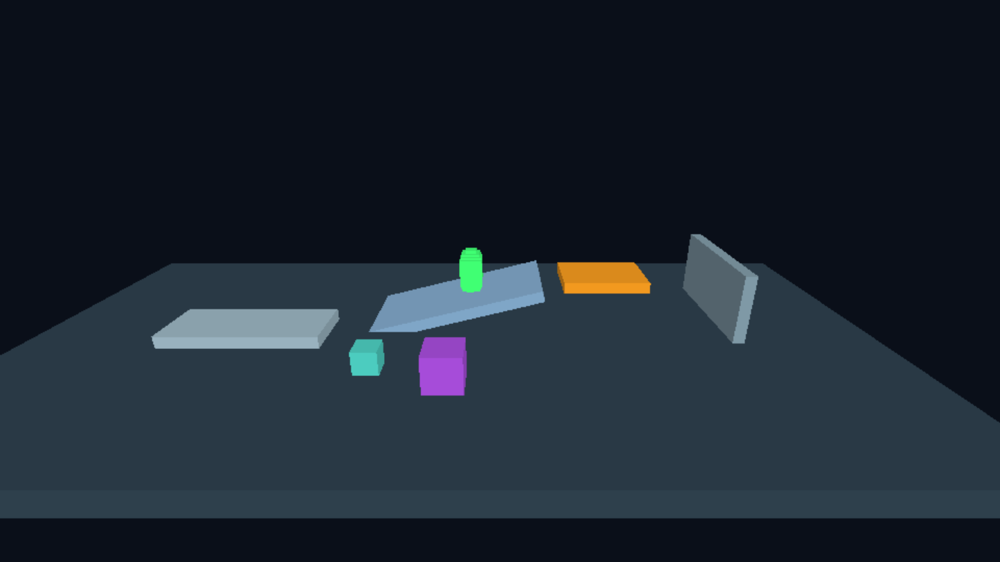

# PHYS8.4 — визуальный тестовый уровень Kton

17.11.2026. [Задача](PLAN.md#phys84), [история проверок](HISTORY.md#phys84-2026-11-17),
[manifest и SHA](PHYS84_RESULTS.json), [consumer и управление](../../ManualTests/KtonVisual/README.md).

Добавлен самостоятельный `ManualTests/KtonVisual`, `IsPackable=false`.
Это локальный App/DI consumer существующих `PrimitiveGameSession`, SceneWorld,
scheduler, Kton bridge и Vulkan/OpenGL primitive surface. Приложение не добавляет
публичных contracts, scene schemas, shader/native/dependency изменений или нового
runtime backend. Общая версия остаётся **1.2611.16.4-alpha**: меняются только
непоставляемый ManualTests consumer и документация, как в PHYS8.1.



Скриншот получен настоящим Vulkan/OpenGL readback; это пример кадра, не golden baseline.
Окружение состоит из пола, склона с плавным входом, движущейся платформы,
динамических кубов, низкого потолка и стены. Физический персонаж — capsule controller
PHYS6. Его отображение — 16-сегментный ступенчатый proxy из кубов с тем же центром
и полным ростом; точная capsule mesh этим consumer не подтверждается.
Зелёный цвет означает наличие опоры, красный — отсутствие опоры.

## Запуск и управление

Из `src`, PowerShell 7:

```powershell
./ManualTests/KtonVisual/Play.ps1
```

Щелчок по изображению даёт фокус. WASD — world XZ, Space — прыжок,
Enter — Play/Pause, F — один Step на паузе, Home — новая сессия,
End — Stop, Escape/потеря фокуса — сброс движения. `-Microsoft` выбирает Microsoft DI.
Helper читает общий SDK/TFM/LangVersion/features через BuildProfile, собирает Release
с отдельным binlog и создаёт новый каталог evidence. Физическая Win32-клавиатура,
мышь, удержание клавиш и ручное полное прохождение здесь не объявляются проверенными.

## Поза, время и владение

Физика вызывается ровно по фиксированным шагам 60 Hz. В interactive loop используются
accumulator и ограниченный catch-up до 100 ms за итерацию. Consumer хранит предыдущую
и текущую копии поз: линейная интерполяция положения, Slerp ориентации. Эти значения
передаются renderer без записи в физический World; metadata сохраняет физический tick.
На паузе и после ручного Step отображается последний завершённый tick. Teleport,
Reset и смена режима очищают историю, исключая протягивание через discontinuity.

Game/session создаются через DI factories; caller владеет их products. Kton world
принадлежит scene subsystem. View заимствует data/input/style, владеет Canvas и его
независимой GPU-копией изображения. Borrowed GL texture используется только внутри
callback. Stop закрывает presentation ticket, освобождает surface до game/World и
window/GL context. App сохраняет fallback ownership GPU products. Во время записи,
tick и render повторного Resolve нет.

## Проверенная область

Матрица запускает CPU и native отдельно на Cobalt и Microsoft DI:

| Профиль | CPU | Native |
|---|---:|---:|
| Source Debug | 2 × 12 групп | 2 × 12 PNG |
| Published source Release | 2 × 12 групп | 2 × 12 PNG |
| Fresh NuGet Debug | 2 × 12 групп | 2 × 12 PNG |
| Fresh NuGet published Release | 2 × 12 групп | 2 × 12 PNG |

Всего **16 профилей, 96 CPU-групп, 96 PNG**. Во всех native-профилях обязательны
Khronos core/synchronization validation с 0 errors / 0 warnings, подтверждение
DrawCore + FramePresented и нулевые GPU owners/handles, UI sessions и physics worlds
после штатного завершения. Два surface/device generations на профиль освобождены.

CPU-проверки используют настоящий UiSession/routed input и Skia raster интерфейса.
Проверены focus, WASD, однократный jump, отсутствие повторного Toggle после key-repeat
через смену режима и сброс при FocusLost; затем физика пола, подъём по склону,
прыжок/приземление, ограничение прыжка потолком и перенос платформой. Центры render
primitives/proxy сравниваются с physics, endpoints — с соседними завершёнными ticks,
midpoint — с их средним. Render не меняет наблюдаемые позы/tick физического World.
Проверены contact tick, Pause, один Step, teleport/reset и idempotent Stop.

Native PNG показывают initial/floor/slope/ceiling, три дробных состояния одного tick,
два одинаковых paused frames, Step, jump и Reset. Разные дробные кадры получены при
неизменном physics tick, paused frames совпадают по pixel SHA. Pause/Step/Stop/Reset
проходят через routed UI и общий обработчик команд interactive loop; после Stop
старый ticket отклоняется, Reset имеет другую World identity.

Private offline feed содержит 19 framework archives одной persisted версии.
Fresh cache и output не имеют project references; NuGet metadata указывает только
на этот feed, загруженные DLL сопоставлены с cache по SHA. Генератор Cobalt поставляется
внутри runtime-пакета Cobalt; analyzer-only source ProjectReference не переносится
на его runtime PackageReference. Extended Skia DLL и font snapshots совпали в четырёх
source/fresh outputs. Нужны заранее восстановленные точные external archives в
workspace NuGet cache; script не скачивает validation layer.

## Границы

Прямой интерактивный запуск `Play.ps1` собрался и создал окно, но Computer Use не смог
надёжно активировать/наблюдать его: снимок показывал перекрывающий Rider. Ввод прекращён;
после отмены exec оставшийся **только наш** child process завершён адресно по PID и
полному command line. Это не passing ручного Win32-прогона и не proof штатного закрытия
interactive loop. Причина ограничения инструмента не установлена. Успешная scripted
матрица выше имеет собственные независимые отчёты и штатный cleanup.

Consumer не запускает Editor/Player IPC, game loader или collectible ALC; их readiness
не выводится из локального окна. Full solution/unit suites здесь не повторялись,
исторические результаты PHYS8.3 сохранены отдельно. Exact collider mesh, ручной Win32
input/close, multi-monitor DPI, expanded limits/workers, raw callbacks/stalls,
device loss, other OS/AOT и общая PHYS8 release matrix остаются открытыми.
